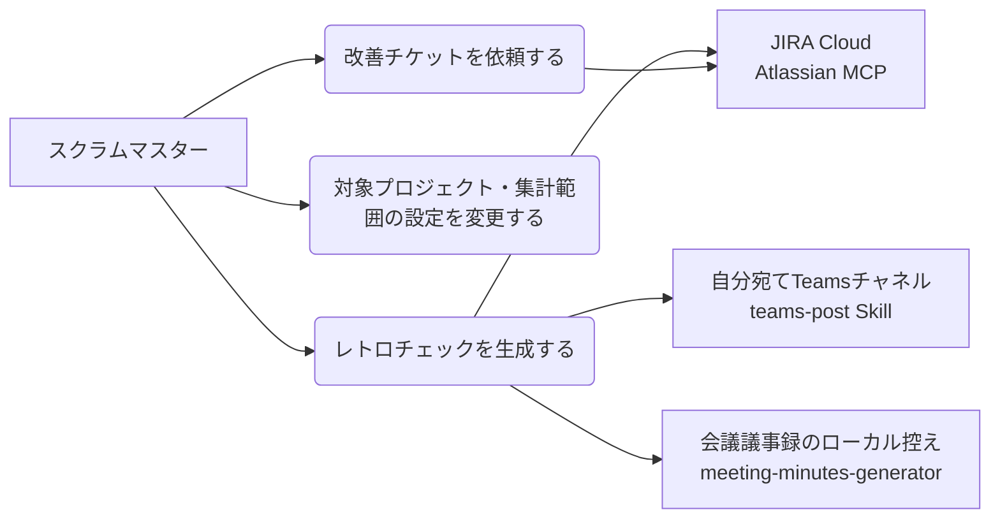

# retro-check: レトロ前のスプリント指標チェック

## サマリ

スクラムマスターがレトロスペクティブの準備で起動するオンデマンドSkill。対象プロジェクト(初期値: dxgarageサイトのSAG)の直近の終了済み6スプリントと進行中スプリント(レトロ対象。暫定値として扱う)について、ベロシティ推移・持ち越し率・割り込み件数・着手から完了までの日数の4指標をAtlassian MCP経由で集計し、推移グラフ+注目ポイントに加えて、会議トランスクリプトとJIRAチケットのコメント・変更履歴からKPT(Keep/Problem/Try)の叩き台を生成した静的HTMLダッシュボード1枚をOneDriveの共有フォルダに出力して、teams-post Skillで自分宛てに通知する。あわせて、チケットごとの実績工数(稼働ステータスの滞在時間のみを積算した人日)と見積(人日換算)を比較し、前倒し/オンスケ/遅延の判定と、遅延チケットの理由の叩き台を出す。ダッシュボード上でTryの実施可否をチェックし、「改善チケット依頼」の操作から対象プロジェクトへの改善チケット起票までを完結できる。レトロを感想ベースからデータベースの議論に変えることが目的。定期実行(スプリント終了予定日の朝の自動生成・配信)とプロジェクト追加セットアップの自動化は別specに切り出す。全体像は[ユースケース図](#ユースケース図)を参照。

## 概要

- **機能名**: retro-check(グローバルSkill。`~/.claude/skills/retro-check/`)
- **目的**: レトロ前に毎回30分かかる手集計・画面キャプチャ集めをなくし、データに基づくふりかえりを可能にする。あわせて、KPTの叩き台作成と改善アクションのチケット化までを1つの流れで完結させる
- **優先度**: 高(自動化アイデアブック案56・113・114。バックログBL-013・BL-016・BL-019・BL-020)

## ユーザーストーリー

スクラムマスターとしては、レトロの開始前に数分でスプリントの定量データを1枚にまとめたい。それにより、レトロの議論を「なんとなく忙しかった」という感想ではなく、「ベロシティが2スプリント連続で下がった」「割り込みが今回だけ倍増した」のような事実から始めたい。

あわせて、スプリント中の会議やJIRAチケットのやり取りから出てきた課題をKPTの叩き台として毎回自分でまとめ直す手間をなくしたい。レトロで「これは実際にやる」と決めた改善アクションは、その場でチェックするだけでチケット化まで済ませ、レトロ後に自分で起票作業をしなくて済むようにしたい。

また、チケットごとに見積(人日換算)と実績工数(自分が稼働していたステータスの滞在時間のみ)を比較し、前倒し・オンスケ・遅延のどれだったかをチケット単位で把握したい。遅延しているチケットについては、その理由をコメントや変更履歴からできる範囲で自動的に拾い出しつつ、拾いきれない分は自分で書き足して残しておきたい。

## ユースケース図

正となる文章: [機能要件](#機能要件)・[ビジネスルール・制約](#ビジネスルール制約)

## 機能要件

### レトロチェックの生成

- [1] 起動: 「レトロのチェックを行って」「レトロチェック」等の依頼で、Claude Codeの対話セッション内でSkillとして起動できること
- [2] 対象の決定: 設定ファイルから対象のJIRAサイト・プロジェクト・集計スプリント本数を読み込むこと。依頼文でプロジェクトや本数の上書き指定があればそちらを優先すること
- [3] データ取得: 対象プロジェクトの終了済みスプリントのうち直近の指定本数(既定6本)と、進行中スプリントがあれば1本加えて、各スプリントに属するチケットをAtlassian MCP経由で取得すること。進行中スプリントが複数見つかった場合(複数ボード構成など)は、どれをレトロ対象にするかをユーザーに確認し、選ばれた1本だけを加えること
- [4] 集計: スプリントごとに4指標(ベロシティ・持ち越し率・割り込み件数・着手から完了までの日数)を[ビジネスルール](#ビジネスルール制約)の定義で算出すること
- [5] 出力: 4指標の最新値と推移グラフ、注目ポイント、[実績工数・見積比較の生成](#実績工数見積比較の生成)で作成したチケット一覧・集計、および[KPT叩き台の生成](#kpt叩き台の生成)で作成したKPT表を含む静的HTMLファイル1枚を生成すること。外部CDN・外部通信に依存せず、ファイル単体でブラウザ表示できること。ただし着手から完了までの日数の推移グラフは[changelog依存指標の算出範囲](#changelog依存指標の算出範囲)の条件を満たす場合のみ表示し、実績・見積比較のチケット一覧・集計は対象チケットが1件も無い場合、KPT表は入力(会議議事録・JIRAコメント/変更履歴)が1件も無い場合は表示しないこと
- [6] 保存と提示: 生成したHTMLをOneDriveの共有フォルダ(初期値: `00_root/auto/sprintReport/retro/`。設定で変更可)に日付入りファイル名で保存し、ユーザーへ保存パスを提示して既定ブラウザで開けるようにすること
- [7] 進行中スプリントの扱い: 進行中スプリントの指標は暫定値(完了は途中集計・持ち越し率は未確定)として算出し、ダッシュボード上で「進行中」ラベルと暫定値である旨を明示すること。レトロはスプリントを閉じる前に行う運用のため、レトロ対象は通常この進行中スプリントになる
- [8] Teams通知: 生成後、teams-post Skillを投稿先指定で呼び出し、自分宛てのチャネルへダッシュボードを開くリンクを通知すること。投稿先(teams-postの投稿先の表示名)は設定で指定する。指標の数値・注目ポイントは通知本文に載せない(閲覧範囲の管理を共有フォルダ側に一元化する)
- [9] リンクの形式: 通知するリンクは、SharePointのライブラリのビューアを経由する形式(`?id=<ファイルのサーバー相対パス>&parent=<親フォルダ>`)にすること。ファイルパスを直接指すURLは、ブラウザ内で表示されず必ずダウンロードになることを実機で確認している。URLはスクリプトが組み立てて出力し、手で組み立てないこと(パーセントエンコードの誤りを防ぐため)

### 注目ポイント

- [1] 内容: 集計結果から「レトロで話すとよさそうな点」を数行(3点程度まで)で添えること。例: 前回スプリント比で大きく動いた指標、複数スプリント連続の増減傾向
- [2] トーン: 事実の指摘にとどめ、原因の断定や改善策の押し付けをしないこと
- [3] 根拠: 注目ポイントには必ず根拠となる数値を併記すること(例: 「ベロシティが3スプリント連続減(21→18→13)」)

### 設定(config)

- [1] 設定ファイル: 集計スプリント本数をSkillディレクトリ配下の設定ファイルで切り替えられること。宛先(対象JIRAサイト・プロジェクトキー)は[project-profile](~/.claude/local-specs/Users/ryosyamazaki/.claude/specs/project-profile/requirements.md#pjの解決)の共通設定を参照すること
- [2] 初期値: スプリント本数=6。宛先の既定値はproject-profileの`defaultProfile`(初期値: SAG)を参照すること
- [3] サイト対応: 宛先(サイト・プロジェクトキー)の解決はproject-profileの共通設定`~/.claude/config/project-profiles.json`を参照すること(dxgarage.atlassian.net・dnode.atlassian.netのどちらも対象)
- [4] フィールド・ステータスの調整: 集計に使うフィールド識別子(スプリント・ストーリーポイント・着手日)と、着手状態・中止扱いにするステータス名の一覧も設定で変えられること(プロジェクトごとにJIRAの構成が異なるため)。着手状態の一覧は[指標の定義](#指標の定義)[6]のとおり、未着手より先に進んだステータスをすべて列挙する
- [5] 実績・見積比較の調整: 稼働ステータスの一覧、見積ソース(ストーリーポイントまたは見積時間)とその換算係数、前倒し/遅延の判定しきい値も設定で変えられること(プロジェクトごとに運用が異なるため)。初期値は[実績工数の算出](#実績工数の算出)・[見積の人日換算](#見積の人日換算)・[前倒しオンスケ遅延の判定](#前倒しオンスケ遅延の判定)のとおり
- [6] 出力と通知の設定: 出力先ディレクトリ(初期値: OneDriveの`00_root/auto/sprintReport/retro/`)、Teams通知の投稿先(teams-postの投稿先の表示名)、リンク組み立てに使うビューアURLとサーバー相対の親フォルダパスも設定で変えられること。出力先を変えるときはこの3つをセットで直す

### KPT叩き台の生成

- [1] 生成方法: レトロ対象スプリントの期間中の会議議事録(会議議事録のローカル控え。[入力範囲](#kpt入力範囲)参照)と、対象プロジェクトのActiveSprint(レトロ対象スプリント)に属する全チケットのコメント・変更履歴を、単一の生成ステップでまとめて読み、KPT(Keep/Problem/Try)の叩き台を作成すること。入力源ごとに別々に候補を作ってから後で名寄せする方式にはしないこと(同じ課題が会議・JIRAの双方から見つかった場合に重複したKeep/Problem/Tryとして出さないため)
- [2] Keep: 継続すべき良かった点を、端的な一文のタイトルとその中身の説明で記載すること(Problemと同じ形にする)。Keep自体はチェックボックスや起票操作を持たないこと
- [3] Problem: 端的な一文のタイトルと、**問題点・直接原因・根本原因の3段落**を記載すること。埋められない段落があっても3つの見出しは省かないこと(どこまで掘れているかが読めるようにするため)
- [4] Try: 改善アクションの説明を記載し、**どのKeepまたはどのProblemに対応する改善アクションかが分かるようにすること**。Problemに対する打ち手だけでなく、Keepをさらによくする打ち手もTryとして扱えること。Keepに対応するTryは無くてもよいこと。各Tryに「起票する」チェックボックスを設けること
- [5] 前回までの持ち越し: 過去の実行で「起票する」も「対象外にする」も選ばれなかったTryは、今回のKPT表にも含め、前回までの継続分であることが分かるように表示すること
- [6] 除外: 「対象外にする」操作が選ばれたTryは、以降の実行でKPT表に再提示しないこと
- [7] 起票済みの除外: 改善チケットとして起票済みのTryは、以降の実行でKPT表に再提示しないこと

### KPT叩き台の手直し

- [1] 編集: ダッシュボード上で、Keepのタイトルと本文、Problemのタイトルと問題点・直接原因・根本原因、Tryの文面をそれぞれ直接編集できること(叩き台の言い回しをレトロの場でその場で直せるようにするため)
- [2] 紐付けの維持: TryとKeep・Problemの紐付けは編集対象にしないこと。**タイトルを編集しても紐付けが切れないこと**(タイトルを紐付けの鍵にすると、直した瞬間にどのKeep・Problemに対する打ち手か分からなくなるため)
- [3] 持ち帰り: 手直しされた内容は「改善チケット依頼」の依頼文に含めること。ただし**直された項目だけ**を含め、直されていない項目は含めないこと(全文を載せると依頼文が無駄に長くなるため)。何も直されていない場合は手直しの情報自体を含めないこと
- [4] 反映: 手直しを含む依頼文を読み取ったときは、起票の前にTryの文面を永続的な記録へ反映し、ダッシュボードも手直し後の内容で作り直すこと(直す前の文面でチケットが立たないようにし、共有される成果物にも手直しが残るようにするため)

### 実績工数・見積比較の生成

- [1] 対象: レトロ対象スプリントの完了チケットのうち、[changelog依存指標の算出範囲](#changelog依存指標の算出範囲)で変更履歴を取得したもの
- [2] 算出: チケットごとに実績工数(人日)・見積(人日)・判定(前倒し/オンスケ/遅延)を[ビジネスルール・制約](#ビジネスルール制約)の定義で算出すること
- [3] 遅延理由: 判定が「遅延」のチケットについて、[遅延理由の生成](#遅延理由の生成)の方法で理由の候補を生成すること
- [4] 出力: チケットごとの一覧(チケットキー・見積・実績工数・判定・遅延理由)と、見積の平均人日・実績工数の平均人日・判定内訳(前倒し/オンスケ/遅延それぞれの件数)をダッシュボードに含めること
- [5] 非表示条件: 実績工数・見積がともに算出できたチケットが1件も無い場合、この一覧・集計自体を表示しないこと

### 実績工数・見積比較の手直し

- [1] 編集: ダッシュボード上で、遅延理由の文面を直接編集できること(KPT叩き台の手直しと同じ操作性)
- [2] 保存: 「実績・見積の内容を保存」の操作で、その時点で直された遅延理由(チケットキーと文面)を実行IDとともに画面に表示すること。あわせてクリップボードへのコピーを試みるが失敗しうる前提とし、画面表示だけは必ず行うこと。ローカルファイルへの書き出し(ブラウザダウンロード)は行わないこと(改善チケットの起票と異なり、ダウンロードのポップアップが操作のたびに出ることを避けるため)
- [3] 反映: ユーザーがChatに戻って保存を指示したら、書き出された内容を読み取り、遅延理由を永続的な記録へ反映すること。以降のレトロチェック生成では、同じチケットについて記録済みの理由があればそれを優先して使い(自動抽出・推測をやり直さない)、無ければ改めて[遅延理由の生成](#遅延理由の生成)を行うこと

### 改善チケットの起票

- [1] 操作: KPT表でチェックした「起票する」Tryについて、「改善チケット依頼」の操作を行うと、その時点のチェック状態(起票する/対象外にする/未指定)を含む依頼文を**画面上に表示すること**。あわせてローカルファイルへの書き出し(ブラウザダウンロード)とクリップボードへのコピーも試みるが、いずれも失敗しうる前提とし、**画面表示だけは必ず行うこと**(表示が無いと操作しても何も起きていないように見えるため)
- [1-1] 依頼文の内容: 依頼文には実行IDと、「起票する」「対象外にする」が選ばれたTryだけを含めること。未指定のTryは含めず、読み取り側が未決一覧から差し引いて件数を数えること(選んでいないTryの分だけ依頼文が長くなるのを避けるため)
- [1-2] 選択件数の表示: チェック状態に応じて「起票する」「対象外にする」「未指定」の件数を画面に表示し、依頼の操作を行う前に対象の件数を確認できること
- [1-3] 依頼文の読み取り: 画面に表示された依頼文をそのまま貼り付けても選択結果を読み取れること(利用者に依頼文からJSON部分を切り出させないこと)
- [2] 起票の実行: ユーザーがChatに戻って起票を指示したら、書き出された選択結果ファイルを読み取り、「起票する」が選ばれたTryを1件ずつ対象プロジェクトへJIRAチケットとして起票すること。「対象外にする」が選ばれたTryは起票せず対象外として記録すること
- [3] 起票先: 起票先プロジェクトは、そのretro-check実行の対象プロジェクト直下とすること
- [4] チケットの内容: 要約はTryの改善アクションを1行に要約したものとし、説明は「概要」(対応するProblemの問題点・直接原因・根本原因、または対応するKeepの内容を出典として含める)「成果物」「完了条件」「レビュワー」(指定がなければ「指定なし」)の4見出しで構成すること
- [5] 二重起票の防止: 起票の直前に「起票中」であることを記録してから起票し、記録・起票の状態(未決/起票中/起票済み/対象外)をTryごとに永続的に記録すること
- [6] 起票以外のJIRA書き込みはしないこと(コメント追加・既存チケットのステータス変更・編集などは対象外)

## ビジネスルール・制約

### 指標の定義

- [1] ベロシティ: そのスプリント内に完了したチケットのストーリーポイント合計。ストーリーポイント未設定のチケットは合計に含めず(0として扱い)、スプリントごとのストーリーポイント設定率(分母はそのスプリントに入っていた全チケット)をダッシュボードに注記すること。対象の全スプリントでストーリーポイント設定が1件もない場合のみ、完了チケット件数を主表示に切り替えること
- [2] 持ち越し率: スプリントに入っていたチケットのうち、未完了のままスプリントが終了したものの割合。件数ベースを基本とし、ストーリーポイントが運用されている場合はSPベースの割合も併記すること。中止チケットと開始前完了チケットは分母・分子のいずれからも除く([完了の判定](#完了の判定)[3][4])
- [3] 割り込み件数: スプリント開始後にそのスプリントへ追加されたチケットの件数
- [4] 割り込みの判定方法: 「スプリント開始後に起票され、そのスプリントに入っていたチケット」を割り込みとみなすこと(チケットごとの変更履歴を取得せずに判定するための近似。スプリント開始前から存在するチケットを途中でスプリントに引き込んだケースは数えない。この近似であることをダッシュボード上に注記する)
- [5] 着手から完了までの日数: チケットが着手状態に入ってから完了するまでの日数(暦日)の中央値。スプリント内に完了したチケットを対象とすること
- [6] 着手の判定: 設定で指定された着手状態のステータスのいずれかに**最初に**変わった時点を着手とみなすこと。着手状態には、作業中を表すステータスに加えて、レビュー中・依頼中のように未着手より先に進んだ状態もすべて含めること(これらを含めないと、そのステータスだけを経て完了したチケットが着手日時なしとして集計から落ちるため)
- [7] 指標名の表示: ダッシュボード上では指標を「着手から完了までの日数」と表記し、何を測っているか(どのステータスへの遷移を着手とみなすか・暦日か・中央値か)を注記に必ず出すこと。「サイクルタイム」のような読み手に意味が伝わらない用語は使わないこと

### changelog依存指標の算出範囲

チケットの着手日時・ステータスごとの滞在時間はJIRAの検索結果には含まれず、チケットごとの変更履歴の取得が必要になる。着手から完了までの日数、実績工数・見積比較のいずれもこの制約を受ける。取得量を抑えるため、算出範囲を次のとおり定める。

- [1] 設定ファイルで「着手日カスタムフィールド」が指定されている場合(JIRA側のAutomation等で着手日を自動記録する運用がある場合)、着手から完了までの日数はその値を着手日時として全対象スプリントの推移を算出すること。実績工数・見積比較はステータスごとの滞在時間そのものが必要なため、この設定の有無によらず変更履歴の取得が必要になること
- [2] 変更履歴の取得は、レトロ対象スプリント(進行中スプリントがあればそれ、なければ直近の終了済みスプリント)の完了チケットに限定すること。着手から完了までの日数は、着手日カスタムフィールドが指定されていない場合にこの範囲に従い、日数はそのスプリントの値のみ表示する(推移グラフは表示しない)。実績工数・見積比較は常にこの範囲(レトロ対象スプリントのみ)に従い、推移は算出しないこと
- [3] 起票から完了までの期間(リードタイム)による代替はしないこと(起票後に着手まで放置される運用実態があり、指標として役に立たないため)

### 実績工数の算出

- [1] 対象: [changelog依存指標の算出範囲](#changelog依存指標の算出範囲)で変更履歴を取得したチケット
- [2] 算出方法: チケットのステータス変更履歴を時系列に並べ、区間(ある状態変化から次の状態変化まで。最後の区間は解決日時まで)ごとに、区間開始時点の状態が設定の稼働ステータス一覧に含まれる場合のみ、その区間の時間を実績工数の対象とすること。チケット作成時点から最初の状態変化までの区間は、稼働ステータス一覧に含まれない初期状態とみなし対象外とすること
- [3] 稼働ステータスの一覧: 実績工数に含めるステータス名の一覧を設定ファイルで指定すること(着手判定に使う一覧[指標の定義](#指標の定義)[6]とは別の設定項目とする。レビュー中・依頼中のような待ち状態は着手済みではあるが稼働中ではないため)。初期値(SAGプロジェクト)は「進行中」のみとする
- [4] 非稼働日の控除: 対象区間の時間のうち、土曜・日曜・日本の祝日にかかる時間は積算対象から除くこと(平日部分のみを積算する)。24時間の積算を1人日として、見積の人日換算と単位を揃えること
- [5] 除外: 稼働ステータスに一度も入らなかったチケット、または解決日時が取れないチケットは実績工数の算出から除外し、除外件数をダッシュボードに明記すること

### 見積の人日換算

- [1] 見積ソース: ストーリーポイントの人日換算、またはJIRAの見積時間フィールドの人日換算のいずれかを設定ファイルで選べること。初期値(SAGプロジェクト)はストーリーポイントの人日換算とする
- [2] ストーリーポイント換算: 設定の換算レート(1ストーリーポイントあたりの人日数)を掛けて人日に換算すること。初期値(SAGプロジェクト)は1ストーリーポイント=1人日とする
- [3] 見積時間換算: 設定の1人日あたりの時間数(初期値8時間)で見積時間を除して人日に換算すること
- [4] 除外: 選んだ見積ソースの値が未設定のチケットは実績・見積比較の対象から除外し、除外件数をダッシュボードに明記すること

### 前倒し/オンスケ/遅延の判定

- [1] 判定方法: 実績工数(人日)を見積(人日)で割った比率で判定すること。比率が設定の前倒し判定しきい値(初期値90%)以下なら前倒し、遅延判定しきい値(初期値110%)を超えるなら遅延、その間はオンスケとすること
- [2] しきい値: 前倒し判定・遅延判定の2つのしきい値は設定ファイルでプロジェクトごとに変更できること
- [3] 除外: 実績工数・見積のいずれかが算出できないチケットは判定対象外とし、対象外件数をダッシュボードに明記すること

### 遅延理由の生成

- [1] 対象: [前倒し/オンスケ/遅延の判定](#前倒しオンスケ遅延の判定)で「遅延」と判定されたチケット
- [2] 生成方法: 対象チケットのコメント本文・変更履歴を読み、遅延理由の候補を生成すること。コメントに理由が明記されている場合はその内容をそのまま理由として採用し(自動抽出)、明記されていない場合は変更履歴(特定ステータスでの滞留など)から推測される理由を提示すること(推測)。どちらも得られない場合は「理由不明」とし、[実績工数・見積比較の手直し](#実績工数見積比較の手直し)でユーザーが手動入力できるようにすること
- [3] 種別の表示: 生成された理由が「自動抽出」「推測」「未入力」のいずれであるかをダッシュボード上に明示すること(どこまで機械的に読み取れたかが分かるようにするため)
- [4] 記録済みの理由の優先: 過去の実行でユーザーが手直しした理由が記録されているチケットは、その内容を優先して使い、[2]の生成をやり直さないこと

### 実績・見積比較の集計

- [1] 平均値: レトロ対象スプリントの完了チケットのうち、実績工数・見積がともに算出できたものについて、見積の平均人日と実績工数の平均人日をダッシュボードに表示すること
- [2] 内訳: 前倒し/オンスケ/遅延それぞれの件数もあわせて表示すること
- [3] 非表示条件: 実績工数・見積がともに算出できたチケットが1件も無い場合、この集計自体を表示しないこと

### 完了の判定

- [1] 完了: 解決日時がスプリント期間内に入っていることをもって「そのスプリント内に完了した」とみなすこと。解決日時はJIRAが完了系ステータスへの遷移で自動設定する日時で、対象プロジェクトの実測では完了チケット全件に設定されている
- [2] スプリント期間の上限: 終了済みスプリントは実際のクローズ日時(記録が無ければ終了予定日時)までとすること。ただし次の対象スプリントが先に始まっている場合は、その開始時刻を上限とすること。JIRAのスプリントは終了予定日を過ぎてからクローズされたり、次のスプリントが先に始まって期間が重なったりするため、上限を設けないと同じチケットが2つのスプリントの完了に数えられてしまう。この切り詰めにより、次スプリントの開始後からクローズまでの間に完了したチケットは、そのスプリントの完了ではなく持ち越しとして数える
- [3] 開始前完了の除外: スプリント開始より前に解決済みだったチケットは、完了にも未完了(持ち越し)にも数えず、ベロシティ・持ち越し率(分母・分子とも)・着手から完了までの日数から除外すること。完了済みの状態でスプリントに入れられたチケットであり、そのスプリントの成果でも持ち越しでもないため。ストーリーポイント設定率の分母には含める(設定率は「そのスプリントに入っていた全チケット」を分母とするため)。除外件数をダッシュボード上に明記すること
- [4] キャンセルの除外: ステータス名が「キャンセル済み」等の中止系ステータスは、ステータスカテゴリが「完了」でもベロシティ・着手から完了までの日数の集計から除外すること(やめた作業を成果に数えない)。持ち越し率の分母からも除外すること

### 依頼文での上書き指定の検証

- [1] スプリント本数の上書き指定は1〜12の整数のみ受け付けること。範囲外・整数でない指定は採用せず、設定ファイルの値を使うことをユーザーに伝えること(根拠: 通常運用で指定しうるスプリント本数の範囲を想定した初期値。極端な指定によるMCP呼び出し過多を防ぐ)
- [2] 上書き指定されたプロジェクトキーで検索した結果、スプリント付きチケットが1件も見つからない場合は、プロジェクトキーの誤りかスプリント運用がない旨を伝えてダッシュボードを生成せず終了すること

### 進行中スプリントの暫定値

- [1] 完了の判定: 解決日時がスプリント開始以降かつ生成時点までにあることをもって完了とみなすこと
- [2] 持ち越し率: 生成時点で未完了のチケットの割合とすること(スプリント終了までに変わる暫定値であることをダッシュボードに明示する)
- [3] 割り込み件数・ベロシティ: 終了済みスプリントと同じ定義を生成時点までの範囲で適用すること

### データが不足する場合の振る舞い

- [1] 終了済みスプリントが指定本数に満たない場合、あるだけの本数で生成し、その旨をダッシュボード上に明記すること
- [2] 終了済みスプリントが1本もない場合でも、進行中スプリントがあれば生成すること(推移グラフは出さず、進行中の暫定値と注記のみ)。終了済みも進行中も無い場合は、ダッシュボードを生成せずその旨をユーザーに伝えて終了すること
- [3] 一部チケットで着手時刻が取得できない等、個別チケットの欠損がある場合は該当チケットを当該指標の集計から除外し、除外件数をダッシュボード上に明記すること

### KPT入力範囲

- [1] 会議議事録: 対象は、レトロ対象スプリントの期間中(開始日時から生成時点まで)に**開催された**会議の議事録のうち、meeting-minutes-generatorのローカル控え(`~/Library/Application Support/meeting-minutes-generator/minutes/`)にある全件とすること。期間内かどうかは会議の開催日時で判定し、議事録ファイルの更新時刻では判定しないこと(議事録は作り直されることがあり、更新時刻は会議の開催日時と一致しないため)。特定の会議種別への絞り込みはしないこと
- [2] 会議議事録が0件、またはローカル控えのフォルダ自体が存在しない場合、その旨をダッシュボード上に明記し、JIRA側の入力のみでKPTを生成すること(議事録が無いことをエラーにしない)
- [3] JIRAチケット: 対象は、対象プロジェクトのActiveSprint(レトロ対象スプリント)に属する全チケットのコメント本文と変更履歴(ステータス遷移等)とすること。過去の終了済みスプリントのチケットは対象にしないこと
- [4] 会議議事録・JIRAチケットの入力がともに0件の場合、KPT表自体を生成しないこと(定量指標のダッシュボードとしては通常どおり生成する)

### スコープ外

- 不在予定(担当者の休暇・不在)を考慮した実績工数の追加控除(不在予定を確認できる仕組みを別途作った後、別specで対応する。今回は土日・日本の祝日の控除までとする)
- 定期実行・自動生成(スプリント終了予定日の朝に自動生成してレトロ前に届ける構想は別specで扱う。無人実行ではAtlassian MCPが使えないため、JIRA APIトークン+launchdバッチの別系統実装になる)
- プロジェクト追加セットアップの自動化(フィールド自動検出等。複数Skillの初期セットアップを束ねる統合セットアップSkillとして別specで扱う。本Skillでは設定ファイルの手動編集手順をSKILL.mdに記載するにとどめる)
- 改善チケットの起票以外のJIRAへの書き込み(コメント追加・既存チケットのステータス変更・編集など)
- KeepからのKPT起票操作(起票操作の対象はTryのみ)
- 複数プロジェクトを横断したKPTの統合(対象は設定された1プロジェクトのみ)
- 一度「対象外にする」・起票済みにしたTryを画面から後で復活させる操作(必要になれば別途検討する)
- スプリント以外の集計単位(カンバン運用・期間指定での集計)
- バーンダウン・累積フロー図など4指標以外のメトリクス(必要になったらBL-009メトリクスダッシュボードで検討する)

## 非機能要件・依存関係

- **認証**: Atlassian MCPが認可済みであること(JIRA APIトークンを必要としない)。JIRAデータの取得は対話セッションのMCPが担う
- **MCP呼び出しの節約**: `jira-progress/requirements.md#非機能要件・依存関係・制約条件` のMCP節約・許可プロンプト方針に従うこと(接続情報をMCPに問い合わせない・取得フィールドを絞る等。内容はそちらを正とし、書き写さない)
- **実行場所**: このマシン上のどのディレクトリからでも実行できること(特定リポジトリの状態に依存しない)
- **依存Skill**: `teams-post`(生成後の自分宛て通知。投稿先を指定して呼び出すため、teams-postの仕様どおり投稿前確認は本Skillの責務になるが、宛先が自分自身のため確認なしで投稿してよい)
- **入力元**: 会議議事録のローカル控えは`meeting-minutes-generator`が書き出すものを読む。控えの場所・書き出し条件は `/Users/ryosyamazaki/repo/study/apps/meeting-minutes-generator/specs/minutes-auto-generation/requirements.md#議事録のローカル控え` を、議事録の構成(会議メタ情報・要約・決定事項・TODO・議論の経緯・未決事項等の見出し)は同spec `#議事録の生成`[2] を参照する(内容はそちらを正とし、書き写さない)
- **改善チケット起票のUIパターン**: チェック→ローカルファイルへの書き出し(ブラウザダウンロード+クリップボードコピー)→チャットに戻って起票を指示→選択結果ファイルを読み取って起票、という一連の流れ(二重起票防止のための起票中/起票済み/対象外の記録も含む)は `minutes-todo-to-jira/design.md#画面設計` ・ `minutes-todo-to-jira/design.md#状態管理` と同じ考え方を踏襲する
