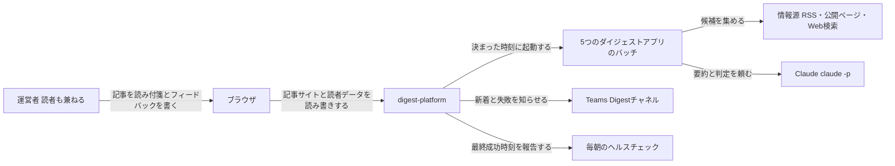
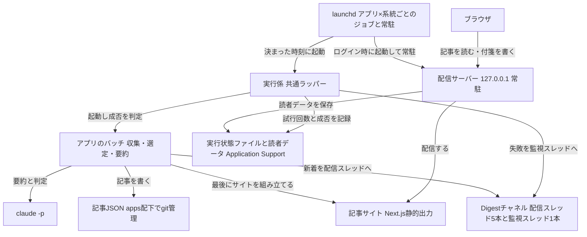

# digest-platform の全体像

## 概要

AI駆動開発・ニュース・未来予測・研究発見・流行の5つのダイジェストアプリ(ai-dev-digest / news-digest / future-digest / research-digest / trend-digest)が共通で使う土台。各アプリが集めて要約した記事を、このMacの中だけで記事サイトとして公開し、読者である運営者本人にTeamsで新着を知らせ、記事づくりが失敗したときも同じチャネルで知らせる。 〔提案〕

GitHub Actions・Cloudflare・Supabase・Google OIDC・LINE などの外部サービスは使わず、このPCだけで完結させる(理由は [ADR 0001](adr/0001-local-only-platform.md))。 〔合意〕

進め方: 共通基盤の5つの機能を先に仕様化し、5つのアプリはそれぞれ `apps/<アプリ名>/` の別specでこの土台の上に順に載せる(ai-dev-digest → news-digest → research-digest と future-digest → trend-digest)。 〔提案〕

## コンテキスト図



本システム(digest-platform)が外とやり取りする相手。情報源と Claude へ出ていくのは各アプリのバッチで、土台はその起動・公開・通知を受け持つ。正となる文章は機能一覧表の各specの requirements.md を参照。

## システム構成図



実際に動く部品の俯瞰。記事JSONだけがgit管理で、実行状態ファイルと読者データはこのMacのローカルのデータフォルダに置く。各部品の詳細は機能一覧表の各specを参照。

## 機能一覧表(機能マップ)

| spec | 機能(利用者から見て) | 役割 | 依存 | 状態 |
|---|---|---|---|---|
| [batch-runner](batch-runner/requirements.md) | 決まった時刻にアプリの記事づくりが自動で走り、失敗しても決めた回数まで自動でやり直す | 実行係(launchd のジョブ・共通ラッパー・claude -p の呼び出し・実行状態ファイル) | なし | 仕様のみ(未実装) |
| [local-site-serving](local-site-serving/requirements.md) | ブラウザで `http://127.0.0.1:<ポート>/<アプリ名>/` を開くと最新の記事が読める | 配信サーバー(記事サイトの組み立てと配信) | アプリのバッチが記事を書いた後に自分でサイトを組み立てる(batch-runner はその結果を成否の判定で確かめる) | 仕様のみ(未実装) |
| [local-reader-store](local-reader-store/requirements.md) | 記事に付箋(ブックマークとメモ)とフィードバックを書き、あとで見返せる。月次見直しのバッチが同じデータを読める | 読者データ(配信サーバーの保存APIとローカル保存) | local-site-serving(配信サーバーに同居) | 仕様のみ(未実装) |
| [teams-broadcast](teams-broadcast/requirements.md) | 新しい記事ができると、Teams の Digestチャネルのアプリごとの配信スレッドに見出しとリンクが届く | 新着通知(teams-post の投稿先への書き出し) | batch-runner(記事の公開のあとに呼ばれる)、local-site-serving(記事のURL) | 仕様のみ(未実装) |
| [failure-notification](failure-notification/requirements.md) | 記事づくりが自動のやり直しを使い切って失敗したとき、監視スレッドに知らせが届き、毎朝のヘルスチェックでも最終成功時刻が見える | 失敗通知(実行状態ファイルの試行回数による判定) | batch-runner(実行状態ファイル)、teams-broadcast と同じ投稿の仕組み | 仕様のみ(未実装) |

## アーキテクチャ概要

launchd が時刻で実行係を起動し、実行係がアプリのバッチを走らせて成否を判定する。アプリのバッチは記事を書いたあと自分で記事サイトを組み立てて新着を Teams に知らせ、実行係は失敗が続いたら監視スレッドに知らせる。読者はブラウザで 127.0.0.1 の配信サーバーから記事を読む。 〔提案〕

<details><summary>詳細を開く</summary>

- **起動**: アプリ×系統(記事公開・月次見直し)ごとに launchd のジョブを1つ持ち、`StartCalendarInterval` で朝の決まった時刻に実行係を起動する。スリープ中だった回は復帰時に1回だけ追い実行される。記事公開は5アプリとも、本番が一時的な失敗で終わったとき同じ日に最大3回やり直す
- **実行係**: 共通ラッパー1本(Python 3 標準ライブラリ)。ロック・絶対パス・CAバンドルの指定を整えてアプリのバッチ(TypeScript、tsx で実行)を起動し、終了コード・成功マーカー・生成物(記事JSONと当日の記事ページ)の3点で成否を決める。結果は実行状態ファイルに試行回数・成否・通知済みとして記録する
- **要約**: アプリのバッチは共通の TypeScript 部品を通して `claude -p` を起動し、要約・判定を頼む。終了コードを信用せず、応答のJSON封筒を分類する(利用枠の枯渇は再試行しても直らない失敗として扱い、それ以外は再試行)
- **公開**: 記事JSONは各アプリの `apps/<アプリ名>/` 配下に置いて git で管理する。アプリのバッチが最後の手順として Next.js の静的エクスポートで記事サイトを組み立て(実行係は当日の記事ページが出たことを成否の判定で確かめる)、配信サーバーが 127.0.0.1 の固定ポートで配信する。5アプリは1サイトに同居し `/<アプリ名>/...` のパスを持つ
- **読者データ**: 付箋とフィードバックは配信サーバーの保存APIを通してローカルのデータフォルダに保存する。月次見直しのバッチは同じファイルを直接読む。読者は本人1人なので認証は持たない
- **通知**: 新着は teams-post の投稿先(OneDrive の監視フォルダ)へ HTML断片を書き出し、Power Automate が Digestチャネルの該当スレッドへ返信として投稿する。失敗通知は監視スレッドへ、本文はアプリ名・ジョブ名・失敗日時・ログのパスの4要素だけ
- **保険**: 毎朝のヘルスチェック(BL-049)の宣言に5アプリの最終成功時刻を加え、launchd の無言停止に気づけるようにする

</details>

## 採用技術

アプリの画面と選定・判定のロジックは TypeScript(Next.js の静的エクスポート・tsx)のまま使う。実行係と配信サーバーは Python 3 標準ライブラリ、Claude の起動はバッチ側の共通 TypeScript 部品、Teams 投稿は既存の teams-post の投稿先の仕組み、CAバンドルは既存部品と同じ探し方を実行係が自分で持つ(理由は [ADR 0002](adr/0002-platform-owns-claude-call-and-ca-bundle.md)) 〔合意〕

<details><summary>詳細を開く</summary>

| 技術 | 用途 |
|---|---|
| TypeScript / Node.js | アプリのバッチ(収集・選定・要約の呼び出し)と共通のバッチ部品。`tsx` で直接実行する |
| Next.js(`output: 'export'`)+ Tailwind CSS | 記事サイト。5アプリの画面と共通部品(ページ送り・図解・付箋欄・フィードバック欄) |
| mermaid(npm 同梱) | 記事中の図解の描画。オフラインでも描ける |
| vitest | TypeScript 側の単体テスト・契約テスト |
| launchd | 実行係の時刻起動と配信サーバーの常駐 |
| Python 3(標準ライブラリだけ) | 実行係のラッパーと配信サーバー。このMacの既存の自動化(launchd 起動・二重起動の防止・CAバンドルの2段の探し方)と同じ型で書くが、`~/.claude/lib` や既存 Skill のスクリプトは参照しない |
| `claude -p`(Claude Code CLI のヘッドレス実行) | 記事の要約・影響度などの判定。バッチ側の共通部品 `application/batch/claude.ts` だけが起動する。WebSearch・WebFetch は使える、MCP は使えない |
| Power Automate(OneDrive の監視フォルダ → Teams への返信投稿) | Digestチャネルの各スレッドへの投稿。投稿先は `~/.claude/config/project-profiles.json` の `user.teams.destinations` |

</details>

## 外部連携IF一覧

外とのやり取りは4つ: 情報源からの候補の取得、`claude -p` による Claude への要約の依頼、teams-post の投稿先フォルダ経由の Teams への通知、毎朝のヘルスチェックへの最終成功時刻の報告 〔提案〕

<details><summary>詳細を開く</summary>

| 相手 | 方向 | 方式・形式 | タイミング | 失敗したとき | 疎通確認 |
|---|---|---|---|---|---|
| 情報源(各アプリが決めた RSS・公式API・公開ページ。WebSearch は `claude -p` の中で使う) | 受ける | launchd から出る HTTP。社内プロキシの CAバンドルを `NODE_EXTRA_CA_CERTS` で指定する | 記事公開の起動ごと | 取れなかった情報源は候補から外し、全情報源が取れなかったときだけ失敗にする(詳細は各アプリのspec) | 各アプリの環境スモーク(launchd から1情報源を取る) |
| Claude(`claude -p --output-format json`) | 送る・受ける | 材料を標準入力で渡し、JSON の封筒 `{result, is_error, api_error_status}` を分類する | 記事公開の起動ごとに数回 | 利用枠の枯渇(429・週の上限)は再試行しても直らない失敗として終了コード2で終わり、それ以外は再試行。再試行後も失敗なら実行係が失敗と記録する | batch-runner の環境スモーク(封筒のキーの実機確認) |
| Teams(teams-post。投稿先は Digestチャネルの配信スレッド5本と監視スレッド1本) | 送る | 投稿先ごとの OneDrive の監視フォルダ `00_root/auto/teamsNotice/<サブフォルダ>/` に HTML断片のファイルを置き、Power Automate のフローが該当スレッドへ返信として投稿する | 記事の公開のあと・失敗通知の判定のあと | 書き出せなかったらログに残す。二次通知はしない | teams-broadcast・failure-notification の環境スモーク(実投稿) |
| 毎朝のヘルスチェック(BL-049) | 送る | 宣言ファイルに5アプリの最終成功時刻の項目を加える | 毎朝の点検時に読まれる | ヘルスチェック側の既定に従う | 宣言追加後に判定を手で1回回す |

- 認証情報・投稿先のフォルダパスは既存の共通部品の設定(`~/.claude/config/`)に従い、ここには書かない
- 配信サーバーは 127.0.0.1 だけで待ち受け、外とは通信しない

</details>

## API共通仕様

配信サーバーの保存APIは 127.0.0.1 からだけ呼べる認証なしの JSON API で、`/api/<アプリ名>/...` の形に揃える 〔提案〕

<details><summary>詳細を開く</summary>

- 待ち受けは 127.0.0.1 の固定ポート1つ。他のホストからは届かない
- 認証・認可は持たない(読者は本人1人。理由は [ADR 0001](adr/0001-local-only-platform.md))
- パスは `/api/<アプリ名>/<資源>`。本文と応答は JSON(UTF-8)。日時は JST の ISO 8601
- エラーは `{error: <短い理由>}` と HTTP 状態コードで返し、スタックトレースは返さない
- 個々のエンドポイントは `local-reader-store/design.md` の「API設計」が正

</details>

## ディレクトリ構成

CLAUDE.md の規約(`apps/<app-name>/{application,specs}`)どおり。`application/` の中を記事サイト・バッチ部品・配信サーバー・launchd に分け、5アプリは `apps/<アプリ名>/` に薄く置く 〔提案〕

<details><summary>詳細を開く</summary>

```
apps/
├── digest-platform/
│   ├── README.md                 # セットアップと build/test/lint/launchd登録のコマンド
│   ├── application/
│   │   ├── package.json          # Next.js・mermaid・vitest・tsx。5アプリはここの workspace として参照
│   │   ├── site/                 # 記事サイトの共通部分(layout・共通 lib・共通 components)
│   │   ├── batch/                # 共通のバッチ部品(TypeScript。claude -p の起動・バッチの終わり方・HTTP取得・Teams書き出し・サイトの組み立て)
│   │   ├── server/               # 配信サーバー(静的配信と保存API)
│   │   ├── launchd/              # 実行係(Python。アプリ登録表・実行状態・再実行判定・成否の判定)と plist の生成スクリプト
│   │   └── tests/
│   └── specs/
│       ├── architecture.md
│       ├── adr/
│       ├── batch-runner/
│       ├── local-site-serving/
│       ├── local-reader-store/
│       ├── teams-broadcast/
│       └── failure-notification/
└── <アプリ名>/                   # ai-dev-digest など5つ。画面・収集・選定と記事JSON・設定ファイル
    ├── application/
    └── specs/
```

- 記事JSONと情報源の設定ファイル(ウォッチリスト・採用基準・ジャンル)は各アプリの `application/` 配下で git 管理する
- 実行状態ファイル・読者データ・観測ログは `~/Library/Application Support/digest/<アプリ名>/` に置き、git には入れない

</details>

## データ運用

記事JSONは git で残して消さない。実行状態ファイル・読者データ・ログはこのMacのローカルのデータフォルダに置く。読者データは消さず、実行状態ファイル・実行ごとのログ・Claude の控えは90日で実行係が消す 〔提案〕

<details><summary>詳細を開く</summary>

| データ | 置き場所 | 保持期間 | 消し方 |
|---|---|---|---|
| 記事JSON | `apps/<アプリ名>/application/` 配下(git 管理) | 消さない | — |
| 記事サイトの成果物 `out/` | `apps/digest-platform/application/` 配下(git には入れない) | 次の組み立てで置き換える | アプリのバッチが組み立てのたびに作り直す |
| 実行状態ファイル `runs/<系統>/<配信日>[-<編>].json`・実行ごとのログ `logs/`・Claude の控え `claude-io/` | `~/Library/Application Support/digest/<アプリ名>/`(権限700) | 90日 | 実行係が次の起動時に消す |
| 読者データ(付箋・フィードバック) | 同上 | 消さない | 運営者が必要に応じて手で消す |
| 観測ログなどアプリ固有の蓄積 | 同上 | 各アプリのspecで決める | 同左 |
| 実行係の要約ログ `runner-<系統>.log`・配信サーバーのログ・launchd の標準出力 | データフォルダと `~/Library/Logs/` | 消さない(1日に数行) | 運営者が必要に応じて手で消す |

- バックアップは git(記事JSON)と OneDrive(通知として届いた見出し)が兼ねる。読者データのバックアップは取らない(失っても記事は残る)
- 初期データは、各アプリの情報源の設定ファイルだけ(元の仕様書に書かれた情報源から復元する)
- データフォルダ `~/Library/Application Support/digest/` へ Claude Code から書くには、`~/.claude/settings.json` の `permissions.additionalDirectories` への登録が要る(運営者の手元作業)

</details>

## 関連ADR

このアプリ配下のADRは2本(外部サービスを使わずこのPCだけで完結させる判断、Claude の起動とCAバンドルを共通基盤が自前で持つ判断)。リポジトリ共通のADRはモノレポ構成の1本を参照する 〔提案〕

<details><summary>詳細を開く</summary>

- [0001](adr/0001-local-only-platform.md) — 外部サービスを使わず、このPCだけで完結させる
- [0002](adr/0002-platform-owns-claude-call-and-ca-bundle.md) — Claude の起動と CAバンドルの探し方を共通基盤が自前で持ち、`~/.claude/lib` を参照しない
- [doc/adr/0001](../../../doc/adr/0001-multi-app-monorepo-layout.md) — 複数アプリを1つのリポジトリに収容する構成

</details>

## セキュリティ

配信サーバーは 127.0.0.1 だけで待ち受けて認証を持たず、社外へ出るのは `claude -p` へ渡す情報源の本文と Teams へ送る記事の見出しだけ。失敗通知にエラーの詳細は載せない 〔提案〕

<details><summary>詳細を開く</summary>

- **保護対象**: 読者データ(付箋のメモ・フィードバック)。本人の関心が分かる情報で、ローカルのデータフォルダ(権限700)にだけ置く
- **認証**: 持たない。読者は本人1人で、配信サーバーは 127.0.0.1 だけで待ち受けるため、同じMacにログインした本人しか届かない
- **社外へ送るもの**: `claude -p` へ渡す情報源の本文・見出し・URL(公開情報のみ)と、Teams へ送る記事の見出し・記事のURL・失敗通知の4要素。読者データは送らない
- **失敗通知**: 本文にエラーの詳細・スタックトレース・ログの中身を載せない(ログに混じる認証情報の断片の漏えい経路を作らない)。ログのパスだけを載せる
- **認証情報の置き場所**: 情報源の API キーが要る場合は Keychain か既存の共通部品の設定に置き、記事JSON・設定ファイル・ログに書かない
- **著作権**: 要約の分量の制限・出典の明記は個人利用でも守る(各アプリのspecの技術的制約)
- 機能ごとの対策は各specの design.md「セキュリティ」が正

</details>

## 技術的制約

Claude Code のサンドボックスからは 127.0.0.1 にも `launchctl` にも届かないため、配信の確認と launchd の登録は運営者の手元ターミナルで行う。`claude -p` は終了コード0でも失敗しうるので成功マーカーで判定する 〔提案〕

<details><summary>詳細を開く</summary>

- Claude Code のサンドボックスから 127.0.0.1 への接続・待ち受けはできない。配信サーバーの動作確認・公開確認のGETは launchd 側のバッチか手元ターミナルで行う
- `launchctl` は Claude Code から使えない。plist の登録・解除・`kickstart` は手元ターミナルへ渡す。`launchctl load` は `RunAtLoad` を即実行するため、配信系のジョブは `RunAtLoad` を付けない
- launchd は PATH を継承しない。node・tsx・claude・python3 は絶対パスで書く。Python/Node の更新でパスが変わると無言で止まる(終了コード78)ため、毎朝のヘルスチェックを保険にする
- launchd から出る HTTP は社内プロキシの TLS 差し替えに当たる。CAバンドルを指定しないと全情報源の取得が失敗する
- `claude -p` は失敗しても終了コード0を返す。成功マーカーと JSON 封筒で成否を決め、利用枠の枯渇(週の上限)は再試行しても直らない失敗として再実行しない。運営者のサブスクの枠を使うため、5アプリ合計の呼び出し回数は各アプリの非機能要件で上限を決める
- `claude -p` の `--allowedTools` などの許可の指定はこのMacの管理設定で無視され、警告が標準出力に混ざる。ツールは `--tools` で絞る(効くかは batch-runner の環境スモークで確かめる)
- `StartCalendarInterval` はスリープ中の回を復帰時に1回だけ追い実行する。本番時刻は起床後の朝に寄せ、深夜には置かない
- 記事公開は土日祝も動かす(research-digest は土曜、future-digest は日曜、ほかの3アプリは毎日)。定時の Teams 投稿を土日祝に止める共通ルールの例外として投稿する
- Next.js の静的エクスポートは `file://` で直接開くと CSS・JS・リンクが解決されない。必ず配信サーバー経由で開く
- `npm install` はサンドボックスからできない。依存の追加は手元ターミナルで行い、`node_modules` は `apps/digest-platform/application/` に1つだけ持つ
- Teams の投稿先の追加(サブフォルダ6つ・Power Automate のフロー6本・スレッドのメッセージIDの控え)は運営者の手元作業。プライベートチャネルへの返信投稿は「読み上げ」投稿先で稼働実績がある
- Teams から `http://127.0.0.1:...` のリンクが開けるかは未確認。開けない場合に備え、通知本文に記事のローカルパスをプレーンで併記する

</details>

## 用語集

記事サイト・配信サーバー・実行係・実行状態ファイル・読者データ・Digestチャネルなど、5つのspecで共通に使う呼び名 〔提案〕

<details><summary>詳細を開く</summary>

- **運営者** — このアプリを動かす本人。読者も兼ねる
- **記事JSON** — アプリのバッチが書く記事1本分のファイル。各アプリの `application/` 配下で git 管理する
- **記事サイト** — Next.js の静的エクスポートで組み立てた記事の閲覧サイト。5アプリが1サイトに同居し `/<アプリ名>/...` のパスを持つ
- **配信サーバー** — 127.0.0.1 の固定ポートで記事サイトを配信し、読者データの保存APIも持つ常駐プロセス。launchd がログイン時に起動する
- **実行係** — launchd から起動する共通ラッパー。アプリのバッチを起動し、成否を判定し、実行状態ファイルを書き、確定した失敗を失敗通知に渡す(通知するかの判定は失敗通知が行う)
- **系統** — 1アプリが持つ launchd ジョブの種類。記事公開と月次見直しの2つ
- **編** — 1アプリの配信回の区分(例: 木曜のサイエンス・テクノロジー編)。配信日と編で1回の配信を特定する
- **成功マーカー** — アプリのバッチが最後まで完遂したときだけ最終行に出す決まった文字列。実行係が成否の判定に使う
- **実行状態ファイル** — `runs/<系統>/<配信日>[-<編>].json`。試行回数・最終結果・通知済みを持つ。再実行の要否と失敗通知の要否はこのファイルで決める
- **読者データ** — 付箋(記事へのブックマークとメモ)とフィードバック(運営者の自由記述)。配信サーバーの保存APIを通してローカルに保存する
- **Digestチャネル** — 新設する自分専用の Teams チャネル。配信スレッド5本(アプリごと)と監視スレッド1本を持つ
- **配信スレッド** — Digestチャネルの中でアプリごとに立てた固定の投稿。新着記事はその返信として届く
- **監視スレッド** — Digestチャネルの中の固定の投稿。失敗通知はその返信として届く
- **投稿先** — teams-post の `user.teams.destinations` の1エントリ。OneDrive の監視フォルダ1つと Power Automate のフロー1本の組で、スレッド1本に対応する

</details>
