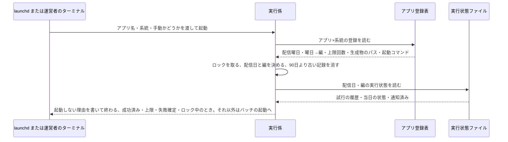
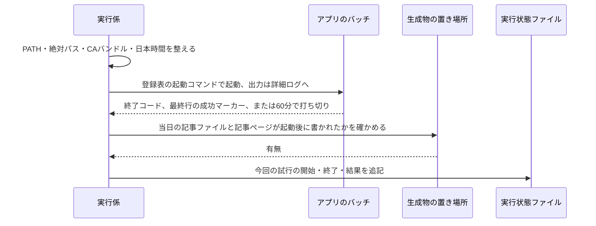
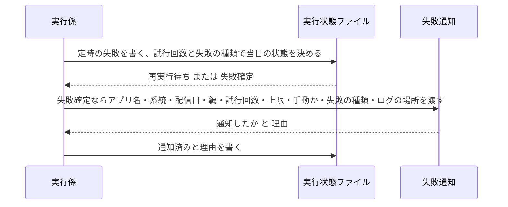
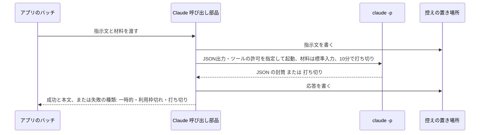
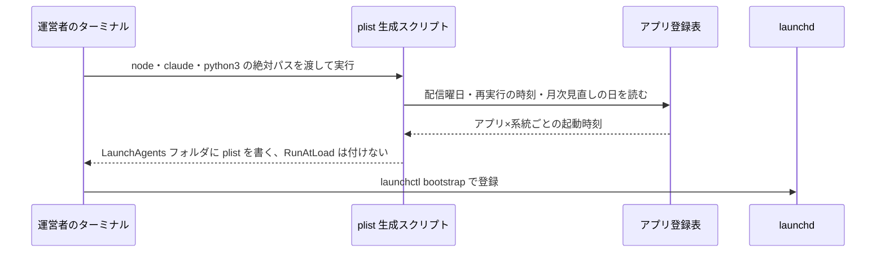
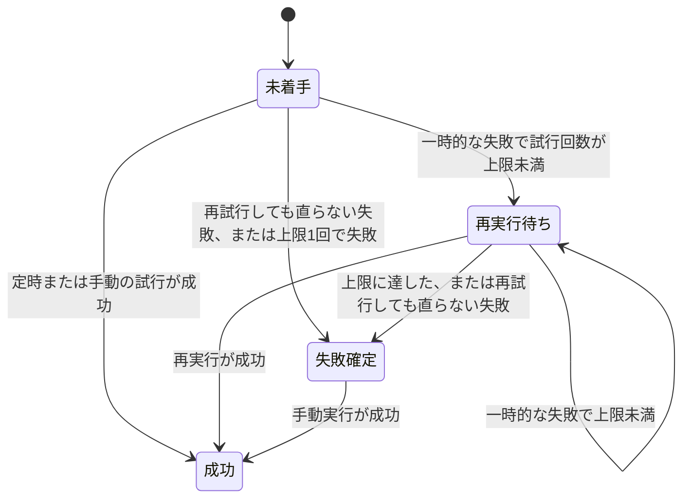

# 実行係(バッチの定時起動と成否の記録)の設計

## 概要

launchd がアプリ×系統ごとの時刻に実行係(Python 3 標準ライブラリだけの1本のスクリプト)を起動し、実行係はアプリ登録表と実行状態ファイルを読んで「今この配信日・編のバッチを動かすべきか」を決めてから、環境を整えてアプリのバッチ(TypeScript)を起動する。終了後は終了コード・成功マーカー・生成物の3点で成否を判定して実行状態ファイルに記録し、失敗を確定したときは失敗通知(failure-notification)に渡す。アプリのバッチが Claude を呼ぶ共通部品(TypeScript)もこの設計に含める。 〔提案〕

## 決定事項

| 論点 | 選んだ案 | 採らなかった案 | 理由 | 影響範囲 | 出所 |
|---|---|---|---|---|---|
| 実行係の言語 | Python 3 標準ライブラリだけの1本のスクリプト(launchd からは python3 の絶対パスで起動) | bash のラッパー(既存の claude_headless.sh と同じ型) | 実行状態ファイル(JSON)の読み書きと失敗の分類が bash 3.2 では書きにくく、日本語の変数名が使えない制約もある。launchd 起動の Python には routine-work-finder の前例がある | 実行係の全処理・plist の ProgramArguments | 提案 |
| アプリのバッチが失敗の種類を実行係に伝える方法 | 終了コードで伝える。0=成功(最終行に成功マーカー)、1=一時的な失敗、2=再試行しても直らない失敗 | 標準出力に失敗の種類を書いた行を出し、実行係がそれを読む | 終了コードは打ち切り・異常終了でも必ず得られ、Claude の利用枠切れをバッチ側で見分けて2で終わるだけで足りる | 成否の判定・Claude の呼び出し規約・各アプリのバッチの終わり方 | 提案 |
| 成功の3点のうち「生成物」の確かめ方 | アプリ登録表に書いた生成物のパス(配信日・編で埋める)が、バッチの起動時刻より後に書かれて存在することで判定する | バッチが生成物のパスを標準出力で報告し、実行係はそれを信じる | 古い生成物が残っているだけで成功と誤判定しないため、起動時刻より後の更新を条件にする | アプリ登録表の項目・成否の判定 | 提案 |
| 記事サイトの組み立てを誰が起動するか | アプリのバッチが最後の手順として local-site-serving の組み立てを呼ぶ。実行係は結果(当日の記事ページがサイトの出力に書かれたこと)だけを確かめる | 実行係がバッチの成功後にサイトを組み立てる(architecture.md のシステム構成図の現在の線) | local-site-serving の要件が「記事公開のバッチの最後に組み立て直す」と決めているため、そちらに揃えて architecture.md の図を直す | architecture.md のシステム構成図と概要・成否の判定 | 提案 |
| 利用枠切れの見分け方 | `claude -p --output-format json` の封筒で `is_error` が真かつ、`api_error_status` が 429 または応答文が利用枠の文言(appendix の一覧)に一致したら「再試行しても直らない失敗」とする。封筒の項目名は環境スモークで実機の応答を保存して確定する | 終了コードと成功マーカーだけで判定し、利用枠切れは区別しない(既存バッチの型) | 要件が利用枠切れを再実行しない失敗として分けるよう求めており、現行 CLI の封筒の形は未確認のまま仮置きして環境スモークで確かめる | Claude の呼び出し規約・テスト戦略の環境スモーク | 提案 |
| ログと実行状態ファイルの保持期間 | 90日を過ぎたら実行係が次の起動時に消す(requirements.md の「ログと記録の保持」) | architecture.md の「データ運用」にある「消さない」 | requirements.md の数値ルール7件をそのまま進める指示に従い、architecture.md のデータ運用の表を90日に揃える | 古い記録の掃除・architecture.md のデータ運用 | 合意 |
| 手動実行で成功済みの日を指定したとき | 再実行・追い実行と同じく「既に成功済み」として起動しない。やり直したいときは運営者が実行状態ファイルを消してから手動実行する | `--force` のような上書きの指定を足す | 成功した日の記事を手動で二重に作る経路を持たないほうが、記事JSONと Teams の新着通知の二重化を防げる | 起動前の判定・README の手動実行の手順 | 提案 |
| 実行状態ファイルが壊れていたとき | 壊れたファイルを同じフォルダに `.corrupt-<日時>` を付けて退避し、「再試行しても直らない失敗」として新しい実行状態ファイルを書き、失敗通知に渡す | 壊れたまま触らず失敗だけ記録する | 退避しないと通知済みを記録できず、同じ失敗の通知が起動のたびに出る | 実行状態の記録・失敗の引き渡し | 提案 |
| 失敗通知(failure-notification)の呼び方 | 同じ Python パッケージの関数として呼ぶ。渡す9項目と返る2項目(通知したか・理由)の契約をこの設計で決め、failure-notification の設計はこの契約に合わせる | 別プロセス(コマンド)として起動し、標準入出力の JSON でやり取りする | 実行係も失敗通知も Python 3 標準ライブラリで、同じ起動の中で呼べば 1分以内の要件も満たしやすい | 失敗の引き渡し・failure-notification の設計 | 提案 |

残りの決定は折りたたみの中。書式そのものは [appendix.md](appendix.md)。

詳細を開く

承認の判断には効かないが、実装の根拠として残す決定。

| 論点 | 選んだ案 | 採らなかった案 | 理由 | 影響範囲 | 出所 |
|---|---|---|---|---|---|
| 配信日と編の決め方 | 配信日は実行係の起動日(日本時間)、編はアプリ登録表の「曜日→編」の対応から引く。編を持たないアプリは配信日だけで特定する | バッチが配信日と編を決めて実行係に返す | 「既に成功済みか」はバッチを起動する前に決めるため、実行係が自分で配信日と編を決める必要がある | 起動前の判定・実行状態ファイルの名前 | 提案 |
| アプリ登録表 | `application/launchd/apps.json` に、アプリごとの配信曜日・曜日→編・再実行の上限・生成物のパス・バッチの起動コマンド・月次見直しの日を持つ。各アプリのspecが決める項目(編の対応・月次見直しの日)は、そのspecの実装時に埋める | 各アプリの `application/` に自分の登録を置き、実行係が集める | 実行係が1ファイルを読むだけで全アプリの起動時刻と判定条件を把握できる。plist の生成も同じ表から行う | アプリ登録表・plist の生成・起動前の判定 | 提案 |
| 実行状態ファイルの置き場所と名前 | `~/Library/Application Support/digest/<アプリ名>/runs/<系統>/<配信日>[-<編>].json`。フォルダは権限700 | architecture.md の `runs/<配信日>-<編>.json`(系統の区別なし) | 記事公開と月次見直しが同じ日に動くことがあり、系統で分けないと同じ日のファイルが衝突する。architecture.md の用語集とデータ運用の表を揃える | 実行状態の記録・architecture.md | 提案 |
| ログの置き方 | アプリ×系統ごとの要約ログ `runner-<系統>.log`(1回の起動につき「実行開始」「実行終了」の2行)と、実行ごとの詳細ログ `logs/<系統>/<配信日>[-<編>]-<試行番号 または manual-<時刻>>.log`(バッチの標準出力・標準エラー)の2層。launchd の標準出力・標準エラーは `~/Library/Logs/digest-<アプリ名>-<系統>.log` に向け、想定外の出力だけが残る | 実行ごとのログファイルだけを持つ | 日次ヘルスチェックのログ形式の宣言は単一ファイルしか読めない(`path` 必須)ため、宣言に向ける要約ログを1本持つ | ログ・failure-notification のヘルスチェックの宣言 | 提案 |
| ヘルスチェックが読む印 | 要約ログの「実行終了」の行を完了の印、同じ行の `RUN-FAILED` を失敗の印にする。失敗の印は当日の状態が「失敗確定」のときだけ出す(再実行待ちの途中失敗には出さない) | 「失敗」という語を失敗の印にする | 「失敗=0」のような集計の語に一致する事故を避け、ASCII の目印にする。再実行待ちの途中で鳴らさないのは failure-notification の判定と同じ考え | ログ・failure-notification の宣言 | 提案 |
| 二重起動の防止 | `mkdir` で作るロックフォルダ `lock/<系統>` に pid を書く。ロックが取れなければ何もせず終わる。ロックフォルダの作成時刻が60分より前なら回収して取り直す | `flock`(macOS の `/bin/bash` 3.2 と標準の環境では使えない) | create-automation-batch の雛形と同じ型で前例がある | 起動前の判定 | 提案 |
| バッチの打ち切り方 | バッチを新しいプロセスグループで起動し、60分でグループごと終了させる(TERM のあと5秒待って KILL) | 番犬プロセスを別に立てる(bash 雛形の型) | Python の subprocess の timeout で同じことが短く書ける | バッチの起動と成否の判定 | 提案 |
| 実行環境の整え方 | plist の `EnvironmentVariables` に node・claude・python3 の絶対パスと `PATH`・`TZ=Asia/Tokyo`・CAバンドルのパス(`NODE_EXTRA_CA_CERTS`・`SSL_CERT_FILE`)を書く。手動実行で環境変数が無いときは実行係が `PATH` と既知の候補から探す | 実行係が毎回 `which` で探す | launchd は PATH を継承しないため、登録時に確定した絶対パスを plist に持たせる(night-batch の setup-launchd.sh と同じ型) | plist の生成・実行環境の整え | 提案 |
| CAバンドルの探し方 | `~/Library/Application Support/ca-bundle/ca-bundle.pem` があればそれ、無ければ `/etc/ssl/cert.pem`。この2段の規則を実行係に写し、`~/.claude/lib` は参照しない | `~/.claude/lib/ca_bundle_tls.py` を import する | study リポジトリのアプリが運営者個人の `~/.claude/lib` に依存すると、他の環境で動かない | 実行環境の整え | 提案 |
| 月次見直しの実行状態ファイル | `runs/review/<起動日>.json`。上限1回で、再実行の時刻も持たない | 月単位の名前(`<年-月>.json`) | 起動日で揃えると記事公開と同じ処理で扱える。手動実行で補うときは別の日になるのが普通で、同じ日に重ねたいときは実行状態ファイルを消す手順(手動実行の決定と同じ)を使う | 実行状態の記録 | 提案 |
| Claude の呼び出し部品の置き場所 | `application/batch/claude.ts` に呼び出し・分類・控えの書き出しを1つの部品として置き、5アプリのバッチはこれだけを使う | 各アプリが自分で `claude -p` を起動する | 規約(時間の上限・利用枠切れ・使わないツール・控え)を1か所に集める | Claude の呼び出し規約 | 提案 |
| Claude に使わせないツールの指定 | `--disallowedTools` で MCP ツール全部(`mcp__*`)と外部送信にあたるツールを明示して外し、許可の問いが出ないようにする。使うツールは WebSearch と WebFetch だけを `--allowedTools` に書く | 指示文で「使わないこと」と頼むだけ | 指示文の頼みは守られないことがあり、ツールの許可で縛るほうが確実 | Claude の呼び出し規約 | 提案 |
| 控え(指示文と応答)の置き場所 | `~/Library/Application Support/digest/<アプリ名>/claude-io/<系統>/<配信日>[-<編>]/<試行番号>-<連番>-prompt.txt` と `-response.json`。90日で実行係が消す | 記事JSONと同じ git 管理の場所 | 控えは障害調査用で、git に入れると差分が毎日増える。routine-work-finder の claude-io と同じ型 | Claude の呼び出し規約・古い記録の掃除 | 提案 |
| TypeScript 側の土台(package.json・tsx・vitest・typescript)の用意 | この spec の最初のタスクで `apps/digest-platform/application/package.json` を作る。採用する OSS は architecture.md の「採用技術」で合意済みのものだけ | 各アプリの spec で初めて作る | batch-runner が共通基盤の最初の spec で、Claude の呼び出し部品(TypeScript)のテストを動かすために要る | 関連するファイル | 提案 |

## 処理フロー

### 起動前の判定(ロック・配信日と編・実行状態の確認・古い記録の掃除)

図はこの処理の俯瞰。手順の文章が正。

詳細を開く

実行係が起動してからアプリのバッチを起動するまでに、動かすべきかどうかを決める。

- **対象**: launchd(定時・追い実行)と運営者のターミナル(手動実行)から起動された実行係の1回の起動
- **手順**:
  1. 引数のアプリ名・系統(記事公開・月次見直し)・手動かどうかを読む。アプリ登録表(`application/launchd/apps.json`。アプリごとの配信曜日・曜日→編・再実行の上限・生成物のパス・バッチの起動コマンド・月次見直しの日を持つ)にそのアプリ×系統の登録が無い場合は、要約ログに「未登録」と書いて失敗(終了コード2)で終わる。この失敗は実行状態ファイルを持たないので失敗通知には渡さず、launchd の標準エラーにも同じ文を出す
  2. 日本時間で現在時刻を取り、配信日を起動日にする。記事公開では登録表の「曜日→編」から当日の編を引く(編を持たないアプリは配信日だけ)。月次見直しは編を持たない
  3. アプリ×系統のロックフォルダを `mkdir` で作る。作れなかった場合、既にあるロックの作成時刻が60分より前なら回収(削除)して作り直し、60分以内なら「実行中のため何もしない」と要約ログに書いて終了コード0で終わる(二重起動は失敗ではない)
  4. ロックが取れたら、そのアプリの `runs/`・`logs/`・`claude-io/` の中で更新時刻が90日より前のファイルを消す(消せなかったファイルは要約ログに書いて続行する)
  5. 配信日・編の実行状態ファイルを読む。無ければ「未着手」として扱う。読めない・JSON として壊れている・必須項目が欠けている場合は「実行状態ファイルが壊れていたとき」の処理(処理フロー「再実行の判定と失敗の引き渡し」の手順)に進み、バッチは起動しない
  6. 当日の状態を見て起動するかを決める。「成功」なら要約ログに「既に成功済み」と書いて終了コード0。「失敗確定」(再試行しても直らない失敗で確定した、または上限に達した)なら「失敗確定のため起動しない」と書いて終了コード0。「未着手」「再実行待ち」で、手動実行でないときは定時の試行回数が上限未満なら起動する。手動実行は試行回数に関係なく起動する(ただし「成功」「失敗確定」の日は上と同じく起動しない)
  7. 起動すると決めたら、要約ログに「実行開始」の行(アプリ名・系統・配信日・編・試行番号または手動)を書き、処理フロー「バッチの起動と成否の判定」へ進む
  8. 実行係がどの経路で終わるときも、終わる直前にロックフォルダを消す(起動時の環境の整えに失敗して落ちる経路も含める)
- **関連するビジネスルール**: `requirements.md#定時起動`([3][4][7])、`requirements.md#実行状態の記録`([2][3])、`requirements.md#再実行`([2][3][4])、`requirements.md#時間の上限`([3])、`requirements.md#ログと記録の保持`([1])

### バッチの起動と成否の判定

図はこの処理の俯瞰。手順の文章が正。

詳細を開く

実行係が環境を整えてアプリのバッチを起動し、終了コード・成功マーカー・生成物の3点で成否を決めて実行状態ファイルに書く。

- **対象**: 起動前の判定で「起動する」と決めた1回の試行
- **手順**:
  1. 環境を整える。node・claude・python3 の絶対パスは plist の環境変数から受け取り、無ければ(手動実行)`PATH` と既知の候補(appendix「実行ファイルの探し方」)から探す。見つからなければ「再試行しても直らない失敗」として手順7へ進む(バッチは起動しない)。`PATH` に node と claude のフォルダを前置し、`TZ=Asia/Tokyo` を設定し、CAバンドルのパスを `NODE_EXTRA_CA_CERTS` と `SSL_CERT_FILE` に設定する。アプリのバッチが読む情報(アプリ名・系統・配信日・編・試行番号・手動かどうか・控えの置き場所)は環境変数で渡す(名前は appendix)
  2. 詳細ログ(`logs/<系統>/<配信日>[-<編>]-<試行番号 または manual-<時刻>>.log`)を開き、先頭に開始時刻と渡した情報(環境変数の値のうちパスと識別子だけ。CAバンドルの中身や認証に関わる値は書かない)を書く
  3. 登録表の起動コマンド(`<node の絶対パス> <tsx の絶対パス> <バッチの入口>` の形)を、作業フォルダを `apps/digest-platform/application/` にして新しいプロセスグループで起動する。標準出力・標準エラーは詳細ログに流す。起動自体に失敗したら「再試行しても直らない失敗」とする
  4. 60分待つ。終わらなければプロセスグループに TERM を送り、5秒待って残っていれば KILL を送り、結果を「打ち切り(一時的な失敗)」とする
  5. 終了したら3点を確かめる。(a) 終了コードが0、(b) 詳細ログに書かれたバッチの標準出力の最終行が成功マーカー(`DIGEST-BATCH-OK`)、(c) 登録表の生成物のパス(配信日・編で埋める。記事公開なら当日の記事ファイルと記事サイトの出力にある当日の記事ページ、月次見直しなら見直し案のファイル)がすべて存在し、更新時刻がバッチの起動時刻より後。3点そろえば「成功」
  6. そろわなければ失敗の種類を決める。終了コードが2なら「再試行しても直らない失敗」、それ以外(終了コード1・0なのにマーカーや生成物が無い・打ち切り・その他の終了コード)は「一時的な失敗」。どの点が欠けたかを詳細ログの末尾に書く
  7. 実行状態ファイルに今回の試行(試行番号、手動かどうか、開始・終了時刻、結果、失敗の種類、詳細ログのパス)を追記し、当日の状態を更新する。成功なら「成功」。手動実行の失敗は当日の状態を変えない(試行回数にも数えない)。定時の失敗は処理フロー「再実行の判定と失敗の引き渡し」に進む
  8. 要約ログに「実行終了」の行(結果・試行番号・当日の状態・詳細ログのパス)を書く。当日の状態が「失敗確定」なら同じ行に `RUN-FAILED` を含める
- **関連するビジネスルール**: `requirements.md#定時起動`([5])、`requirements.md#成否の判定`([1]〜[6])、`requirements.md#実行状態の記録`([1][4])、`requirements.md#時間の上限`([1])

### 再実行の判定と失敗の引き渡し

図はこの処理の俯瞰。手順の文章が正。

詳細を開く

定時の試行が失敗したとき、当日の状態を「再実行待ち」か「失敗確定」に決め、失敗確定なら失敗通知に渡して結果を記録する。手動実行の失敗は当日の状態を変えずに、そのまま失敗通知に渡す。

- **対象**: バッチの起動と成否の判定で「失敗」になった試行、および壊れていた実行状態ファイル
- **手順**:
  1. 失敗の種類が「再試行しても直らない失敗」なら、上限に達していなくても当日の状態を「失敗確定」にする
  2. 「一時的な失敗」で、定時の試行回数(手動を除く)が登録表の上限に達したら「失敗確定」、未満なら「再実行待ち」にする。上限が1回のアプリ(ai-dev-digest・news-digest・trend-digest・全アプリの月次見直し)は1回目の失敗で「失敗確定」になる
  3. 手動実行の失敗は、当日の状態を変えず、試行回数にも数えず、手順4へ進む(失敗通知が「手動実行は直ちに通知」と判定する)
  4. 当日の状態が「失敗確定」になったとき、または手動実行の失敗のとき、失敗通知の判定関数に次の9項目を渡す: アプリ名・系統・配信日・編・試行回数・上限回数・手動実行かどうか・失敗の種類・詳細ログのパス。「再実行待ち」のときは渡さない(通知するかどうかの判定は failure-notification の責務だが、再実行待ちの失敗は渡しても必ず見送りになるため呼ばない)
  5. 失敗通知から「通知したか」と「理由」(直ちに通知・手動実行・再実行を使い切った・再実行中のため見送り・通知済み)を受け取り、実行状態ファイルの「通知済み」と「通知の理由」に書く。失敗通知の関数が例外で落ちた場合は通知済みを偽のまま、理由に「通知の失敗」と書いて要約ログにも残す(実行係自身は落とさない)
  6. **実行状態ファイルが壊れていたとき**: 壊れたファイルを同じフォルダに `<元の名前>.corrupt-<日時>` として退避し、当日の状態「失敗確定」・失敗の種類「再試行しても直らない失敗」・試行の履歴なしの新しい実行状態ファイルを書く。失敗通知には試行回数0・詳細ログのパスとして要約ログのパスを渡し、手順5と同じく結果を書く。要約ログには「実行終了」と `RUN-FAILED` を書く
- **関連するビジネスルール**: `requirements.md#再実行`([1][3][4][5])、`requirements.md#失敗の引き渡し`([1][2])、`requirements.md#実行状態の記録`([3])、`requirements.md#成否の判定`([4])

### Claude の呼び出し規約(アプリのバッチが使う共通部品)

図はこの処理の俯瞰。手順の文章が正。

詳細を開く

5アプリのバッチが Claude を呼ぶときに必ず通る TypeScript の部品。利用枠切れを見分け、指示文と応答の控えを残す。

- **対象**: アプリのバッチからの Claude の呼び出し1回
- **手順**:
  1. 呼び出し元から指示文・材料(標準入力で渡す本文)・呼び出しの名前(控えのファイル名に使う)を受け取る。指示文の末尾に「最後の行に成功マーカー `CLAUDE-CALL-OK` だけを出力すること。質問や確認はせず、できない場合はその理由を書いて成功マーカーを出さないこと」を付け足す
  2. 実行係から環境変数で受け取った控えの置き場所に、指示文を `<試行番号>-<連番>-prompt.txt` として書く(連番は呼び出しごとに増える)。材料に認証に関わる値が混ざらないように、呼び出し元は材料を渡す前に自分で除く(部品は材料の中身を検査しない)
  3. `claude -p` を、JSON 出力(`--output-format json`)、使うツールの許可(WebSearch・WebFetch だけ)、使わないツールの指定(MCP ツール全部と外部送信にあたるツール。一覧は appendix)、APIキーの環境変数を渡さない環境で起動し、材料を標準入力で渡す。claude の実行ファイルは実行係から受け取った絶対パスを使う
  4. 10分待つ。終わらなければ打ち切り、結果を「打ち切り(一時的な失敗)」にする
  5. 標準出力を JSON の封筒として読む。読めなければ「一時的な失敗」。封筒の `is_error` が真で、`api_error_status` が 429 または応答文が利用枠の文言(appendix「利用枠切れの文言」)に一致すれば「利用枠切れ」、それ以外の `is_error` は「一時的な失敗」。`is_error` が偽でも応答文の最終行が成功マーカーでなければ「一時的な失敗」
  6. 応答の封筒全体を `<試行番号>-<連番>-response.json` として控えに書く(失敗したときも書く)
  7. 成功なら成功マーカーの行を除いた応答文を返す。失敗なら種類(一時的・利用枠切れ・打ち切り)を返す。呼び出し元のバッチは、利用枠切れを受け取ったら処理を続けずに終了コード2で終わり、一時的な失敗は自分の再試行の決まり(各アプリのspec)に従って再び呼ぶか終了コード1で終わる
  8. バッチが最後まで完遂したときだけ、標準出力の最終行に成功マーカー `DIGEST-BATCH-OK` を出して終了コード0で終わる(終わり方の共通部品 `application/batch/exit.ts` を使う)
- **関連するビジネスルール**: `requirements.md#Claude の呼び出し規約`([1]〜[6])、`requirements.md#時間の上限`([2])、`requirements.md#成否の判定`([2][4])

### launchd ジョブの生成と登録

図はこの処理の俯瞰。手順の文章が正。

詳細を開く

運営者が手元のターミナルで plist 生成スクリプトを実行し、アプリ登録表からアプリ×系統ごとの plist を作って launchd に登録する。

- **対象**: 5アプリ×2系統の launchd ジョブ(月次見直しの日が登録表で未定のアプリは、記事公開の plist だけを作る)
- **手順**:
  1. 運営者が `application/launchd/make_plists.py` を、node・claude・python3 の絶対パスと出力先(既定は `~/Library/LaunchAgents/`)を指定して実行する。パスが存在しない・バージョン番号を含む(更新で変わる)場合は生成を止めて理由を出す
  2. 生成スクリプトはアプリ登録表を読み、記事公開はそのアプリの配信曜日ごとに本番 06:30 と、再実行があるアプリは 10:30・14:30・18:30 を起動時刻の並びに入れる。月次見直しは登録表の日の 07:30 を入れる
  3. ジョブ名は `com.example.digest-<アプリ名>-<系統>`。`ProgramArguments` は python3 の絶対パス・実行係の絶対パス・アプリ名・系統。`EnvironmentVariables` に絶対パス・`PATH`・`TZ`・CAバンドルのパス・`HOME` を書く。`RunAtLoad` は書かない。標準出力・標準エラーは `~/Library/Logs/digest-<アプリ名>-<系統>.log`
  4. 生成した plist は `plutil -lint` と同じ検査(plistlib で読めること)を通してから書く
  5. 登録・解除・即時起動(`launchctl bootstrap`・`bootout`・`kickstart`)は README に書いたコマンドを運営者が手元で実行する。Claude Code のサンドボックスからは `launchctl` を使えない
- **関連するビジネスルール**: `requirements.md#定時起動`([1][2][5][6])、`requirements.md#実行時刻`([1]〜[5])

## バリデーション

実行係は引数(アプリ名・系統)と実行状態ファイルの形だけを検証し、不正なら起動せずに失敗として終わる 〔提案〕

詳細を開く

- 引数の系統は `publish`(記事公開)と `review`(月次見直し)のどちらか。それ以外、またはアプリ登録表に無いアプリ名は「未登録」の失敗(終了コード2)
- 実行状態ファイルは JSON として読め、必須項目(アプリ名・系統・配信日・当日の状態・試行の一覧・通知済み)を持つこと。1つでも欠ければ「壊れている」として処理フロー「再実行の判定と失敗の引き渡し」の手順6に進む
- アプリ登録表は読めない・必須項目が欠けている場合、実行係は「未登録」と同じく終了コード2で終わる(登録表の壊れは全アプリに及ぶため、要約ログと launchd の標準エラーの両方に書く)
- plist 生成スクリプトは、渡された絶対パスが存在すること・バージョン番号を含まないことを確かめる

## エラーハンドリング

実行係は自分の処理の失敗で黙って止まらず、要約ログに理由を書いてロックを外してから終わる。バッチの失敗は3段階(一時的・再試行しても直らない・打ち切り)に分けて実行状態ファイルに残し、失敗確定のときだけ失敗通知に渡す 〔提案〕

詳細を開く

- 実行係の中で想定外の例外が起きたら、例外の内容を要約ログと launchd の標準エラーに書き、ロックフォルダを消して終了コード2で終わる。実行状態ファイルは可能なら「一時的な失敗」として追記する(追記に失敗しても落とさない)
- 実行状態ファイルの書き込みは、一時ファイルに書いて置き換える(途中で落ちて壊れたファイルが残らないようにする)
- 失敗通知の関数が例外で落ちても実行係は落とさず、通知済みを偽のまま理由「通知の失敗」を記録する。翌日のヘルスチェックが要約ログの `RUN-FAILED` で拾う
- 詳細ログが開けない(データフォルダに書けない)場合は、launchd の標準エラーに書いて終了コード2で終わる(バッチは起動しない)
- 古い記録の掃除で消せないファイルがあっても起動は続ける(要約ログに1行)
- アプリのバッチが要約ログや実行状態ファイルを直接書くことはない(実行係だけが書く)

## 関連するファイル(抜粋)

新規は実行係の Python パッケージ・アプリ登録表・plist 生成スクリプト・Claude 呼び出し部品(TypeScript)・README の5まとまり。変更は architecture.md のみ 〔提案〕

詳細を開く

新規:

- `apps/digest-platform/application/launchd/runner.py` — 実行係の入口。引数を読み、`digest_runner` パッケージの処理を順に呼ぶ
- `apps/digest-platform/application/launchd/digest_runner/registry.py` — アプリ登録表の読み取りと検証
- `apps/digest-platform/application/launchd/digest_runner/calendar.py` — 日本時間の現在時刻、配信日と編の決定
- `apps/digest-platform/application/launchd/digest_runner/lock.py` — ロックの取得・60分での回収・解放
- `apps/digest-platform/application/launchd/digest_runner/state.py` — 実行状態ファイルの読み書き・壊れたファイルの退避・当日の状態の更新
- `apps/digest-platform/application/launchd/digest_runner/environment.py` — 実行ファイルの探索、PATH・TZ・CAバンドルの設定、バッチへ渡す環境変数
- `apps/digest-platform/application/launchd/digest_runner/launch.py` — バッチの起動・60分の打ち切り・詳細ログへの出力
- `apps/digest-platform/application/launchd/digest_runner/judge.py` — 終了コード・成功マーカー・生成物による成否の判定と失敗の種類
- `apps/digest-platform/application/launchd/digest_runner/handoff.py` — 失敗通知へ渡す9項目の組み立てと結果の記録(failure-notification の関数の契約もここで型として持つ)
- `apps/digest-platform/application/launchd/digest_runner/summary_log.py` — 要約ログの「実行開始」「実行終了」「RUN-FAILED」の書き出し
- `apps/digest-platform/application/launchd/digest_runner/retention.py` — 90日より古い記録の掃除
- `apps/digest-platform/application/launchd/apps.json` — アプリ登録表
- `apps/digest-platform/application/launchd/make_plists.py` — アプリ登録表から plist を生成するスクリプト
- `apps/digest-platform/application/batch/claude.ts` — Claude の呼び出し・分類・控えの書き出し
- `apps/digest-platform/application/batch/exit.ts` — バッチの終わり方(成功マーカーと終了コード)の共通部品
- `apps/digest-platform/application/package.json` — tsx・vitest・typescript(Next.js・mermaid は local-site-serving で足す)
- `apps/digest-platform/application/tests/runner/` — 実行係の unittest(Python 標準ライブラリ)。fixture と性能テスト(`tests/perf/`)を含む
- `apps/digest-platform/application/tests/batch/claude.test.ts` — Claude 呼び出し部品の vitest
- `apps/digest-platform/README.md` — テスト・lint の実行、plist の生成と登録、手動実行、`additionalDirectories` の登録の手順

変更:

- `apps/digest-platform/specs/architecture.md` — システム構成図の「サイトを組み立てる」の線をアプリのバッチ側へ、アーキテクチャ概要の「公開」の記述、ディレクトリ構成の `batch/` と `launchd/` の分担、データ運用の保持期間(90日)と実行状態ファイルの名前、用語集の実行状態ファイルの名前

## 状態管理

配信日・編ごとの当日の状態は4つ(未着手・再実行待ち・成功・失敗確定)で、実行状態ファイルだけが持つ 〔提案〕

図は当日の状態の遷移の俯瞰。文章が正。

詳細を開く

- 当日の状態は `~/Library/Application Support/digest/<アプリ名>/runs/<系統>/<配信日>[-<編>].json` が持つ。実行係以外は書かない
- 「成功」と「失敗確定」は定時の起動では変わらない(どちらも起動しない)。「失敗確定」の日に手動実行が成功したときだけ「成功」へ進む
- 手動実行の失敗は状態を変えない
- 壊れていた実行状態ファイルは退避され、新しいファイルは「失敗確定」から始まる
- 配信日は起動日(日本時間)で決める。Mac が丸1日以上スリープして追い実行が翌日の深夜に動いた場合、その回は翌日の配信日として扱われ、元の日は未着手のまま残る(翌日の本番の時刻には「既に成功済み」となるため、その日の本番は追い実行が担う)

## セキュリティ

APIキーを置かず運営者の Claude Code の認証で動かし、ログ・控え・通知に認証に関わる値を書かない。データフォルダは運営者だけが読める権限700にする 〔提案〕

詳細を開く

- **APIキーを持たない**: 実行係はバッチに渡す環境変数を自分で組み立て、`ANTHROPIC_API_KEY` など認証に関わる変数は渡さない(launchd の環境には元から無いが、手動実行で運営者のシェルに残っていても引き継がない)。Claude の呼び出しは運営者の Claude Code の認証(サブスクリプション)で行う
- **ログと控えに書かない**: 実行係が詳細ログの先頭に書くのはパスと識別子だけで、環境変数の一覧を書かない。Claude の呼び出し部品は材料を検査しないので、認証に関わる値を材料に混ぜない責任は各アプリのバッチにある(各アプリの spec のセキュリティに書く)
- **ツールの縛り**: Claude のヘッドレス実行は WebSearch・WebFetch だけを許可し、MCP ツールと外部送信にあたるツールを明示して外す。承認待ちで止まる経路と、意図しない外部送信の経路を両方ふさぐ
- **データフォルダの権限**: `~/Library/Application Support/digest/<アプリ名>/` 配下のフォルダは700、ファイルは600で作る(routine-work-finder と同じ)
- **起動コマンドの出所**: 実行係が起動するコマンドはアプリ登録表(git 管理)に書かれたものだけで、引数からコマンドを受け取らない
- **失敗通知の本文**: 失敗通知に渡すのは9項目の識別子とパスだけで、エラーの生の文字列は渡さない(本文の4要素は failure-notification が決める)

## パフォーマンス

launchd の起動からバッチの起動までを10秒以内に収めるため、実行係は標準ライブラリだけを読み込み、起動前の判定で外部に出ない 〔提案〕

詳細を開く

- 起動前の判定(登録表・ロック・実行状態ファイル・古い記録の掃除)はローカルのファイル操作だけ。90日の掃除は1アプリの3フォルダを1回走査するだけで、1日に数ファイルしか増えないため秒以内で終わる
- 実行係は Claude もネットワークも呼ばない(非機能要件 [2])
- 性能テスト(`tests/perf/`)では、登録表と実行状態ファイルを用意した状態で入口から起動コマンドの直前までの時間を測り、閾値を5秒(要件10秒の1/2)に置く

## ログ

アプリ×系統ごとの要約ログ(1回の起動に「実行開始」「実行終了」の2行。失敗確定のときだけ `RUN-FAILED`)と、実行ごとの詳細ログ(バッチの標準出力・標準エラー)の2層。行の書式は appendix に置く 〔提案〕

詳細を開く

- **要約ログ** `~/Library/Application Support/digest/<アプリ名>/runner-<系統>.log`(追記。日次ヘルスチェックの宣言はこのファイルを読む)
  - 起動のたびに「実行開始」(INFO): 配信日・編・試行番号または手動
  - 終わるときに「実行終了」(INFO): 結果(成功・一時的な失敗・再試行しても直らない失敗・打ち切り・既に成功済み・失敗確定のため起動しない・実行中のため何もしない・未登録)・試行番号・当日の状態・詳細ログのパス。当日の状態が「失敗確定」になった起動では同じ行に `RUN-FAILED`
  - 想定外の例外・失敗通知の失敗・消せなかった古い記録は WARNING で1行ずつ
  - 行の書式は [appendix.md](appendix.md#要約ログの行) に従う(行頭は ISO 8601 の時刻。ヘルスチェックが時刻を読める形)
- **詳細ログ** `~/Library/Application Support/digest/<アプリ名>/logs/<系統>/<配信日>[-<編>]-<試行番号 または manual-<時刻>>.log`
  - 先頭に開始時刻・渡した識別子とパス、本文にバッチの標準出力と標準エラーをそのまま、末尾に終了コード・成功マーカーの有無・生成物の有無・判定結果
- **launchd の標準出力・標準エラー** `~/Library/Logs/digest-<アプリ名>-<系統>.log`: 実行係が起動できなかったときの Python のエラーなど、想定外の出力だけが残る
- **Claude の控え** `claude-io/` は呼び出し規約の手順で書く(ログではなく記録として扱い、90日で消す)
- どのログにも認証に関わる値を書かない(セキュリティ)

## テスト戦略

requirements の [n] 全41項目に割り当て済み。うち1項目(非機能-2)はテストを置かず、備考に理由を書く。 〔提案〕

詳細を開く

| 仕様項目 | リスク種別 | テスト種別 | 量の目安 | 備考 |
|---|---|---|---|---|
| 定時起動-1 | 環境 | 環境スモーク | 実行経路ごとに1回(launchd・手元ターミナルの2回) | launchd 経由で1アプリの記事公開が起動し成果物が出ること。手元ターミナルからの手動実行も1回。曜日・時刻の正しさは実行時刻-1〜4の構造検証が担う |
| 定時起動-2 | 環境 | 環境スモーク | 1回 | launchd の挙動。Mac をスリープさせて定時を過ぎてから復帰し、1回だけ起動したことを要約ログで確かめる |
| 定時起動-3 | 論理 | 単体 | 正常1 + 分岐2 | 未登録のアプリ名・未登録の系統で終了コード2 |
| 定時起動-4 | 並行 | 単体 | 競合1パターンにつき1件(2件) | ロック中に起動して何もせず終わる、60分より古いロックを回収して起動する |
| 定時起動-5 | 環境 | 環境スモーク | 1回 | launchd 経由で node と claude が見つかり、CAバンドル経由で情報源が取れること。環境変数の組み立て自体は単体(正常1 + 絶対パスが無い分岐1)を足す |
| 定時起動-6 | 生成物 | 構造検証 | 生成器1つに1件 | 生成した全 plist に `RunAtLoad` が無いこと。わざと足すと落ちる否定確認 |
| 定時起動-7 | 論理 | 単体 | 正常1 + 分岐1 | 手動の引数で判定・記録・引き渡しが定時と同じ経路を通る。成功済みの日は起動しない |
| 成否の判定-1 | 論理 | 単体 | 正常1 + 分岐3 | 3点そろって成功、終了コード・マーカー・生成物がそれぞれ欠けて失敗 |
| 成否の判定-2 | 境界 | 契約 | fixture 1種 + 失敗形1 | 終了コード0でマーカーの無い出力。fixture は想像 fixture から始め、環境スモークで保存した実出力に置き換える |
| 成否の判定-3 | 境界 | 単体 | 正常1 + 打ち切り1 | 上限を数秒に縮めた偽のバッチで打ち切りを再現し、プロセスグループごと止まること |
| 成否の判定-4 | 論理 | 単体 | 正常1 + 分岐2 | 終了コード2で「再試行しても直らない失敗」、1・打ち切りで「一時的な失敗」 |
| 成否の判定-5 | 生成物 | 構造検証 | 生成器1つに1件 | 詳細ログの先頭に環境変数の一覧が無く、わざと認証に見える値を環境に入れても出てこない否定確認 |
| 成否の判定-6 | 生成物 | 構造検証 | 生成器1つに1件 | 要約ログの「実行終了」行と `RUN-FAILED` を、日次ヘルスチェックの判定と同じ読み方(行頭の ISO 8601 時刻)で読めること |
| 実行状態の記録-1 | 生成物 | 構造検証 | 生成器1つに1件 | 書いた実行状態ファイルが JSON として読め、必須項目をすべて持つ |
| 実行状態の記録-2 | 論理 | 単体 | 正常1 + 分岐1 | 成功済みの日は起動せず「既に成功済み」 |
| 実行状態の記録-3 | 境界 | 契約 | 失敗形3 | 空ファイル・壊れた JSON・必須項目の欠け。退避ファイルができて失敗確定で書き直され、失敗通知に渡る。fixture は想像 fixture(実応答に相当するものが無い) |
| 実行状態の記録-4 | 環境 | 環境スモーク | 1回 | launchd 経由でデータフォルダに実行状態ファイルと詳細ログが書かれる |
| 再実行-1 | 論理 | 単体 | 正常1 + 分岐2 | 上限4のアプリは4回目まで起動、上限1のアプリは2回目を起動しない |
| 再実行-2 | 論理 | 単体 | 正常1 + 分岐2 | 未成功かつ上限未満で起動、上限到達で起動しない、成功済みで起動しない |
| 再実行-3 | 論理 | 単体 | 正常1 | 再試行しても直らない失敗のあとは上限未満でも失敗確定 |
| 再実行-4 | 論理 | 単体 | 正常1 + 分岐1 | 手動の失敗が試行回数と当日の状態を変えない |
| 再実行-5 | 論理 | 単体 | 正常1 | 月次見直しは1回で失敗確定 |
| Claude の呼び出し規約-1 | 環境 | 環境スモーク | 1回 | launchd 経由で `ANTHROPIC_API_KEY` の無い環境から Claude の呼び出しが成功する |
| Claude の呼び出し規約-2 | 生成物 | 構造検証 | 生成器1つに1件 | 組み立てた指示文の末尾に成功マーカーの指示があり、控えの prompt に同じ文がある |
| Claude の呼び出し規約-3 | 境界 | 単体 | 正常1 + 打ち切り1 | 偽の claude コマンド(sleep)で10分を数秒に縮めて打ち切りを再現(vitest) |
| Claude の呼び出し規約-4 | 境界 | 契約 | fixture 2種 + 失敗形3 | 利用枠切れの封筒・通常の失敗の封筒。空・JSON でない・`is_error` 欠け。fixture は想像 fixture から始め、環境スモークで保存した実応答に置き換える |
| Claude の呼び出し規約-5 | 生成物 | 構造検証 | 生成器1つに1件 | 起動引数に許可ツールと不許可ツールの指定が含まれ、MCP ツールが不許可側にある |
| Claude の呼び出し規約-6 | 生成物 | 構造検証 | 生成器1つに1件 | 控えの prompt と response が所定の名前で書かれ、response は JSON として読める |
| 失敗の引き渡し-1 | 境界 | 契約 | fixture 1種 | 偽の判定関数に9項目が揃って渡ること。fixture は設計で決めた契約(failure-notification の実装後に実関数で置き換える) |
| 失敗の引き渡し-2 | 論理 | 単体 | 正常1 + 分岐1 | 通知したか・理由が実行状態ファイルに書かれる。判定関数が例外のとき理由「通知の失敗」 |
| 実行時刻-1 | 生成物 | 構造検証 | 生成器1つに1件 | 記事公開の plist の起動時刻に 06:30 がある |
| 実行時刻-2 | 生成物 | 構造検証 | 生成器1つに1件 | 10:30・14:30・18:30 が research-digest・future-digest にだけある |
| 実行時刻-3 | 生成物 | 構造検証 | 生成器1つに1件 | research-digest に土曜、future-digest に日曜の Weekday がある |
| 実行時刻-4 | 生成物 | 構造検証 | 生成器1つに1件 | 月次見直しの plist の起動時刻が 07:30 |
| 実行時刻-5 | 環境 | 環境スモーク | 1回 | launchd 経由の要約ログの時刻が日本時間で、`TZ` の設定は単体(正常1)を足す |
| 時間の上限-1 | 境界 | 単体 | 正常1 + 打ち切り1 | 成否の判定-3 と同じテストで、上限の値が登録表でなく実行係の定数60分であること |
| 時間の上限-2 | 境界 | 単体 | 1件 | Claude の呼び出し規約-3 と同じテストで、上限の値が10分であること |
| 時間の上限-3 | 並行 | 単体 | 競合1パターンにつき1件 | 作成から60分を過ぎたロックだけ回収する(59分は回収しない) |
| ログと記録の保持-1 | 論理 | 単体 | 正常1 + 分岐2 | 91日前のファイルは消え、89日前は残る。消せないファイルがあっても続行 |
| 非機能-1 | 非機能 | 性能 | 数値要件1つに1件 | `tests/perf/` で入口から起動コマンドの直前までを計測、閾値5秒(要件10秒の1/2) |
| 非機能-2 | 非機能 | なし | — | 実行係は Claude を呼ぶコードを持たないため、テストで数える対象が無い。`digest_runner` パッケージに claude の起動が無いことは実装レビューで確かめる |

