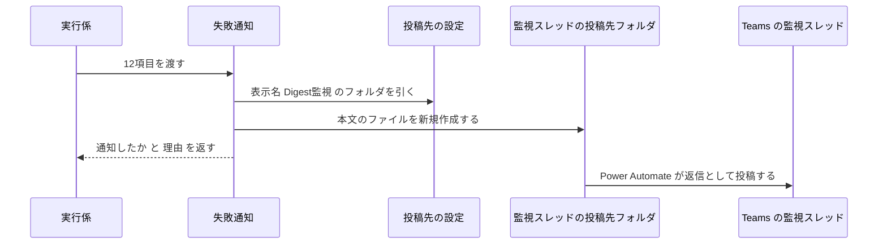
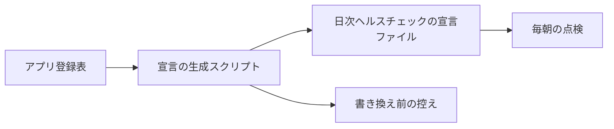

# 失敗通知の設計

## 概要

実行係(batch-runner)が同じ起動の中で呼ぶ失敗通知の判定関数が、渡された12項目(アプリ名・系統・配信日・確定の理由・失敗日時・既に通知済みか・ログのパスなど)から「通知済みなら見送る・そうでなければ4要素の本文を組み立てて監視スレッドの投稿先フォルダへ書き出す」を行い、「通知したか」と「理由」を返す。あわせて、アプリ登録表(アプリごとの有効の印・配信曜日・起動コマンドを書いた1ファイル)から日次ヘルスチェックの宣言を作るスクリプトを持ち、アプリを有効にする手順で宣言と Confluence の定期実行カタログへ反映する 〔提案〕

## 決定事項

| 論点 | 選んだ案 | 採らなかった案 | 理由 | 影響範囲 | 出所 |
|---|---|---|---|---|---|
| 監視スレッドへの書き出し方 | study の中に Python 標準ライブラリだけの小さな書き出し部品を持ち、teams-post と同じ規則(投稿先フォルダに `post-<日時>.txt` を新規作成、フォルダが無ければ失敗)で書く | `~/.claude/skills/teams-post` の部品を import する | study の外のパスに固定で依存せず、worktree でもテストが閉じる。規則は同じなので Power Automate のフローはそのまま使える | 投稿用ファイルの書き出し・関連するファイル | 合意 |
| 書き出しに失敗したときのやり直し | 失敗通知がその場で10秒おきに最大3回まで書き出しを試す。投稿先の設定やフォルダが無いときは1回で諦める。それでも書けなければ書き出し失敗を返し、そのあとは実行係の渡し直し(配信日が変わったあとの起動で同じ12項目を再び渡すこと)に任せる | 1回だけ試して実行係の渡し直しに任せる | 実行係の渡し直しは前日以前の記録だけが対象で、届くのが翌日・翌週・翌月にずれる。一瞬の詰まりならその場で届けたい | 投稿用ファイルの書き出し・エラーハンドリング | 合意 |
| 投稿先の引き方 | teams-post と共用の投稿先の設定ファイルから、表示名「Digest監視」の投稿先フォルダを引く。無い・読めないときは書き出し失敗として返す | 投稿先のフォルダをアプリ登録表や環境変数に持つ | 投稿先の正は teams-post と同じ1か所に置く(architecture の決定)。パスを study に書かない | 投稿用ファイルの書き出し・セキュリティ | 合意 |
| 日次ヘルスチェックの宣言の作り方 | アプリ登録表から、有効なアプリ×系統の宣言を作る宣言の生成スクリプトを持ち、アプリを有効にする手順で宣言ファイルへ反映する | 手順書に書き方だけを載せ、手で足す | plist と同じ登録表から作るので、起動時刻と宣言の時刻の一覧がずれない | ヘルスチェックの宣言の生成・README | 合意 |
| 判定の材料 | 通知済みかどうかは実行係が渡す「既に通知済みか」だけで決め、失敗通知は自分の記録を持たない | 失敗通知が配信日・編ごとの通知済みの記録を自分で持つ | 通知済みの印は実行係の実行状態ファイルが持つ(batch-runner の契約)。記録が2か所にあると食い違う | 通知の判定 | 提案 |
| 配信サーバーの宣言 | 記事サイトを配信する常駐の配信サーバー(local-site-serving)の宣言はこの仕様で作らず、local-site-serving の仕様が扱う | この仕様で配信サーバーの launchd の名前とログの場所を仮に決めて宣言する | 配信サーバーは未設計で、名前とログの場所を先に決めると local-site-serving の設計を縛る | ヘルスチェックの宣言の生成・local-site-serving | 合意 |

残りの決定は折りたたみの中。書式そのものは [appendix.md](appendix.md)。

詳細を開く

承認の判断には効かないが、実装の根拠として残す決定。

| 論点 | 選んだ案 | 採らなかった案 | 理由 | 影響範囲 | 出所 |
|---|---|---|---|---|---|
| 契約に合わない入力 | 12項目の欠け・型の誤りは例外にして、実行係の「通知の失敗」(渡し直しの対象)に任せる | 黙って通知する・書き出し失敗として返す | 契約違反は実行係側の不具合で、書き出し失敗と区別して要約ログに型とメッセージが残るほうが直しやすい | 通知の判定・エラーハンドリング | 提案 |
| launchd から OneDrive へ書くときの備え | 書き出しの前にプロセスの I/O 方針を「データレスのファイルを実体化する」に切り替え(`setiopolicy_np`。ctypes で呼ぶ)、切り替えに失敗しても書き出しは続ける | 何もしない | launchd から OneDrive の同期フォルダへの書き込みが EDEADLK で失敗した実績(読み上げプレーヤー)がある | 投稿用ファイルの書き出し | 提案 |
| 本文の形 | HTML断片。改行は ` `、値は HTML のエスケープをかけ、ログのパスはリンクにしない | プレーンテキスト | Teams への投稿は HTML断片で届き、プレーンテキストだと改行が効かない(既存の投稿先の実績) | 本文の組み立て | 提案 |
| 失敗通知自身のログ | 自分のログファイルは持たず、書き出しに失敗したときだけ例外の種類を標準エラー(launchd の標準エラーのファイル)に1行出す。結果は実行係が要約ログと実行状態ファイルに残す | 失敗通知専用のログファイルを持つ | 同じ起動の中で呼ばれるので、結果の記録は呼び出し側の1か所で足りる | ログ | 提案 |
| 宣言ファイルへの反映 | 生成スクリプトの `--apply` で、識別名が `com.example.digest-` で始まる既存の条目を作り直した条目に置き換え、書き換え前のファイルを `.bak-<日時>` で残す | 生成した条目を標準出力に出すだけにして手で貼る | 何度流しても同じ結果になり、無効にしたアプリの条目も消える | ヘルスチェックの宣言の生成 | 提案 |

## 品質統制の適用

| 統制 | 判定 | 理由 | 反映先 | 出所 |
|---|---|---|---|---|
| IMC-01 PII入出力 | 適用 | ログのパス(利用者のホームフォルダ名を含む)を Teams へ送る。エラーの中身にはトークン等が混ざりうる | セキュリティ | 提案 |
| IMC-02 冪等性 | 適用 | 投稿用ファイルの書き出しは通知という副作用を持ち、実行係の渡し直しで同じ失敗が再び来る | 処理フロー・エラーハンドリング | 提案 |
| IMC-03 監査ログ | 適用 | 外部(Teams)への連携を行う | ログ | 提案 |
| IMC-04 静的解析 | 適用 | 常に適用 | プロジェクト共通の設定 | 提案 |
| IMC-05 コミット粒度 | 適用 | 常に適用 | dev-flow.md のコミット規約 | 提案 |
| IMC-06 OWASP | 適用 | 外部(OneDrive 経由で Teams)へ送り、設定ファイルを読む | セキュリティ | 提案 |

## 処理フロー

### 失敗の通知

図は失敗1件の通知の俯瞰。手順の文章が正。

詳細を開く

実行係から渡された確定済みの失敗・手動実行の失敗・成功したバッチの警告を1件ずつ判定し、通知するなら監視スレッドの投稿先フォルダへ本文を書き出して結果を返す。

- **対象**: 実行係が判定関数 `judge_and_notify` に渡す12項目(項目の正は batch-runner の [appendix.md「失敗通知に渡す項目と返る項目」](../batch-runner/appendix.md#失敗通知に渡す項目と返る項目python-の関数の契約))
- **手順**:
  1. 12項目がそろい、型が契約どおりかを確かめる(下記「バリデーション」)。合わなければ例外を投げて終わる(実行係が「通知の失敗」として記録し、配信日が変わったあとの起動で渡し直す)
  2. 「既に通知済みか」が真なら、何も書き出さずに「通知していない・通知済みのため見送り」を返す。失敗か警告かで見る印が違うのは実行係が選んで渡すので、失敗通知は区別しない
  3. 確定の理由・試行回数・上限回数による見送りはしない。渡されたものはすべて通知する(手動実行の失敗・再試行しても直らない失敗・最後の機会・前日以前の締め・記録なし・壊れた記録・上限に達した失敗・警告のどれでも同じ)
  4. 本文を組み立てる(書式は [appendix.md「本文」](appendix.md#本文))。1行目を件名にし、確定の理由が警告なら「【警告】」、それ以外は「【失敗】」とアプリ名を置く。続けてジョブ名(系統の日本語名・配信日・編)・失敗日時(日本時間の「年-月-日 時:分」)・ログのパスを1行ずつ置く。警告のときはジョブ名のあとに「公開は成功、新着の送り出しに失敗」を添える。12項目のうち失敗の種類・確定の理由・試行回数・上限回数・手動かどうかの値は本文に載せない
  5. 投稿先の設定ファイルから表示名「Digest監視」の投稿先を引く。設定ファイルが無い・JSONとして読めない・表示名が無い・フォルダのパスが無いときは、書き出し失敗として手順8へ進む
  6. プロセスの I/O 方針を「データレスのファイルを実体化する」に切り替えてから(切り替えに失敗しても続ける)、投稿先フォルダに `post-<年月日-時分秒>.txt` を新規作成し、本文を1回の書き込みで書いて閉じる(teams-post と同じ置き方。本文は数百バイトで、書きかけのファイルが拾われる窓はごく短い)。同じ名前があれば連番を付けて次の名前を試す。フォルダが無いときは作らずに失敗とする(同期が外れているのに成功扱いにしないため)
  7. 書き込みで失敗したら、手順6で作ったファイルが残っていれば消し(不完全な本文が投稿されないようにするため。消せなくても続ける)、10秒待って手順6をやり直し、最大3回まで試す。投稿先の設定が引けない・投稿先フォルダが無いときはやり直さない
  8. 書けたら「通知した・通知した」を、3回とも書けなかったら「通知していない・書き出し失敗」を返す。別の経路での通知はしない(このあとの渡し直しは実行係が、配信日が変わったあとの起動で行う)
- **関連するビジネスルール**: `requirements.md#通知の判定`・`requirements.md#通知の本文と投稿`・`requirements.md#通知のタイミング`・`requirements.md#本文に載せないもの`

### ヘルスチェックの宣言の作成

図は宣言を作る流れの俯瞰。手順の文章が正。

詳細を開く

アプリ登録表で有効なアプリ×系統の launchd ジョブを、日次ヘルスチェックの宣言の条目にして宣言ファイルへ反映する。アプリを有効にする・無効にするたびに流す。

- **対象**: アプリ登録表 `application/launchd/apps.json` と、日次ヘルスチェックの宣言ファイル `~/.claude/config/automation-health-check.json`
- **手順**:
  1. アプリ登録表を読む。記事公開は有効の印が真のアプリ、月次見直しは見直しの日が決まっているアプリだけを対象にする
  2. 対象のアプリ×系統ごとに宣言の条目を1つ作る(書式は [appendix.md「宣言の条目」](appendix.md#宣言の条目))。識別名と時刻は plist の生成スクリプトと同じ関数から取る。記録の読み方は要約ログ `runner-<系統>.log` を、完了の印 `RUN-SUCCEEDED`・失敗の印 `RUN-FAILED` で読む
  3. 毎日のアプリ(配信曜日が7曜日)の記事公開は、時刻の一覧 06:30・10:30・14:30・18:30 の定時ジョブとして宣言する。週1回のアプリの記事公開と全アプリの月次見直しは「毎日動くとは限らない」ジョブの印(`notAlwaysScheduled`)を付ける(稼働判定の対象外になり、登録の有無だけが点検される。予定時刻は毎日の時刻しか書けないため)
     - 毎朝 09:00 の点検は直前の予定時刻(06:30)以降に成功の印が無ければ異常とするので、06:30 の回が一時的な失敗で再実行待ちの日は点検の報告に異常が出る(再実行で直れば翌日は消える。監視スレッドへの通知は失敗が確定するまで出ない)
     - 前日に失敗の印が出た翌朝も、当日 06:30 が成功していれば1回だけ「最後の実行が失敗」と報告される(点検は1つ前の成功の印より後の失敗の印を見るため)
     - 週1回のアプリの取りこぼしは実行係の締め(記録なし・前日以前の締め)が次の配信曜日に通知し、通知できなかった記録は渡し直しが拾う。月次見直しの取りこぼし(止まっていた日に動かなかった回)は通知されず、見直し案のファイルが無いことで運営者が気づいて手動で補う
  4. `--apply` が無ければ、作った条目を標準出力に出して終わる(宣言ファイルは変えない)
  5. `--apply` があれば、宣言ファイルを `<元の名前>.bak-<年月日-時分秒>` に複製してから、識別名が `com.example.digest-` で始まる既存の条目を取り除き、作った条目を足して書き戻す。宣言ファイルが無い・JSONとして読めないときは書き換えずにエラーで終わる
  6. 反映したあと、運営者は日次ヘルスチェックの判定を手で1回回して新しい条目が読めることを確かめ、Confluence の定期実行カタログに同じジョブを載せる(README「アプリを有効にするとき」の手順)
- **関連するビジネスルール**: `requirements.md#ヘルスチェックの宣言への追加`

## バリデーション

判定関数は受け取った12項目のそろいと型を確かめ、合わなければ例外を投げる。実行係はそれを「通知の失敗」(通知済みを偽のまま残す理由の1つ)として記録し、配信日が変わったあとの起動で渡し直す 〔提案〕

詳細を開く

- 12項目のキーがすべてあること。足りないキーがあれば例外(多いキーは無視する)
- アプリ名・系統・配信日・確定の理由・失敗日時・ログのパスが空でない文字列で、系統が `publish` か `review`、確定の理由が契約の8種のどれかであること
- 「既に通知済みか」「手動実行かどうか」が真偽値であること
- 失敗日時が ISO 8601 として読めること。読めなければ例外
- 例外のメッセージには項目の名前だけを入れ、値は入れない(値にパスが含まれるため)
- 契約違反の記録は、実行係が渡し直すたびに(最大35日間)同じ例外になり、要約ログに WARNING と `RUN-FAILED` が出続ける。黙って通知して隠すより、実行係側の不具合として出し続けて直させるほうがよいので、これを許容する(実行係が前日以前の締めで失敗日時の無い記録を渡しうる経路があり、そのときもこの扱いになる)

## エラーハンドリング

失敗通知は投稿用ファイルをその場で10秒おきに最大3回まで書き出し直し、それでも書けなければ「書き出し失敗」を返す。別の経路では通知せず、そのあとは実行係の渡し直し(配信日が変わったあとの起動で同じ項目を再び渡すこと)と日次ヘルスチェックが拾う 〔合意〕

詳細を開く

- 書き込めない・空いているファイル名が見つからない(同じ秒に1,000件)ときは10秒おきに最大3回まで試し、それでも駄目なら「書き出し失敗」を返す。投稿先の設定が引けない・投稿先フォルダが無いときは試し直さずに「書き出し失敗」を返す。どれも例外を外へ出さない
- 契約に合わない入力だけは例外を投げる(実行係が理由「通知の失敗」として記録し、渡し直しの対象にする。決定事項の折りたたみ「契約に合わない入力」)
- 同じ失敗が2回来たとき(実行係の渡し直し)は、「既に通知済みか」が偽である限り2回とも書き出す。通知済みを真にするのは実行係で、書き出しに成功したと返したときだけ真になるので、ふつうは1回しか届かない。ただし書き出しに成功した直後、実行係が通知済みを記録する前に落ちると、配信日が変わったあとの起動の渡し直しで同じ失敗がもう1回届く。取りこぼすより2回届くほうが安全なので、これを許容する
- I/O 方針の切り替え(`setiopolicy_np`)に失敗しても書き出しは続ける

## 関連するファイル(抜粋)

新規は失敗通知のパッケージ・宣言の生成スクリプト・それぞれのテスト。変更は digest-platform の README と architecture.md 〔提案〕

詳細を開く

新規:

- `apps/digest-platform/application/launchd/failure_notification/__init__.py` — 判定関数 `judge_and_notify`(入力の確かめ・通知済みの見送り・本文の組み立てと書き出しの呼び出し)。実行係が `sys.path` に足す `launchd/` の直下に置き、既定のモジュール名 `failure_notification` で読み込まれる
- `apps/digest-platform/application/launchd/failure_notification/message.py` — 本文(件名と4要素)の組み立て
- `apps/digest-platform/application/launchd/failure_notification/writer.py` — 投稿先の設定から「Digest監視」を引き、I/O 方針を切り替えて投稿用ファイルを新規作成する
- `apps/digest-platform/application/launchd/make_health_declarations.py` — アプリ登録表から日次ヘルスチェックの宣言の条目を作り、`--apply` で宣言ファイルへ反映する
- `apps/digest-platform/application/tests/failure_notification/` — 判定・本文・書き出し・宣言の生成のテスト
- `apps/digest-platform/application/tests/perf/test_notify_latency.py` — 書き出しまでの所要時間の性能テスト

既存でこの機能から使うもの:

- `apps/digest-platform/application/launchd/digest_runner/handoff.py` — 判定関数を呼び、返り値の形を確かめる(契約テストで本物の関数を通す)
- `apps/digest-platform/application/launchd/make_plists.py` — 識別名 `label()` と起動時刻(`PUBLISH_FIRST`・`PUBLISH_RETRIES`・`REVIEW_TIME`・`ALL_WEEKDAYS`)を宣言の生成でも使う
- `apps/digest-platform/application/launchd/digest_runner/registry.py` — アプリ登録表の読み込み

変更:

- `apps/digest-platform/README.md` — 「アプリを有効にするとき」の手順4を、宣言の生成スクリプトの `--apply`・判定の手動実行・Confluence の定期実行カタログの更新に置き換える。監視スレッドの投稿先「Digest監視」を用意する手順を足す
- `apps/digest-platform/specs/architecture.md` — 機能マップの failure-notification の状態を実装の進み具合に合わせる

## セキュリティ

本文には12項目のうち4要素だけを載せ、エラーの中身・失敗の種類の生の値は載せない。投稿先のフォルダパスはログにも例外にも出さない 〔提案〕

詳細を開く

- 本文に載せるのはアプリ名・ジョブ名・失敗日時・ログのパスだけ。実行係もエラーの生の文字列を渡さない(batch-runner の契約)ので、Teams にトークンや鍵が流れる経路は無い
- 本文の値はすべて HTML のエスケープをかけてから埋める(アプリ名やパスに `<` などが入っても投稿の HTML が崩れない・別の要素を差し込まれない)
- ログのパスはホームフォルダを `~` に置き換えて載せる(利用者名を Teams に出さない)
- 書き出しに失敗したときの標準エラーへの1行と、契約違反の例外のメッセージには、投稿先のフォルダパスと12項目の値を入れない(例外の種類と項目名だけ)
- 投稿先の設定ファイルは読むだけで書き換えない。宣言の生成スクリプトが書き換えるのは宣言ファイルだけで、書き換える前に控えを残す

## パフォーマンス

失敗の確定から投稿用ファイルの書き出しまで1分以内。Claude もネットワークも呼ばず、設定ファイル1つの読み込みとファイル1つの書き出しだけで終える 〔提案〕

詳細を開く

- 判定関数は外部プロセスを起動しない(Claude・`osascript`・HTTP のどれも呼ばない)
- 性能テストは1件の通知で40秒以内(要件の1分の2/3)を見る。実際は1秒未満の見込みで、OneDrive の同期が詰まって書き込みが待たされる場合だけが律速になる

## ログ

失敗通知は自分のログファイルを持たない。何を通知したかは実行係の実行状態ファイル(通知済みと通知の理由)に残り、実行係の要約ログには書き出し失敗と通知の失敗のときだけ WARNING 行が残る。失敗通知は書き出し失敗のとき例外の種類を標準エラーに1行出す 〔提案〕

詳細を開く

- どのアプリ・配信日・編の失敗を通知したか・見送ったか・書けなかったかは、実行係の実行状態ファイルの「通知済み」と「通知の理由」に残る(batch-runner の設計)。要約ログに残るのは書き出し失敗と通知の失敗の WARNING 行だけで、通知できたときの行は無い
- 3回とも書けなかったときに標準エラーへ `failure-notification: write_failed <例外の種類>` を1行出す(launchd の標準エラーのファイル `~/Library/Logs/digest-<アプリ名>-<系統>.log` に残る)
- 宣言の生成スクリプトは、反映した条目の識別名と控えのファイル名を標準出力に出す

## テスト戦略

requirements の [n] 全23項目に割り当て済み。テストを置かない3項目は備考に理由を書いた 〔提案〕

詳細を開く

| 仕様項目 | リスク種別 | テスト種別 | 量の目安 | 備考 |
|---|---|---|---|---|
| 通知の判定-1 | 論理 | 単体 | 正常1 | 月次見直し(上限1)の1回目の失敗(確定の理由 `exhausted`)が通知される |
| 通知の判定-2 | 論理 | 単体 | 正常1 + 分岐7 | 確定の理由8種のどれでも、通知済みが偽なら書き出す。試行回数が上限未満でも見送らない |
| 通知の判定-3 | 論理 | 単体 | 正常1 | 確定の理由 `permanent` で試行回数1・上限4でも通知される |
| 通知の判定-4 | 論理 | 単体 | 正常1 + 分岐1 | 手動実行の失敗が通知される。通知済みが真なら見送る |
| 通知の判定-5 | 論理 | 単体 | 正常1 + 分岐2 | 通知済みが真なら書き出さず `already_notified`。警告で通知済みが偽なら書き出す(失敗の印とは独立) |
| 通知の判定-6 | 生成物 | 契約 | 正常3 + 失敗形5 | 本物の `judge_and_notify` を `handoff.notify` に通し、返り値が契約の2項目で受け入れられる(通知した・通知済み・書き出し失敗)。キーの欠け・型の誤り・系統や確定の理由の値の誤り・失敗日時が読めないは例外になり `notify_error` で記録される。fixture は batch-runner の `handoff.build` で作る |
| 通知の本文と投稿-1 | 生成物 | 構造検証 | 生成器1つに正常2 | 本文を行に分け、件名・ジョブ名・失敗日時・ログのパスの4行だけがあること。警告では定型句が付くこと |
| 通知の本文と投稿-2 | 生成物 | 構造検証 | 正常1 | 失敗の種類・確定の理由・試行回数・上限回数の値が本文に現れないこと |
| 通知の本文と投稿-3 | 生成物 | 構造検証 | 正常2 | 件名が「【失敗】<アプリ名>」「【警告】<アプリ名>」で始まること |
| 通知の本文と投稿-4 | 環境 | 環境スモーク | 1回 | launchd 経由の実行係で手動実行を失敗させ、監視スレッドに返信として届く |
| 通知の本文と投稿-5 | 生成物 | 構造検証 | 正常1 + 分岐1 | 改行が ` `、`<a` を含まない、`<` を含むアプリ名・パスがエスケープされる。ホームフォルダが `~` になる |
| 通知の本文と投稿-6 | 境界 | 契約 | 失敗形6 + 分岐3 | 設定ファイルが無い・JSON が壊れている・表示名が無い・フォルダのパスが無い・フォルダが無い・同じ名前が埋まっている(連番で書ける/1,000件で失敗)。どれも例外を出さず `write_failed`。書き込みの失敗は3回試して諦める・2回目で書ければ `notified`・設定やフォルダが無いときは試し直さない(待ち時間は差し替えて0秒で回す)。fixture は `~/.claude/config/project-profiles.example.json` の destinations の形から機微値を除いて作る |
| ヘルスチェックの宣言への追加-1 | 環境 | 構造検証 + 環境スモーク | 生成器1つに1件 + 1回 | 有効なアプリだけの条目ができ、無効なアプリ・見直しの日が未定のアプリは出ない。配信サーバーの条目は作らない。環境スモークは `--apply` のあと判定を手で回して新しい条目が読める |
| ヘルスチェックの宣言への追加-2 | 生成物 | 構造検証 | 正常2 + 分岐1 | 毎日のアプリは時刻4つで印なし、週1回のアプリと月次見直しは「毎日動くとは限らない」印付き。時刻と識別名が `make_plists.py` の plist と一致する |
| ヘルスチェックの宣言への追加-3 | 生成物 | 構造検証 | 正常1 | 条目の完了の印が `RUN-SUCCEEDED`、失敗の印が `RUN-FAILED`、読むファイルが `runner-<系統>.log`。印を要約ログに出すのは batch-runner の実装済みのテスト(ログ-n)が担保 |
| ヘルスチェックの宣言への追加-4 | 環境 | なし | — | Confluence の定期実行カタログの更新は、アプリを有効にするときの運営者の手元作業。tasks.md 末尾の確認チェックリストで確かめる |
| 通知のタイミング-1 | 論理 | 単体 | 通知の判定-2 と共用 | 渡されたものは使い切ったあとの1回だけ。途中の失敗を渡さないのは batch-runner の再実行-n が担保 |
| 通知のタイミング-2 | 論理 | なし | — | 上限回数と直らない失敗の分類は batch-runner が持ち、この機能はその値を使わない。batch-runner の再実行のテストが担保 |
| 通知のタイミング-3 | 論理 | 単体 | 通知の判定-5 と共用 | 失敗と警告で印が別に渡されるので、それぞれ最大1回 |
| 本文に載せないもの-1 | 論理 | 構造検証 | 通知の本文と投稿-2 と共用 | |
| 本文に載せないもの-2 | 論理 | なし | — | 運営者がログを開く操作で、テストの対象になる処理が無い |
| 非機能要件-1 | 非機能 | 性能 | 1件 | 1件の通知で40秒以内(要件1分の2/3)。`tests/perf/test_notify_latency.py`。書き出しを3回試して諦める最悪の場合も待ちは20秒で、要件に収まる |
| 非機能要件-2 | 非機能 | 構造検証 | 1件 | `failure_notification` のソースが `subprocess`・`urllib`・`http` を import せず、`claude` を起動しないこと |

