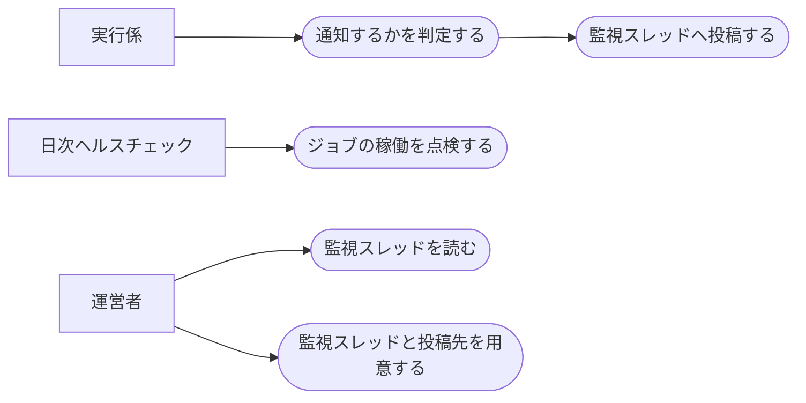

# 失敗通知

ステータス: 仕様確認中(未実装) ／ 優先度: 中

## 概要

運営者の「Digest系5アプリの記事公開のバッチがこのMacで失敗しても、ログを開かないと気づけない」を解決する。 〔提案〕

- **通知の判定**: 実行係(batch-runner)が確定した失敗(自動のやり直しを締めたもの・直らない失敗・手動実行の失敗)と成功した回の警告を受け取り、同じ配信日・編で既に通知済みでなければ通知する仕組み。再試行で直る途中の失敗は実行係が渡してこないので、使い切ってから1回だけ知らせることになる 〔提案〕
- **通知の本文と投稿**: アプリ名・ジョブ名・失敗日時・ログの場所の4要素だけの本文を、Digestチャネルの監視スレッドへ teams-post の仕組みで投稿する。本文に機微情報を載せないために要る 〔提案〕
- **ヘルスチェックの宣言への追加**: 毎朝の定期処理の日次ヘルスチェックに、5アプリ×系統の launchd ジョブと配信サーバーを宣言する。通知の仕組み自体が動かなくなったときの最後の保険として要る 〔提案〕

進め方: batch-runner と同時に作る。監視スレッドの作成と投稿先の登録は運営者の手元作業で、teams-post の投稿先を増やす手順(extend-teams-automation)に従う 〔提案〕

## ユーザーストーリー

- 運営者としては、失敗の通知を Digestチャネルの監視スレッドにまとめて受けたい 〔合意〕
- 運営者としては、記事公開のバッチが失敗したとき、ログを開かなくても Teams で気づきたい 〔提案〕
- 運営者としては、自動で再実行されるアプリは、再実行を使い切るまで通知で騒がれたくない 〔提案〕
- 運営者としては、通知の本文に鍵やエラーの生の文字列が載らないようにしたい 〔提案〕
- 運営者としては、通知の仕組み自体が動かなくなっていることに、毎朝のヘルスチェックで気づきたい 〔提案〕

## ユースケース図

線はアクターとユースケースの関わりを表し、処理の順序ではない。「実行係」が失敗を確定して渡すところまでは batch-runner の仕様が担う。正となる文章は機能要件・ビジネスルール・制約を参照。

## 機能要件

### 通知の判定

実行係が確定して渡してきた失敗(再実行のある記事公開は締まったとき、再実行のない月次見直しは1回目)と、手動実行の失敗・成功したバッチの警告を通知する。同じ配信日・編は失敗で1回、警告で1回しか通知しない 〔提案〕

詳細を開く

- [1] 再実行のない系統(全アプリの月次見直し)は、1回目の失敗で通知すること 〔論理〕
- [2] 再実行のある記事公開(5アプリとも)は、実行係が失敗を確定して渡してきたとき(試行回数が上限に達した、再試行しても直らない失敗、配信日の 18:30 以後の最後の機会で失敗した、前日以前の未着手・再実行待ちを締めた、記録の無い直前の配信日を締めた。いずれも batch-runner の「再実行」が決める)だけ通知し、途中の失敗では通知しないこと 〔論理〕
- [3] 「再試行しても直らない失敗」(設定の誤り・利用枠切れ)で再実行を打ち切った場合は、上限に達していなくても通知すること 〔論理〕
- [4] 手動実行の失敗は、再実行の有無にかかわらず直ちに通知すること(ただし [5] の通知済みが優先する) 〔論理〕
- [5] 同じ配信日・編について既に通知済み(実行係が渡す「既に通知済みかどうか」が真)なら、再び失敗を受け取っても通知しないこと(手動実行の失敗で通知したあとに定時の失敗確定が来る、手動実行が2回続けて失敗する、などのため)。通知済みの印は失敗と警告で別で、失敗を通知した日に手動実行が成功して警告だけ残った場合は警告を通知する。実行係が渡すものはすべて確定済みの失敗(または手動実行の失敗・成功したバッチの警告)なので、試行回数と上限による見送りの判定は持たない 〔論理〕
- [6] 廃止([1] に統合。番号は残す) 〔論理〕
- [7] 判定の結果と理由(通知した・通知済みのため見送り・書き出し失敗)を実行係に返し、実行状態ファイルに残せるようにすること。受け取る項目(確定の理由を含む12項目)と返す項目は batch-runner の付録「失敗通知に渡す項目と返る項目」が正 〔生成物〕

### 通知の本文と投稿

本文はアプリ名・ジョブ名・失敗日時・ログの場所の4要素だけにして、Digestチャネルの監視スレッドへ teams-post の仕組みで投稿する 〔提案〕

詳細を開く

- [1] 本文はアプリ名・ジョブ名(系統と配信日・編)・失敗日時(日本時間)・ログファイルのパスの4要素のみとすること。警告(公開は成功したが新着の送り出しに失敗した)のときは、ジョブ名のあとに「公開は成功、新着の送り出しに失敗」の定型句を添える 〔生成物〕
- [2] エラーの詳細・スタックトレース・Claude の応答・トークンや鍵などの機微情報を本文に含めないこと 〔生成物〕
- [3] 件名の先頭に失敗と分かる印(「【失敗】」。警告のときは「【警告】」)を付け、5アプリの失敗が同じスレッドに並んでも見分けられるようにアプリ名を件名にも入れること 〔生成物〕
- [4] 投稿先は Digestチャネルの監視スレッドとし、teams-post の投稿先の仕組み(投稿先専用の同期フォルダへファイルを書き出し、Power Automate のフローが投稿する)で投稿すること 〔環境〕
- [5] 本文は Teams で読める形(改行が効く形)にすること。ログファイルのパスはリンクにせず文字として書く(このMacの中のパスは Teams からは開けないため) 〔生成物〕
- [6] 投稿用ファイルの書き出しに失敗した場合は、その事実を実行係に返して(理由「書き出し失敗」)実行係のログに失敗の印として残させ、自分では再送や別の経路での通知をしないこと。渡し直しは実行係が次の起動で行う(batch-runner の「失敗の引き渡し」[3]) 〔境界〕

### ヘルスチェックの宣言への追加

5アプリ×系統の launchd ジョブと配信サーバーを、定期処理の日次ヘルスチェックの宣言に加え、通知の仕組みが止まっても毎朝の点検で気づけるようにする 〔提案〕

詳細を開く

- [1] 5アプリ×系統(記事公開・月次見直し)の launchd ジョブと、記事サイトを配信する常駐の配信サーバー(local-site-serving)を、日次ヘルスチェックの宣言に追加すること 〔環境〕
- [2] 週1回のアプリ(research-digest・future-digest)の記事公開と月次見直しのジョブは配信曜日・配信日にしか動かないため、「毎日動くとは限らない」ジョブ(`notAlwaysScheduled`)として宣言すること。このジョブは日次ヘルスチェックの稼働判定の対象外になり(宣言の予定時刻は毎日の時刻しか書けない)、登録の有無だけが点検される。週1回のアプリの取りこぼしは batch-runner の「再実行」[8][9] の締めが次の配信曜日に通知し、通知できなかった記録は「失敗の引き渡し」[3] が渡し直す。月次見直しの取りこぼし(止まっていた日に動かなかった回)は通知されず、見直し案のファイルが無いことで運営者が気づいて手動で補う(batch-runner の「再実行」[5][9])。毎日動く3アプリの記事公開は予定時刻 06:30・10:30・14:30・18:30 の定時ジョブとして宣言する(plist の時刻の一覧と一致させる。batch-runner は毎日のアプリの plist を曜日なしの4件で作る)。毎朝 09:00 の点検では、直前の予定時刻(06:30)以降に成功の印が無ければ異常になるため、06:30 の回が一時的な失敗で再実行待ちの日は点検の報告に異常が出る(再実行で直れば翌日は消える。監視スレッドへの通知は締まるまで出ない) 〔環境〕 【推測: 再実行待ちの日の異常を受け入れる点】
- [3] 実行係のログに、ヘルスチェックが読む成功の印(成功した起動だけに出し、その時刻を最終成功日時として読む)と失敗の印を出し、その文言を宣言に書くこと。失敗の印は正常時の集計行に一致しない文言を選ぶ 〔生成物〕
- [4] 宣言の追加と同時に、Confluence の定期実行カタログにも同じジョブを載せること 〔環境〕

## ビジネスルール・制約

### 通知のタイミング

再実行のある記事公開は「失敗が確定してから1回」、再実行のない月次見直しは「1回目で」。再試行しても直らない失敗と手動実行は待たずに通知する。通知は配信日・編ごとに失敗で最大1回、警告で最大1回 〔提案〕

詳細を開く

- [1] 再実行の仕組みは一時的な失敗からの自動復旧を狙ったものなので、使い切るまでは様子見でよいとすること。根拠: 元の設計(GitHub Actions 版)で運営者が決めた方針を引き継ぐ 〔論理〕
- [2] 再実行の上限回数と「再試行しても直らない失敗」の分類は batch-runner の仕様に従い、この仕様では独自に決めないこと 〔論理〕
- [3] 通知は配信日・編ごとに、失敗で最大1回・警告で最大1回とすること(失敗を通知した日に手動実行が成功して警告だけ残れば、警告の1回が届く)。根拠: ローカルでは再実行の時刻と追い実行のたびに実行係が動くため、抑止が無いと同じ失敗が何度も届く 〔論理〕

### 本文に載せないもの

本文は4要素だけにし、エラーの中身は本文に載せずログを読んでもらう 〔提案〕

詳細を開く

- [1] ログに混ざりうるトークン・鍵・接続情報の断片を Teams に流す経路を作らないため、エラーの詳細は本文に載せないこと。根拠: 元の設計で運営者が決めた方針を引き継ぐ 〔論理〕
- [2] 詳細を知りたいときは、本文に書いたログファイルのパスを運営者が手元で開くこと 〔論理〕

## 非機能要件

- [1] 実行係が失敗を確定してから、監視スレッドへの投稿用ファイルを書き出すまでが1分以内であること 〔非機能〕 〔提案〕
- [2] 通知の判定と本文の組み立てでは Claude を呼ばないこと(呼び出し回数0回) 〔非機能〕 〔提案〕

## 依存関係

実現性: Teams への投稿と日次ヘルスチェックの宣言はできる。監視スレッドへの投稿先(同期フォルダと Power Automate のフロー)は運営者の手元作業で用意する 〔提案〕

詳細を開く

| 依存 | 結論 | 確認内容 |
|---|---|---|
| Digestチャネルの監視スレッドへの投稿先 | できる(手元作業が要る) | 自分専用のチャネルの特定スレッドへ返信する方式は「読み上げ」の投稿先で稼働している。監視スレッドを立て、投稿先専用の同期フォルダとフローを extend-teams-automation の手順で1つ追加する |
| teams-post の投稿の仕組み | できる | 既存の投稿先8つが同じ仕組みで稼働している。launchd から同期フォルダへ書くと失敗する例(BL-053)があり、既存の書き出し方に従う |
| 定期処理の日次ヘルスチェック | できる | 宣言ファイルに追加すれば翌朝から点検される(BL-049)。追加後は判定を手で1回回して確かめる |
| 実行係からの失敗の受け取り | できる | batch-runner の「失敗の引き渡し」で決めた項目を受け取る。先に batch-runner を作る |

## スコープ外

- 失敗の原因の自動診断、再実行以外の自動復旧 〔提案〕
- 通知自体が出せなかったときの二次的な通知(日次ヘルスチェックが最後の保険) 〔提案〕
- 新着記事の通知(teams-broadcast) 〔提案〕
- 「全枠の収集に失敗したときの運営者への警告」のようなアプリ固有の警告(各アプリの仕様) 〔提案〕
- 運営者以外への通知、LINE・メールなど Teams 以外の経路 〔提案〕
- 配信サーバーが止まっていることの検知(日次ヘルスチェックの常駐ジョブの点検に任せる) 〔提案〕
