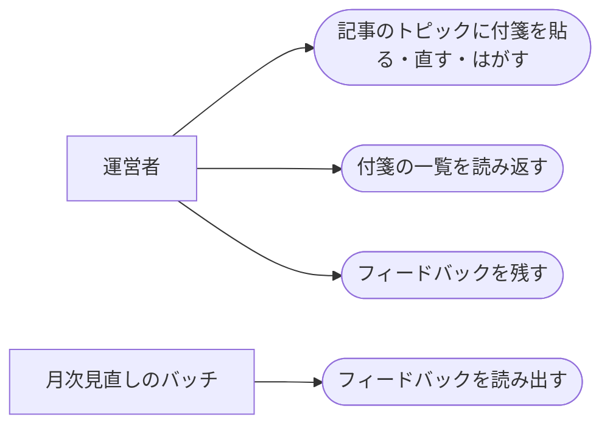

# 読者データの保存

ステータス: 仕様確認中(未実装) ／ 優先度: 低

## 概要

記事サイトの付箋(記事のトピックに貼るメモ付きのブックマーク)と、フィードバック(記事を読みながら運営者が残す自由記述)を、外部のデータベースとログインなしで、このMacの中に保存する。 〔合意〕

- **読者データの保存API**: 配信サーバー([local-site-serving](../local-site-serving/requirements.md))が持つ読み書きの受け口。記事サイトの画面が、付箋の保存・取得・削除とフィードバックの保存に使う。記事サイトと同じアドレスで受けるため、画面側に外部サービスの接続先を持たせずに済む 〔提案〕
- **読者データのファイル**: `~/Library/Application Support/digest/<アプリ名>/` に置く付箋とフィードバックの保存先。記事サイトを作り直しても消えず、月次見直しのバッチがフィードバックを直接読める 〔合意〕

進め方: 付箋は trend-digest を除く4アプリ、フィードバックは5アプリが使う。付箋の貼り方・一覧の画面の仕様は各アプリの既存specのままとし、この仕様は保存先と受け口だけを置き換える 〔提案〕

## ユーザーストーリー

- 運営者としては、付箋とフィードバックを、外部のデータベースでなく配信サーバー経由でこのMacに保存したい 〔合意〕
- 運営者としては、ログインせずに記事に付箋とメモを貼り、あとで一覧から読み返したい 〔提案〕
- 運営者としては、記事を読みながらその場でフィードバックを残し、月次の見直しで読み返されるようにしたい 〔提案〕
- 運営者としては、記事サイトを作り直しても付箋とフィードバックが消えないでほしい 〔提案〕

## ユースケース図

線はアクターとユースケースの関わりを表し、処理の順序ではない。「月次見直しのバッチ」は各アプリの月次見直しのspecが扱い、ここでは読み出せる形で残すことだけを決める。正となる文章は機能要件・ビジネスルール・制約を参照。

## 機能要件

### 付箋の保存

記事サイトの画面から、記事のトピックごとの付箋(メモ付き)を保存・更新・削除し、アプリごとの一覧を取得できる 〔提案〕

詳細を開く

- [1] 付箋は、アプリ名・記事ID・トピックID・メモ本文・最終更新日時を持つこと 〔論理〕
- [2] 1つのトピックに付箋は1件までとし、すでにある場合は新規作成でなく更新として扱うこと 〔論理〕
- [3] メモ本文が空文字・空白だけの場合は保存しないこと。文字数の上限は「ビジネスルール・制約」の「文字数と件数」に従う 〔境界〕
- [4] 付箋を削除すると、そのトピックは再び付箋の無い状態に戻ること 〔論理〕
- [5] 一覧は、アプリごとに最終更新日時の新しい順で返すこと 〔論理〕
- [6] 記事サイトを作り直しても付箋が消えないこと(保存先をビルド成果物の外に置く) 〔環境〕
- [7] trend-digest は付箋を持たないこと 〔論理〕

### フィードバックの保存

記事のトピックごとの自由記述のフィードバックを追記だけで保存し、公開画面には出さず、月次見直しのバッチが読める形で残す 〔提案〕

詳細を開く

- [1] フィードバックは、アプリ名・記事ID・トピックID・本文・保存日時を持つこと 〔論理〕
- [2] 本文が空文字・空白だけの場合は保存しないこと 〔境界〕
- [3] 画面からは追記だけができ、編集・削除・一覧表示はしないこと 〔論理〕
- [4] 月次見直しのバッチが、アプリと期間を指定してフィードバックを読み出せること 〔環境〕
- [5] 記事サイトの画面は、ログインや運営者の判定なしにフィードバックの入力欄を常に表示すること 〔論理〕

### 保存APIの受け口

配信サーバーが 127.0.0.1 の同じアドレスで保存APIを受け、記事サイトの画面は同じ配信元への呼び出しとして使う 〔提案〕

詳細を開く

- [1] 保存APIは記事サイトと同じアドレス・ポートで受けること 〔環境〕
- [2] 127.0.0.1 以外からの呼び出しは受け付けないこと 〔環境〕
- [3] 保存に失敗した場合、画面は入力内容を消さずに失敗を表示し、やり直せること 〔境界〕
- [4] 読者データのファイルが読めない・形が壊れている場合は、壊れたファイルを退避して空から始め、退避したことをログに残すこと 〔境界〕

## ビジネスルール・制約

### 保存場所と形式

読者データは `~/Library/Application Support/digest/<アプリ名>/` に置き、git では管理しない。ファイルの形式(JSONかSQLiteか)は設計で決める 〔合意〕

詳細を開く

- [1] 保存先は `~/Library/Application Support/digest/<アプリ名>/`。根拠: 置き場の決定(記事JSONと設定は git 管理、実行状態・付箋・フィードバックは Application Support)
- [2] 読者データは記事サイトのビルド成果物にも git にも含めない。根拠: 作り直しやコミットで消えたり混ざったりしないため

### 文字数と件数

付箋のメモは200文字まで、1トピックに1件(元の付箋の仕様を踏襲) 〔提案〕

詳細を開く

- [1] 付箋のメモの上限は200文字。根拠: 元の付箋の仕様(一覧のカード表示を圧迫しない目安)
- [2] 1トピックにつき付箋は1件。根拠: 元の付箋の仕様(複数メモの切り替えを持たない単純な運用)

## 非機能要件

- [1] 付箋とフィードバックの保存・取得の応答は1秒以内であること 〔非機能〕 〔提案〕
- [2] 付箋とフィードバックは自動では消さず、保持期間は無期限とすること 〔非機能〕 〔提案〕
- [3] 1アプリあたり付箋・フィードバックとも1万件までは[1]の応答を保つこと(想定は年に数百件) 〔非機能〕 〔提案〕

## 依存関係

実現性: 配信サーバー(launchd)から `~/Library/Application Support/digest/` への書き込みは「できる」。Claude Code の対話から同じ場所を読み書きすることは「未確定」(`permissions.additionalDirectories` への登録が要る)。記事サイトの画面から同じ配信元の保存APIを呼ぶことは「できる」。月次見直しのバッチがファイルを直接読むことは「できる」 〔提案〕

詳細を開く

| 依存 | 結論 | 確認内容 |
|---|---|---|
| 配信サーバー(launchd)から `~/Library/Application Support/digest/` へ書く | できる | launchd のプロセスはサンドボックスの外で動く。読み上げプレーヤーが同じ場所の配下に書いている |
| Claude Code の対話から同じ場所を読み書きする | 未確定 | サンドボックスは `~/Library/` 配下への書き込みを拒否する。`~/.claude/settings.json` の `permissions.additionalDirectories` に `/Users/ryosyamazaki/Library/Application Support/digest` を登録すると書ける(読み上げプレーヤーで実績)。登録は運営者の操作 |
| 記事サイトの画面から同じ配信元の保存APIを呼ぶ | できる | 同じアドレス・ポートへの呼び出しは通常のWeb技術の範囲 |
| 月次見直しのバッチがフィードバックのファイルを読む | できる | launchd から同じ場所を読むだけ |

## UI/UX要件

- 付箋とフィードバックの入力欄・一覧は元の記事サイトの配置のまま、ログインしているかどうかの条件を外して常に使えるようにする 〔提案〕
- 保存に失敗したときは、入力した内容を消さずに失敗を表示する 〔提案〕

## スコープ外

- 複数の読者を分けること、権限の分離、他の人との共有 〔提案〕
- 読者データのバックアップ・他の端末との同期(OSの仕組みに任せる) 〔提案〕
- 付箋の貼り方・一覧の画面の仕様そのもの(各アプリの既存spec) 〔提案〕
- フィードバックを読み返す画面(月次見直しのバッチが読むだけ) 〔提案〕
