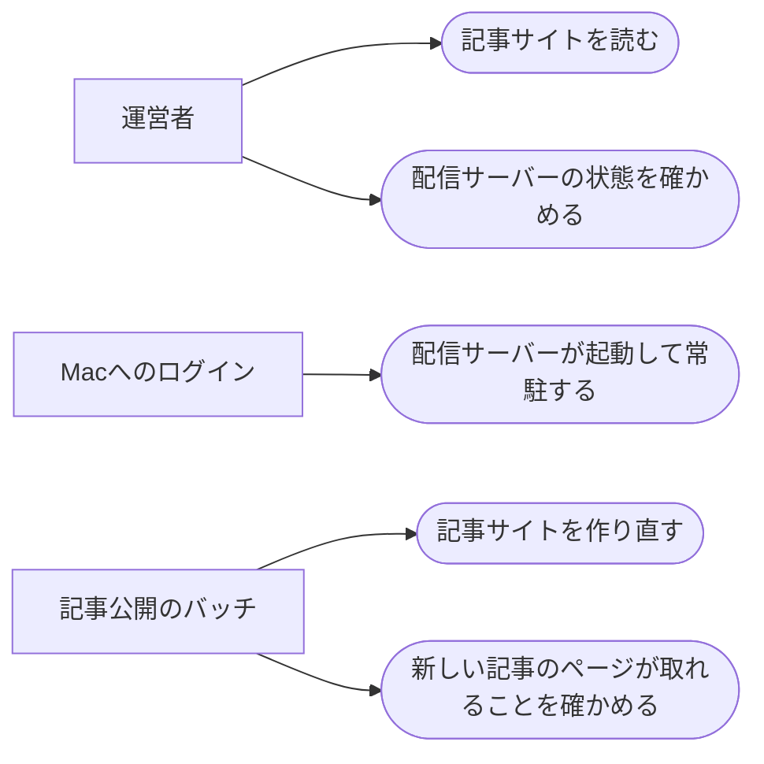

# 記事サイトの配信

ステータス: 仕様確認中(未実装) ／ 優先度: 高

## 概要

Digest系アプリ5種(ai-dev-digest / news-digest / future-digest / research-digest / trend-digest)の記事サイトを、外部のホスティングを使わず、このMacの中だけでブラウザから読めるようにする。 〔合意〕

- **配信サーバー**: 127.0.0.1 で記事サイト(Next.js の静的エクスポートの成果物)を配信する常駐プロセス。ログイン時に起動して常駐し、5アプリのサイトを1つのアドレスの下に同居させる。記事サイトの画面が付箋・フィードバックを保存するための受け口([local-reader-store](../local-reader-store/requirements.md))も兼ねる 〔提案〕
- **サイトの再ビルドと公開確認**: 記事を公開するバッチの最後に、記事JSONから記事サイトを作り直して配信内容を入れ替え、新しい記事のページが配信サーバーから取れることを確かめる処理。新着の通知([teams-broadcast](../teams-broadcast/requirements.md))は、この公開確認が取れてから送る 〔提案〕

進め方: 5アプリの記事JSONの作り方は各アプリのspecで扱い、この仕様は配信の仕組みだけを決める。配信サーバーの実行方法(launchd の登録)は[batch-runner](../batch-runner/requirements.md)と同じ型に揃える 〔提案〕

## ユーザーストーリー

- 運営者としては、記事サイトを外部のサービスに置かず、127.0.0.1 のアドレスをブラウザで開いて読みたい 〔合意〕
- 運営者としては、記事を公開したら、数分以内に新しい記事のページが読める状態になっていてほしい 〔提案〕
- 運営者としては、Macを再起動しても、配信サーバーが自分で立ち上がっていてほしい 〔提案〕
- 運営者としては、5アプリの記事サイトを1つのアドレスの下で行き来したい 〔提案〕

## ユースケース図

線はアクターとユースケースの関わりを表し、処理の順序ではない。「記事公開のバッチ」は各アプリの公開処理で、その起動は[batch-runner](../batch-runner/requirements.md)が担う。正となる文章は機能要件・ビジネスルール・制約を参照。

## 機能要件

### 記事サイトの配信

配信サーバーは、記事サイトの静的な成果物(ページ・CSS・JS・画像)を 127.0.0.1 の固定した1つのポートで配信し、5アプリのサイトをアプリ名ごとの階層に同居させる 〔提案〕

詳細を開く

- [1] 配信サーバーは、記事サイトのビルド成果物(ページのHTML・CSS・JS・画像・図解の描画に要るファイル)をそのまま返すこと 〔環境〕
- [2] 5アプリの記事サイトは1つの配信サーバーの下で、アプリ名ごとの階層(例: `/ai-dev-digest/`)に同居し、一覧ページ・記事ページ・付箋一覧ページはその階層の下に置くこと 〔論理〕
- [3] 末尾が `/` のアドレス(記事ごとのフォルダ)には、そのフォルダの索引ページを返すこと。Next.js の静的エクスポートは記事ごとにフォルダと索引ページの形で出力するため 〔境界〕
- [4] 存在しないアドレスには「見つからない」を返し、別のページを代わりに返さないこと 〔境界〕
- [5] 127.0.0.1 以外(同じネットワークの他の端末・外部)からの接続は受け付けないこと 〔環境〕
- [6] 外部のCDN・フォント・スクリプトを読み込まずに表示できること(Mermaidの図解の描画を含む) 〔環境〕

### 配信サーバーの常駐

配信サーバーは launchd の常駐ジョブとしてMacへのログイン時に起動し、落ちても自動で立ち上がり直す 〔合意〕

詳細を開く

- [1] Macへのログイン時に自動で起動し、常駐すること 〔環境〕
- [2] 異常終了した場合、自動で再起動すること 〔環境〕
- [3] ポートは固定の1つとし、このMacの他の常駐サービス(読み上げプレーヤー等)と衝突しない値にすること 〔環境〕
- [4] 起動・停止・ポート番号・ログの場所を、運営者が手元のターミナルで確かめられること(手順は `apps/digest-platform/README.md` に書く) 〔環境〕
- [5] 毎朝の定期処理の日次点検(ヘルスチェック)で配信サーバーが動いているかを確かめられるよう、生存の目印(応答、または最終起動時刻のログ)を出すこと 〔環境〕

### 日次ヘルスチェックへの宣言

配信サーバーの launchd の常駐ジョブを、このMacの定期処理の日次ヘルスチェックの宣言に加え、止まっていたら毎朝の点検で気づけるようにする 〔提案〕

詳細を開く

- [1] 配信サーバーの常駐ジョブを、生存の目印を読む形で日次ヘルスチェックの宣言に追加し、Confluence の定期実行カタログにも載せること 〔環境〕

### サイトの再ビルドと公開確認

記事公開のバッチの最後に、記事JSONから記事サイト全体を作り直して配信内容を入れ替え、新しい記事のページが配信サーバーから取れることを確かめる 〔提案〕

詳細を開く

- [1] 記事JSONが追加・更新されたら、そのアプリを含む記事サイト全体を作り直すこと 〔生成物〕
- [2] 作り直しの途中で古いサイトが消えて読めない時間ができないよう、完成した成果物で配信内容を入れ替えること 〔並行〕
- [3] 作り直しに失敗した場合、古い成果物を配信し続け、失敗を実行係([batch-runner](../batch-runner/requirements.md))に伝えること(失敗通知の対象になる) 〔境界〕
- [4] 入れ替えのあと、新しい記事のページを配信サーバーから取得し、取れたことを公開確認の成功とすること。取れない場合は失敗として扱い、新着の通知を出させないこと 〔境界〕
- [5] 公開確認は非機能要件の待ち時間の中で取れなければ失敗にすること 〔境界〕
- [6] 運営者が手元のターミナルから、同じ再ビルドと公開確認を1つのコマンドで実行できること 〔環境〕

## ビジネスルール・制約

### 配信の範囲

記事サイトはこのMacの中だけで読み、外部公開・他の端末からの閲覧・認証は持たない。読者は運営者本人1人 〔合意〕

詳細を開く

- [1] 配信サーバーは 127.0.0.1 だけで待ち受ける。根拠: ローカルPCだけで完結する方針(運営者の指定)
- [2] ログイン・認証の仕組みは持たない。根拠: 読者が運営者本人1人のため、複数読者を分ける必要がない

### 記事のアドレスの形

記事ページのアドレスは「配信サーバーのアドレス + アプリ名の階層 + 記事ID」の1つの形に固定し、新着の通知・付箋一覧・一覧ページがすべて同じ形を使う 〔提案〕

詳細を開く

- [1] 記事ページのアドレスは配信サーバーのアドレスとポート、アプリ名の階層、記事IDの順で組み立て、この組み立て方を1か所で決めて全員が参照する。根拠: 通知と画面でアドレスの形がずれると、開けないリンクが届く
- [2] 記事サイトは `file://` で直接開く使い方をしない。根拠: Next.js の静的エクスポートは絶対パスでCSS・JSを参照し、記事ごとのフォルダのアドレスも索引ページに解決されないため、`file://` では表示とリンクが壊れる

## 非機能要件

- [1] 再ビルドの開始から公開確認の完了まで、5分以内に終わること 〔非機能〕 〔提案〕
- [2] 公開確認の待ち時間は最大60秒とし、それを過ぎたら失敗にすること 〔非機能〕 〔提案〕
- [3] 記事ページの応答は1秒以内であること 〔非機能〕 〔提案〕
- [4] 配信サーバーが異常終了してから再起動するまで、30秒以内であること 〔非機能〕 〔提案〕

## 依存関係

実現性: launchd で常駐する 127.0.0.1 のサーバーは「できる」(読み上げプレーヤーで稼働実績)。launchd から Next.js のビルドを実行することは「未確定」(Node の絶対パスと所要時間を実機で確かめる)。Teams の通知から 127.0.0.1 のリンクを開くことは「未確定」([teams-broadcast](../teams-broadcast/requirements.md)で確かめる)。Claude Code のサンドボックスから配信サーバーに接続して動作確認することは「できない」(手元のターミナルで行う) 〔提案〕

詳細を開く

| 依存 | 結論 | 確認内容 |
|---|---|---|
| launchd の常駐ジョブで 127.0.0.1 のサーバーを動かす | できる | 読み上げプレーヤー(127.0.0.1:18765)が同じ方式で稼働中 |
| launchd から Next.js のビルドを実行する | 未確定 | launchd は PATH を継承しないため Node を絶対パスで指定する。所要時間が非機能要件[1]に収まるかを実機で確かめる |
| Teams の通知から 127.0.0.1 のリンクを開く | 未確定 | teams-broadcast の実機確認で決める。開けない場合は通知にローカルパスを併記して補う |
| Claude Code のサンドボックスから配信サーバーへ接続する | できない | サンドボックスは 127.0.0.1 への接続を拒否する(`Operation not permitted`)。動作確認は手元のターミナルで行う |
| Mermaid の図解をオフラインで描画する | できる | 元の記事サイトは Mermaid を npm 同梱で読み込んでおり、CDN に依存しない |

## UI/UX要件

- 記事サイトの画面には、ログイン状態の表示・ログインボタンを置かない 〔提案〕
- 5アプリの一覧ページ・記事ページ・付箋一覧ページの配置と見た目は、元の記事サイトのまま保つ 〔提案〕

## スコープ外

- 外部への公開、同じネットワークの他の端末からの閲覧、HTTPS、認証 〔提案〕
- 記事JSONの作り方・記事の選定と要約(各アプリのspec) 〔提案〕
- 付箋・フィードバックの保存の中身([local-reader-store](../local-reader-store/requirements.md)) 〔提案〕
- 配信サーバーの起動・停止を Claude Code の対話から行うこと(launchctl はサンドボックスで使えないため、手元のターミナルで行う) 〔提案〕
