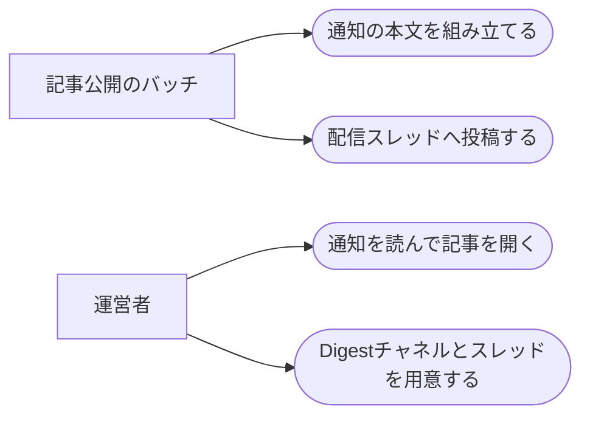

# 新着記事のTeams通知

ステータス: 仕様確認中(未実装) ／ 優先度: 中

## 概要

Digest系アプリ5種の記事が公開されたことを、LINE の代わりに、Teams の自分専用チャネル(Digestチャネル)にアプリごとに立てたスレッドへ通知する。 〔合意〕

- **Digestチャネルと配信スレッド5本**: 新設する自分専用の Teams チャネルに、5アプリ分の親メッセージ(スレッド)を立て、各アプリの新着はその返信として届く。チャネル・スレッド・投稿先の登録は運営者が手元で行う 〔合意〕
- **新着通知の本文**: 記事タイトル・その回の見出し一覧・記事ページのアドレス・記事ページのローカルパスを並べた HTML 断片。通知を見てすぐ記事を開くために要る 〔提案〕
- **通知の送り出し**: 記事公開のバッチが公開確認([local-site-serving](../local-site-serving/requirements.md))を取ったあとに、既存の Teams 投稿の仕組み(teams-post)で配信スレッドへ送る処理 〔提案〕

進め方: 失敗の通知は監視スレッドへ送り、[failure-notification](../failure-notification/requirements.md)が扱う。投稿先の新設(チャネル・スレッド・Power Automate のフロー)は extend-teams-automation の手順で運営者が行い、この仕様の実装の前提になる 〔提案〕

## ユーザーストーリー

- 運営者としては、新着記事の通知を LINE でなく Teams で受け取りたい 〔合意〕
- 運営者としては、新設のチャネルの中に配信の項目ごと(5アプリ)にスレッドを立て、そこに配信してほしい 〔合意〕
- 運営者としては、土曜・日曜の配信も当日に受け取りたい 〔合意〕
- 運営者としては、通知から記事をすぐ開きたい 〔提案〕

## ユースケース図

線はアクターとユースケースの関わりを表し、処理の順序ではない。「記事公開のバッチ」の起動と成否の判定は[batch-runner](../batch-runner/requirements.md)が担う。正となる文章は機能要件・ビジネスルール・制約を参照。

## 機能要件

### 通知の本文

記事タイトル・その回の見出し一覧・記事ページのアドレス・記事ページのローカルパスを、Teams で読める HTML 断片として組み立てる 〔提案〕

詳細を開く

- [1] 記事タイトルは記事ページに表示されるものと同一にし、通知用の文言を別に作らないこと 〔論理〕
- [2] 見出し一覧は、その回の記事に載った順で全件載せること 〔論理〕
- [3] 記事ページのアドレスは配信サーバーの記事ページ1本だけにし、トピックごとの出典のアドレスは載せないこと 〔論理〕
- [4] 記事ページのローカルパス(ビルド成果物の HTML の絶対パス)を、リンクにせずプレーンな文字で併記すること(`file://` で包まない) 〔生成物〕
- [5] 本文は HTML 断片で組み立てること(改行は ` `、リンクは `<a>`)。折りたたみは Teams で効かないため使わないこと 〔生成物〕
- [6] 本文の先頭にアプリを表す接頭辞(例: 【AI駆動開発ダイジェスト】)を付け、1行目でアプリと記事タイトルが分かること 〔生成物〕

### 通知のタイミングと回数

公開確認が取れた回だけ、1回の公開につき1回通知し、失敗しても再送しない 〔提案〕

詳細を開く

- [1] 公開確認([local-site-serving](../local-site-serving/requirements.md)の「サイトの再ビルドと公開確認」)が成功したあとに送ること 〔論理〕
- [2] 1回の公開につき1回だけ送り、再実行で同じ記事が再び公開された場合は送らないこと 〔論理〕
- [3] 公開確認が失敗した回は送らないこと(開けないリンクを送らない) 〔論理〕
- [4] 通知の送り出しに失敗しても、記事の公開そのものは成功として扱うこと。送り出しの失敗は実行状態に記録し、失敗通知([failure-notification](../failure-notification/requirements.md))の対象にすること 〔境界〕
- [5] 運営者が手元で公開のバッチを実行した場合も送ること。ただし[2]のとおり、すでに送った記事は送らない 〔論理〕

### 配信スレッドへの投稿

アプリごとの配信スレッド(teams-post の投稿先)へ、既存の Teams 投稿の仕組みで投稿する 〔提案〕

詳細を開く

- [1] アプリと投稿先(配信スレッド)の対応を設定に持ち、5アプリ分を登録すること 〔論理〕
- [2] 投稿は既存の teams-post の仕組み(投稿先フォルダへのファイルの書き出し)で行い、Teams へ HTTP で直接送らないこと 〔環境〕
- [3] 対応する投稿先が設定に無いアプリは、通知を失敗として扱うこと 〔境界〕
- [4] 定期実行(launchd)から呼ばれたときも、投稿先フォルダへ書き出せること 〔環境〕

## ビジネスルール・制約

### 土日祝の扱い

定時投稿を土日祝に止めるルールの例外として、土曜・日曜の配信も当日に通知する 〔合意〕

詳細を開く

- [1] research-digest の土曜、future-digest の日曜の配信は、当日に通知する。根拠: 運営者の決定(曜日ごとの編の分割の意味を保つ)。業務の通知ではなく個人向けの配信のため、土日祝に定時投稿を止めるルールの対象にしない

### 本文に載せないもの

要約の全文・出典のアドレス・処理の失敗の詳細は本文に載せない 〔提案〕

詳細を開く

- [1] 要約の全文は載せず、記事ページへ誘導する。根拠: 元の配信の仕様(タイトル・見出し一覧・リンクの3要素)
- [2] 出典のアドレスは載せない。根拠: 元の配信の仕様
- [3] 失敗の詳細は載せない。失敗は[failure-notification](../failure-notification/requirements.md)が監視スレッドへ送る

### 投稿先の構成

Digestチャネルには配信スレッド5本と監視スレッド1本を立て、スレッド1本を teams-post の投稿先1つとして登録する 〔提案〕

詳細を開く

- [1] チャネルは新設の自分専用チャネル1つ、スレッドはアプリごとの配信スレッド5本と監視スレッド1本。根拠: 運営者の指定
- [2] スレッド1本が投稿先1つに対応し、投稿先ごとに専用のフォルダと Power Automate のフローを用意する(extend-teams-automation の「特定スレッドへの返信」方式)。根拠: teams-post は投稿先ごとにフォルダとフローを持ち、スレッドへの返信はフロー側の作りで決まる
- [3] 親メッセージ(スレッドの起点)は消さない。根拠: フローは親メッセージのIDに固定して返信するため、消すと届かなくなる

## 非機能要件

- [1] 公開確認の成功から Teams に通知が届くまで、10分以内であること(フローの起動の遅れを含む) 〔非機能〕 〔提案〕
- [2] 通知は週に10件程度(日次1アプリ+週次4アプリ分)で、1回の公開につき1件を超えないこと 〔非機能〕 〔提案〕

## 依存関係

実現性: teams-post 経由の Teams 投稿は「できる」。スレッドへの返信方式は「できる」(読み上げの投稿先で稼働実績。ただしプライベートチャネルでの返信は「未確定」で実投稿で確かめる)。Teams の通知から 127.0.0.1 のリンクを開くことは「未確定」。Digestチャネル・スレッド・投稿先6つの新設は運営者の手元作業で「未着手」 〔提案〕

詳細を開く

| 依存 | 結論 | 確認内容 |
|---|---|---|
| teams-post 経由で Teams に投稿する | できる | 自分専用チャネルへの投稿先8つが稼働中。HTTP の直接投稿は組織の DLP で不可のため、この経路だけを使う |
| 特定のスレッドへの返信として投稿する | できる | 読み上げの投稿先が同じ方式で稼働中。プライベートチャネルでの返信の可否は未確認のため、新設時の実投稿で確かめる |
| Teams の通知から 127.0.0.1 のリンクを開く | 未確定 | 実機で確かめる。開けない場合は本文のローカルパスを手で開く運用にし、設計で代替(ブラウザで開くコマンドの併記など)を決める |
| Digestチャネル・スレッド6本・投稿先6つの新設 | 未着手 | extend-teams-automation の手順で運営者が行う。フォルダ6つ+Power Automate のフロー6本 |
| launchd から投稿先フォルダ(OneDrive)へ書く | できる | 既存の定期処理(夜間バッチ・監視通知)が同じ経路で投稿している |

## UI/UX要件

- 通知はアプリごとのスレッドに積み重なり、スレッドを開けばそのアプリの配信の履歴として読める 〔提案〕
- 通知の1行目でアプリと記事タイトルが分かり、記事ページのリンクとローカルパスが本文の中に並ぶ 〔提案〕

## スコープ外

- 複数人への配信・ブロードキャスト、LINE 公式アカウントの運用 〔提案〕
- 失敗通知の本文と判定([failure-notification](../failure-notification/requirements.md)) 〔提案〕
- Teams のチャネル・スレッド・フローの作成手順そのもの(extend-teams-automation) 〔提案〕
- 複数の記事をまとめて送ること、翌営業日にずらして送ること 〔提案〕
