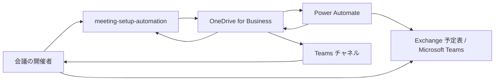
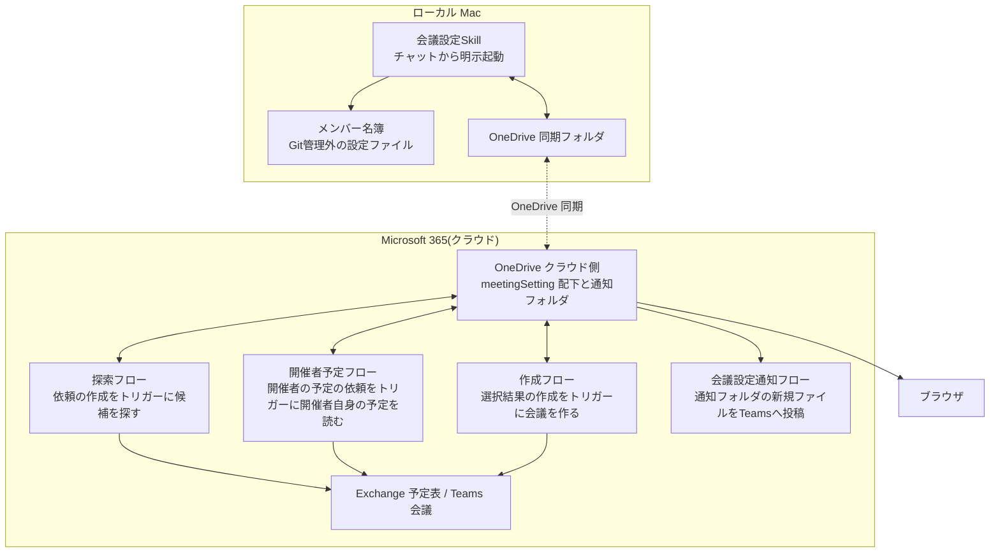

# meeting-setup-automation アーキテクチャ

## 概要

社内会議の日程調整とTeams会議の作成・招待を自動化するアプリ。チャットで件名・参加者・所要時間・アジェンダを伝えると、参加者全員が空いている候補枠を提示し、選んだ枠でTeams会議を作成して参加者を招待する。録画とファシリテーターの有効化は、作成完了通知に含まれる会議オプション画面の直リンクから開催者が手動で行う 〔合意〕

参加者全員は空いていて開催者自身の予定だけが重なる枠は、候補とは別に「開催者の予定のみ重なる枠」として重なる予定の件名と一緒に示し、候補と同じように選べる 〔合意〕

チャットから明示的に起動するSkillが起点で、参加者全員の空き時間の探索・開催者自身の予定の取得・会議の作成はテナント側のPower Automateフローが担い、両者はOneDrive上のファイルを介して連携する。M365テナントへのAPI認証(Entra IDアプリ登録・テナント管理者同意)を必要としない点は`teams-transcript-fetcher`と共通で、認証はOneDrive同期クライアントとPower Automateのコネクタに委ねる。specは1つで、[meeting-scheduling](meeting-scheduling/requirements.md)が候補提示からTeams会議の作成・招待までを担う 〔合意〕

## アーキテクチャの目的

M365テナントへのAPI認証を一切必要とせず、追加ライセンスなしで利用できる範囲の機能だけで、会議の日程調整と作成を自動化する 〔合意〕

<details><summary>詳細を開く</summary>

このアプリ固有の制約として、以下がすべて使用できない前提で構成を組む。

- Microsoft Graphのオンライン会議リソース(録画の自動開始・会議オプションの設定・共同開催者ロールはここにしか存在しない。到達できるのはMicrosoft Teamsコネクタのパススルーだけで、その接続にオンライン会議を読み書きする権限が無い)
- Power Automateのプレミアムコネクタ・カスタムコネクタ・素のHTTPアクション(割り当てライセンスの対象外)
- Power AutomateのHTTP要求受信トリガー(組織のPower Platform DLPポリシーでブロックされる)
- Claude Code実行環境からの外部ネットワーク通信(サンドボックスで遮断されている)

</details>

## 設計方針

外部との通信はPower Automateに寄せてSkillはファイルの読み書きだけを行う。Skillは常駐せず「待つ側」に立ち、判断はSkill側に一本化してフローは頼まれたことだけをする。自動化できない設定は手動操作を最短にする形で残し、候補の選択画面はブラウザで開ける場所に置く 〔合意〕

<details><summary>詳細を開く</summary>

**1. 外部との通信はPower Automateに寄せ、Skillはファイルの読み書きだけを行う**

Skillが動く実行環境は外部ネットワークが遮断されているため、カレンダーの参照も会議の作成もSkillからは行えない。外部と話す役はすべてPower Automateフローに置き、Skillとフローの境界をOneDrive上のファイルに限定する。

**2. Skillは「待つ側」に立ち、常駐プロセスを持たない**

候補の提示と作成完了の通知は、依頼を出したSkillのセッション自身が台帳の到着を待って行う。監視バッチもlaunchdジョブも新設しない。想定利用が月に数回であり、常駐する仕組みを維持するコストが利便性に見合わないため。待ち時間の上限を超えた場合は待ちを打ち切り、依頼IDを指定した再起動で続きから再開する。

**3. 判断はSkill側に一本化し、フローは「頼まれたことだけをする」役に徹する**

候補が0件だったときの代替案の組み立て、参加者の名前解決、開催者の予定のみ重なる枠の切り出しと予定との突き合わせ、選択結果の妥当性判定はすべてSkill側に置く。フローは「渡された条件で探す」「渡された範囲で開催者自身の予定を読む」「渡された枠で作る」だけを行う。判断ロジックがフローとSkillに分かれると、片方だけ変更したときに静かに壊れるため。

**4. 自動化できない設定は「手動操作を最短にする」形で残す**

録画の自動開始とファシリテーター機能の有効化は自動化できない(理由は[技術的制約](#技術的制約)と[adr/0001](adr/0001-manual-recording-and-facilitator.md))。これを機能の不成立とはせず、会議作成の応答から会議オプション画面の直リンクを取り出して通知に載せることで、手動操作をリンク1回とトグル操作に縮める。

**5. 候補の選択画面はブラウザで開ける場所に置く**

選択画面のURLをTeams通知で受け取れるようにするため、選択画面はローカルのファイルパスではなくOneDrive上に置き、ブラウザで表示される形式のURLで開く。ローカルファイルとして開く前提にすると、ターミナルの前にいないと選択に進めない。

</details>

## コンテキスト図



図は本アプリとその外側にあるものの境界の俯瞰。内部構成は[システム構成図](#システム構成図)を参照。

- `Power Automate` は空き時間の探索・開催者自身の予定の取得・会議の作成を担う外部の実行環境で、テナント側に存在しこのリポジトリでは管理しない 〔合意〕
- 本アプリと `Power Automate` は直接通信せず、`OneDrive` 上のファイルを介してやり取りする 〔合意〕
- 候補選択画面もOneDrive上に置き、開催者はブラウザで開いて候補を選ぶ 〔合意〕
- Teamsへの通知は、本アプリがOneDriveへ書き出したファイルを通知フローが投稿する形で開催者へ届く。投稿先ごとに専用フォルダと専用フローが1組必要なため、この機能用の通知フローも新設する 〔合意〕
- 開催者から `Exchange 予定表 / Microsoft Teams` への直接の線は、会議オプション画面での録画・ファシリテーターの手動有効化を表す 〔合意〕

## システム構成図



図は実際に使うコンポーネントの俯瞰。フローとOneDriveの間の両方向の線は、トリガーとなるファイルを読んで結果のファイルを書き出す往復を表す。文章での説明は[アーキテクチャ概要](#アーキテクチャ概要)。

## アーキテクチャ概要

Skillが依頼を書き出すと探索フローが候補を返し、Skillが選択画面を作って通知する。開催者が選んだ1行をチャットに貼るとSkillが選択結果を書き出し、作成フローが会議を作って作成結果を返し、Skillが完了を通知する。開催者の予定のみ重なる枠があるときは、選択画面を作る前に開催者の予定の依頼と取得の往復が1回入る 〔合意〕

<details><summary>詳細を開く</summary>

開催者がチャットでSkillを起動すると、Skillはメンバー名簿で参加者名をメールアドレスに解決し、探索条件を添えた**依頼**をOneDriveの依頼フォルダへ書き出す。依頼は同期を経てクラウド側に届き、それをトリガーに探索フローが参加者全員の空き時間を探索し、**候補**を候補フォルダへ書き出す。

Skillは候補の到着を待ち、届いた候補から**候補選択画面**を生成してOneDrive上に置く。同期完了後、その画面のURLを通知フォルダ経由でTeamsへ通知し、同じURLをチャットにも表示する。候補が0件だった場合は、条件を段階的に緩めるのではなく2つの代替案を同時に用意して開催者に選ばせる。仮の予定を空きとみなした候補は受け取った候補を絞り直すだけで作り、期間と時間帯を広げた候補は依頼を1件増やして取り直す(詳細は[meeting-scheduling/requirements.md#候補が0件のときの代替案の提示](meeting-scheduling/requirements.md#候補が0件のときの代替案の提示))。

参加者全員は空いていて開催者自身の予定だけが重なる枠は、候補には数えず、選択画面の最後の区画に**開催者の予定のみ重なる枠**として並べる。重なる予定の件名・時刻・空き状況の種別は、Skillが**開催者の予定の依頼**を書き出し、それをトリガーに開催者予定フローが開催者自身の既定カレンダーを読んで**開催者の予定**を書き出すことで得る。取得できなくても枠の提示は止めない(詳細は[meeting-scheduling/requirements.md#開催者の予定のみ重なる枠の提示](meeting-scheduling/requirements.md#開催者の予定のみ重なる枠の提示)、経緯は[adr/0003](adr/0003-organizer-own-events-flow.md))。

開催者はブラウザで選択画面を開き、候補を1つ選んで選択結果をコピーし、チャットに貼る。Skillは貼られた内容から依頼IDと候補を特定して**選択結果**を選択結果フォルダへ書き出す。これをトリガーに作成フローが選択された枠でTeams会議を作成し、参加者を招待して、**作成結果**を作成結果フォルダへ書き出す。

Skillは作成結果の到着を待ち、会議の日時・参加者・参加URLと、会議本文から取り出した会議オプション画面の直リンクをTeamsとチャットへ知らせる。開催者はその直リンクから録画とファシリテーターを手動で有効化する。

待ち時間の上限を超えた場合、Skillは待ちを打ち切って終了する。依頼IDを指定して再度起動すると、その依頼の待ち合わせの続きから再開する(設計方針2)。

</details>

## 採用技術

Claude Code Skill・Power Automate(クラウドフロー、Office 365 Outlookコネクタ)・OneDrive同期クライアント・静的HTML・teams-post Skillの5つで構成し、プレミアムコネクタ・カスタムコネクタは使わない 〔合意〕

<details><summary>詳細を開く</summary>

| 技術 | 用途 |
|---|---|
| Claude Code Skill | 依頼の組み立て、名前解決、候補の絞り込み、候補選択画面の生成、待ち合わせ、通知内容の作成。手順は`~/.claude/skills/meeting-setup/`、処理は`application/`のPythonスクリプト |
| Power Automate(クラウドフロー) | 参加者の空き時間の探索、開催者自身の予定の取得、Teams会議の作成と招待 |
| Office 365 Outlookコネクタ | 予定表への到達手段。空き時間の探索・開催者自身の予定の取得(専用アクション「イベントのカレンダー ビューの取得 (V3)」)・会議の作成に使う。**プレミアムコネクタ・カスタムコネクタは利用できない** |
| OneDrive 同期クライアント | M365への認証代行およびクラウドとローカルのファイル受け渡し |
| 静的HTML | 候補選択画面。ブラウザで開くだけで動作し、サーバーを持たない |
| teams-post Skill | 通知フォルダへの書き出しによるTeams投稿 |

</details>

## 非機能要件への対応

利用規模(月に数回・参加者5名程度)の中で依頼を取り違えないことは台帳のファイル名に依頼IDを持たせる方式で、対話セッションからのみ実行することは常駐・定期実行の仕組みを一切持たない構成で担保する 〔提案〕

<details><summary>詳細を開く</summary>

数値目標はspec側が正で、ここには何で担保するかだけを書く。

| 非機能要件 | 実現方式 | 関連spec |
|---|---|---|
| 月に数回・参加者5名程度の利用規模で、複数の依頼が同時に走らなくても依頼IDによる取り違えが起きない | 6種類の台帳ファイルすべてのファイル名に依頼IDを含め、同じ依頼IDのファイルだけを突き合わせる。常駐プロセスを持たず、依頼を出したセッション自身が待つ | [meeting-scheduling/requirements.md#非機能要件](meeting-scheduling/requirements.md#非機能要件) [1] |
| このMac上のチャットセッションからのみ実行し、定期実行・無人実行を行わない | launchd・cron・条件監視の仕組みを持たず、チャットからの明示起動と依頼IDを指定した再開だけを入口にする | [meeting-scheduling/requirements.md#非機能要件](meeting-scheduling/requirements.md#非機能要件) [2] |

</details>

## 機能一覧表(機能マップ)

| spec | 機能(利用者から見て) | 役割 | 依存 | 状態 |
|---|---|---|---|---|
| [meeting-scheduling](meeting-scheduling/requirements.md)([設計](meeting-scheduling/design.md)) | 参加者と所要時間を伝えるだけで候補が出て、選ぶだけでTeams会議が作られる | 空き時間から候補を提示し、開催者の予定のみ重なる枠を重なる予定の件名付きで別に示し、選択された枠でTeams会議を作成して招待する | Power Automateフロー4本(探索フロー・開催者予定フロー・作成フロー・会議設定通知フロー)の新設、会議設定通知の投稿先の登録、OneDrive同期クライアントの稼働 | リリース済み |

## ディレクトリ構成

CLAUDE.mdの規約(`infra/` + `application/`)から逸脱し、`infra/` を持たず `application/` と `specs/` だけを置く。チャット向けの手順(SKILL.md)とメンバー名簿はリポジトリの外に置く 〔合意〕

<details><summary>詳細を開く</summary>

```
apps/meeting-setup-automation/
├── application/     # 処理スクリプト・候補選択画面のテンプレート・テスト
└── specs/           # 仕様3点セット
```

- **`infra/` を持たない。** クラウドリソースを作らないため、Terraformの管理対象がない
- Power Automateのフロー定義はテナント側に存在し、このリポジトリでは管理しない。構築に使ったフローの設定内容と手順は `application/` 配下に記録する
- **チャット向けの手順(SKILL.md)はこのリポジトリに置かない。** `~/.claude/skills/meeting-setup/` に置き、処理はここの `application/` を絶対パスで呼ぶ(`night-batch`・`extend-teams-automation`と同じ形)
- メンバー名簿は個人情報を含むためGit管理下に置かず、`~/Library/Application Support/meeting-setup-automation/roster.json` に置く(リポジトリには記入例だけを置く)

</details>

## 外部サービス

Exchange 予定表・Microsoft Teams・OneDrive for Business・Power Automateの4つに依存し、いずれもPower Automateのコネクタと同期クライアントを通じて使う 〔合意〕

<details><summary>詳細を開く</summary>

| サービス | 用途 |
|---|---|
| Exchange 予定表 | 参加者の空き時間の参照、開催者自身の予定の参照、会議の作成先 |
| Microsoft Teams | 会議の実体(参加URL・会議オプション)と、通知の届け先チャネル |
| OneDrive for Business | 依頼・候補・開催者の予定の依頼・開催者の予定・選択結果・作成結果・候補選択画面の置き場。およびM365への認証代行 |
| Power Automate | 空き時間の探索、開催者自身の予定の取得、会議の作成 |

</details>

## 外部連携IF一覧

Power Automateフロー4本とはOneDrive上のJSONファイル(探索・開催者予定・作成の3本はSkillが書いてフローが返す往復)とHTML断片(会議設定通知フローはSkillが書いてフローが投稿するだけ)で連携する。このほかに、Skillが置いた候補選択画面(静的HTML)を開催者がブラウザで読む連携が1つある。遅延・欠損は待ち上限5分の打ち切りと依頼IDでの再開で、失敗はフローが書き出す失敗理由で扱う 〔提案〕

<details><summary>詳細を開く</summary>

フォルダ名・ファイル名・JSONの形・HTML断片の書式は [meeting-scheduling/appendix.md](meeting-scheduling/appendix.md) の「台帳ファイルの書式」が正。接続先URLと認証情報はPower Automateの接続(テナント側)にあり、このリポジトリには書かない。

| 連携 | 相手 | Skillが書くもの | 返ってくるもの | 遅延・欠損 | 相手の失敗 | 重複 | 形式不正 | 疎通確認 |
|---|---|---|---|---|---|---|---|---|
| 候補の探索 | 探索フロー | 依頼(`request/` のJSON) | 候補(`candidates/` のJSON) | 待ち上限5分で打ち切り、台帳を残して依頼IDで再開する | フローは失敗理由を入れた候補を書き、Skillは理由を伝えて終了する(代替案2の候補の失敗は手元の枠の提示を続ける) | 同じ依頼ID・試行番号の依頼は1回だけ書く。フローは同じ名前のファイルを上書きする | 読めない・途中まで書かれている間は「まだ来ていない」として待ち、上限で打ち切る | tasks.md の実機確認E1と動作確認チェックリスト |
| 開催者の予定の取得 | 開催者予定フロー | 開催者の予定の依頼(`organizerEventsRequest/` のJSON) | 開催者の予定(`organizerEvents/` のJSON) | 待ち上限5分で打ち切り、件名なしで枠を提示する。再開時は予定ファイルがあれば使い、無ければ待ちから続ける | フローは失敗理由を入れた予定ファイルを書き、Skillは件名なしで枠を提示して理由を添える | 同じ依頼IDでは1回だけ書く(試行番号・再試行番号を持たない) | 読めない間は待ち、上限で打ち切って件名なしで提示する。知らない種別・非公開の値は「不明」・件名そのままとして読む | tasks.md の実機確認E8・E9(開催者予定フローの構築時) |
| 会議の作成 | 作成フロー | 選択結果(`selection/` のJSON) | 作成結果(`result/` のJSON) | 待ち上限5分で打ち切り、台帳を残して依頼IDで再開する | フローは失敗理由を入れた作成結果を書き、Skillは作成失敗として伝え、開催者の指示があるときだけ再試行番号を増やして書き直す | 1つの再試行番号につき1回だけ書く。成功した作成結果がある依頼IDでは書かない | 読めない間は待ち、上限で打ち切る。会議本文から直リンクを取り出せない場合は会議の作成を失敗とせず代替手順を通知する | tasks.md の実機確認E2〜E4と動作確認チェックリスト |
| Teams通知 | 会議設定通知フロー | 通知ファイル(`teamsNotice/meetingSetting/` のHTML断片) | なし(フローがチャネルへ投稿する) | 通知が届かなくてもチャットの表示で作業を続ける | 書き出しに失敗してもチャットへ表示して処理を続ける | 通知1件につき1ファイル。再開時に同じ通知を出し直すことがある | HTML断片のエスケープはSkill側で担保し、フローはそのまま投稿する | 動作確認チェックリスト(Teamsでの描画) |
| 候補選択画面 | ブラウザ(開催者) | 候補選択画面(`html/` の静的HTML) | なし(開催者がコピーした1行をチャットに貼る) | 同期が完了するまでURLで開けないため、読み戻しの確認と30秒の猶予を置いてから通知し、開けなければ再読込する案内を添える | — | 同じ依頼IDの画面は上書きする | 貼られた1行は候補ファイルと突き合わせ、一致しなければ書き出さずに聞き返す | 動作確認チェックリスト(ビューア形式URLで開けること) |

</details>

## データ運用

台帳(開催者の予定ファイルを含む)・候補選択画面・通知ファイルは削除せず、保持期間を設けない。バックアップはOneDriveの版履歴に委ね、初期データはメンバー名簿だけ 〔提案〕

<details><summary>詳細を開く</summary>

- **保持**: 台帳(依頼・候補・開催者の予定の依頼・開催者の予定・選択結果・作成結果)・候補選択画面・通知ファイルは削除しない。進行状態を台帳の有無から導く方式のためで、作成済みに到達した依頼のファイルはどの会議をこの機能で設定したかの参照用に残す。保持期間は設けない
- **開催者の予定ファイルも削除しない**: 件名を含むが、置き場所を個人のOneDriveの台帳フォルダに限り、共有フォルダ・共有リンクには出さない(design.md のセキュリティ)。削除しないのは、同じ依頼で取り直さない判定に使うため
- **バックアップ**: OneDrive for Business の版履歴とごみ箱に委ね、別途は取らない。台帳はフローとSkillのどちらかが必ず書き直せるものではないため、消えた台帳は依頼を出し直す
- **初期データ**: メンバー名簿 `roster.json` を作業フォルダに置く(作り方はアプリの `README.md`)。名簿の更新はファイルの置き換えだけで、進行中の依頼には影響しない
- **移行**: なし。台帳の形を変えるときは、進行中の依頼(作成結果に到達していない依頼)が無いことを確かめてから切り替える
- **インデックス**: 持たない。ファイル名の依頼IDで引く

</details>

## 関連ADR

アプリ内のADRが3本(録画・ファシリテーターの手動運用、空き時間の解釈の置き場所、開催者自身の予定の取得)と、リポジトリ共通のモノレポ構成のADRが1本 〔合意〕

<details><summary>詳細を開く</summary>

- [adr/0001-manual-recording-and-facilitator.md](adr/0001-manual-recording-and-facilitator.md) — 録画とファシリテーターを手動運用にし、会議テンプレートを使わない判断
- [adr/0002-availability-interpretation-in-skill.md](adr/0002-availability-interpretation-in-skill.md) — 空き時間探索の応答解釈と待ち時間の決め方をSkill側に置く判断
- [adr/0003-organizer-own-events-flow.md](adr/0003-organizer-own-events-flow.md) — 開催者自身の予定の件名だけを専用フローで取得し、参加者の予定の件名は扱わない判断
- [0001-multi-app-monorepo-layout.md](../../../doc/adr/0001-multi-app-monorepo-layout.md) — モノレポ構成の方針

</details>

## セキュリティ

守るのはメンバー名簿・参加URL・開催者自身の予定の件名の3つ。資格情報を持たず、他人の予定は空き状況だけを扱い、開催者の予定ファイルは件名・時刻・種別・非公開かどうかに絞って個人のOneDriveに留める 〔合意〕

<details><summary>詳細を開く</summary>

- **参加者の氏名とメールアドレスの対応表(メンバー名簿)は個人情報である。** Git管理下に置かず、`~/Library/Application Support/meeting-setup-automation/roster.json` に置く。リポジトリ内に置いて`.gitignore`で守る形にすると、書き忘れ1つで個人情報がコミットされるため
- **参加URLを知れば会議に参加できる。** 参加URLを含む作成結果ファイルと通知は、共有せず個人利用の範囲に留める
- **資格情報を一切保持しない構成である。** クライアントシークレット・証明書・アクセストークンをこのアプリはどこにも保存しない。認証はOneDrive同期クライアントとPower Automateのコネクタに委ねている
- **参加者の空き時間は他人の予定情報である。** 扱うのは空いているかどうかだけとし、参加者の予定の件名・本文・出席者は取得も保存もしない。候補が0件のときの代替案1で示すのも「誰に仮の予定があるか」までとする
- **開催者自身の予定の件名は開催者本人の情報であり、取得するのは開催者自身の既定カレンダーだけとする。** 開催者の予定ファイルに書き出すのは件名・開始と終了・空き状況の種別・非公開かどうかに限り、本文・出席者・場所は書き出さない。非公開(プライベート)の予定は選択画面・通知に件名を出さない。選択画面と通知は開催者個人のOneDriveと自分専用チャネルに置かれ、共有しない

</details>

## 技術的制約

空き時間のコネクタは時間帯で絞れず世界標準時で返し、応答は要求した件数で打ち切られる。他人の予定の件名は共有相手に限られ、Graphパススルーは `POST /me/events` しか通らない。録画・ファシリテーター・会議テンプレートは自動化できず、フォルダ監視には検知の待ちがあり、Skillは外部ネットワークへ通信できない 〔合意〕

<details><summary>詳細を開く</summary>

- **参加者の空き時間を返すコネクタは、時間帯や勤務時間で絞り込めない。** 返るのは純粋な空き時間で、時刻はすべて世界標準時。時間帯・曜日・祝日の絞り込みと日本時間への変換はすべてSkill側で行う
- **他人の予定の件名を読めるのは、開催者のカレンダー一覧にそのカレンダーが入っている参加者に限る。** カレンダー一覧に入るのは、その参加者が共有の招待を出し開催者が承諾したカレンダーだけで、表示のために並べているだけのカレンダーは入らない。共有している相手が限られるため、この機能では参加者の予定の件名を扱わない([meeting-scheduling/requirements.md#スコープ外](meeting-scheduling/requirements.md#スコープ外))。開催者自身の既定カレンダーは共有設定に依存せず常に読めるため、開催者の予定の件名だけはコネクタの専用アクション「イベントのカレンダー ビューの取得 (V3)」で取得する([adr/0003](adr/0003-organizer-own-events-flow.md))
- **Graphパススルーで通っているのは`POST /me/events`だけで、読み取りの経路は1つも通っていない。** `me/calendar/getSchedule`(関数の呼び出し)・`me/events?$select=...`(クエリ付き)・`users/<upn>/events?$select=...`・`me/events`(クエリなしのGET)は、いずれもコネクタの検証で`400`になりGraphへ届かない。予定の取得は、パススルーではなくコネクタの専用アクション「イベントのカレンダー ビューの取得 (V3)」で行う
- **空き時間の応答は要求した最大件数で打ち切られる。** 打ち切られた集合の外にある枠は、こちら側で絞り込みを緩めても現れない
- **出席可能率だけでは全員空きを判定できない。** 下限を100%にしても仮の予定が入った出席者を含む枠が返り、開催者の空き状況は出席者の一覧とは別の項目で返る
- **録画の自動開始・ファシリテーター機能の有効化・共同開催者ロールの付与は自動化できない。** これらはMicrosoft Graphのオンライン会議リソースにしか存在せず、このアプリが使える接続の権限では変更できない(調査の内容と再検討の条件は[adr/0001](adr/0001-manual-recording-and-facilitator.md))
- **会議テンプレートを自動作成した会議に適用できない。** テンプレートの指定はオンライン会議リソース側のプロパティで、予定として作成する経路からは渡せず、作成後の後付けもできない([adr/0001](adr/0001-manual-recording-and-facilitator.md))
- **Power Automateのフォルダ監視トリガーには検知の待ちがある。** OneDrive同期のラグと合わせて、依頼から候補の到着までに45〜50秒、選択結果から作成結果の到着までに70秒かかる前提で設計する。**この検知間隔は短時間に連続して依頼を出すと絞られ、往復が10分以上に伸びることがある**(実測: 7分間隔での連続実行で670秒)。連続して依頼を出す処理は、待ちが打ち切られても壊れない作りにする
- **OneDriveへ書き出した候補選択画面は、同期が完了するまでURLで開けない。** URLを通知する前に同期の完了を確認する必要がある
- Power AutomateとSkillはOneDrive上の同一ファイルに双方から書き込まない(一方が書くファイルを他方は読み取りにのみ使う)
- **Skillの実行環境から外部ネットワークへ通信できない。** カレンダーの参照・会議の作成をSkillから直接行う構成は取れない

</details>

## 用語集

依頼・候補・開催者の予定のみ重なる枠・代替案1と2・4本のフローなど、この機能の台帳ファイルと役割の呼び名 〔合意〕

<details><summary>詳細を開く</summary>

| 用語 | 意味 |
|---|---|
| 依頼 | Skillが書き出す、1件の会議設定の依頼を表すファイル。件名・参加者・所要時間・アジェンダ・探索条件を持つ |
| 依頼ID | 依頼1件を一意に指す値。依頼・候補・開催者の予定の依頼・開催者の予定・選択結果・作成結果のファイル名に共通して使う唯一の共有点 |
| 候補 | 探索フローが書き出す、探索で返った枠(出席者ごとの空き状況と開催者の空き状況付き)の一覧を表すファイル。Skillがこれを絞り込んで候補枠にする |
| 開催者の予定のみ重なる枠 | 探索フローが返した枠のうち、参加者全員の空き状況が「空き」で開催者の空き状況だけが「空き」以外の枠。候補には数えず、選択画面の最後の区画に重なる開催者の予定の件名付きで並べる。開催者が自分の予定を調整すれば開けられる枠 |
| 開催者の予定の依頼 | Skillが書き出す、開催者の予定のみ重なる枠を覆う期間を表すファイル。開催者予定フローのトリガーになる |
| 開催者の予定 | 開催者予定フローが書き出す、開催者自身の既定カレンダーの予定(件名・開始と終了・空き状況の種別・非公開かどうか)の一覧を表すファイル |
| 候補選択画面 | 候補から生成する静的HTML。開催者がブラウザで開き、候補を1つ選んで選択結果をコピーする |
| 選択結果 | 開催者が選んだ候補を表すファイル。Skillが書き出し、作成フローのトリガーになる |
| 作成結果 | 作成フローが書き出す、作成した会議の情報を表すファイル。参加URLと会議本文を含む |
| 代替案1 | 候補が0件のとき、仮の予定を空きとみなして出す候補。受け取った候補を絞り直すだけで作る。開催者だけが空き以外の枠は含めない |
| 代替案2 | 候補が0件のとき、期間を3週間・時間帯を9時30分から18時30分に広げて出す候補。依頼を1件増やして取り直す |
| 会議オプション画面の直リンク | 会議本文に含まれる、その会議の会議オプション画面を開くURL。録画とファシリテーターの手動有効化に使う |
| メンバー名簿 | 参加者の名前とメールアドレスの対応表。Git管理外のローカル設定ファイル |
| 探索フロー | 依頼の作成をトリガーに、参加者全員の空き時間を探して候補を書き出すPower Automateフロー |
| 開催者予定フロー | 開催者の予定の依頼の作成をトリガーに、開催者自身の既定カレンダーを読んで開催者の予定を書き出すPower Automateフロー |
| 作成フロー | 選択結果の作成をトリガーに、Teams会議を作成して作成結果を書き出すPower Automateフロー |
| 会議設定通知フロー | 通知フォルダの新しいファイルをTeamsの自分専用チャネルへ投稿するPower Automateフロー |

</details>
