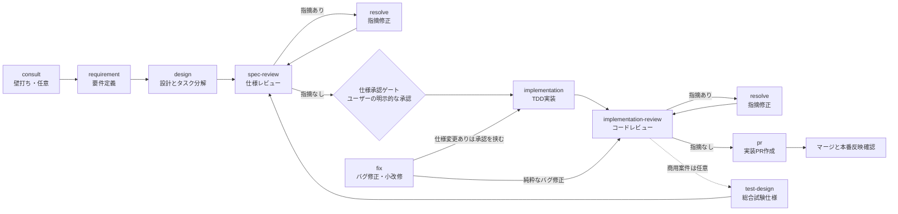

# 開発フロー定義ハブ

開発フロー(`/devflow:requirement`〜`/devflow:pr`・`/devflow:fix`)に共通する事項の正はこのファイル。各工程SKILL.mdは自工程固有の手順だけを持ち、共通事項はここへの参照で済ませる(同じ内容を複数箇所にコピーしない)。

# 全体フロー図



新機能は`consult`(任意)→`requirement`→`design`→`spec-review`のルート、バグ修正・小改修は`fix`から`implementation`または`implementation-review`へ合流する。レビューで指摘が出るたびに`resolve`で修正して再レビューを受ける。

# 工程一覧・レビューAgent対応表

| 工程Skill | 前工程 | 次工程 | レビューAgent | Agent既定モデル(frontmatter) |
|---|---|---|---|---|
| [consult](skills/consult/SKILL.md) | (任意の起点) | requirement | - | - |
| [requirement](skills/requirement/SKILL.md) | consult(任意) | design | - | - |
| [design](skills/design/SKILL.md) | requirement | spec-review | - | - |
| [spec-review](skills/spec-review/SKILL.md) | design | 指摘あり→resolve / 指摘なし→承認→implementation | spec-reviewer | sonnet |
| [implementation](skills/implementation/SKILL.md) | spec-review(承認後) | implementation-review | implementer(任意委譲) | sonnet |
| [implementation-review](skills/implementation-review/SKILL.md) | implementation | 指摘あり→resolve / 指摘なし→pr | code-reviewer | opus |
| [resolve](skills/resolve/SKILL.md) | spec-review / implementation-review / PRコメント | 指摘元レビューへ戻る | - | - |
| [test-design](skills/test-design/SKILL.md)(任意・商用案件) | implementation-review | spec-review(system-test.mdのレビュー)→承認→試験実施→pr またはリリース判定 | spec-reviewer | sonnet |
| [pr](skills/pr/SKILL.md) | implementation-review(実装PR) / spec-review(仕様承認PR) | マージ後の後続作業 | impl-pr-reviewer(実装PR作成前のみ) | haiku |
| [fix](skills/fix/SKILL.md) | (入口。新規specの場合はrequirementへ切替) | implementation または implementation-review | - | - |

Agentのモデルは各`agents/*.md`のfrontmatterに固定値として明示する(`model: inherit`は使わない)。個別の呼び出しで既定と異なるモデルにしたい場合(下表の「例外」)は、Agent起動時に呼び出し側からモデルを上書きする。

# メインセッションの推奨モデル

工程を実行する**メインセッション自体**の推奨モデル。Agent(spec-reviewer・code-reviewer等)自体のモデルは上表のfrontmatter値が既定であり、これとは別の話。

| 実行する工程 | 推奨モデル | 例外 |
|---|---|---|
| consult | Sonnet | 複雑な方針判断・技術選定・影響範囲の分析が必要な相談のみ**Opus**を検討(論点の整理・トレードオフの分析に高い推論能力が要るため) |
| requirement | Sonnet | - |
| design | requirements.mdのビジネスルール複雑度による。複数条件・外部仕様が複雑に絡む: **Opus** / 標準〜シンプル: **Sonnet** | - |
| spec-review | Sonnet | - |
| implementation | Sonnet | 複雑なロジック・複数の状態管理を伴う実装のみ**Opus**を検討 |
| implementation-review | Sonnet(呼び出しのみ。レビュー本体はcode-reviewer Agentが既定Opusで実施) | 文言修正のみなど明らかに軽微な変更は、Agent起動時に`model: sonnet`で上書きしてよい |
| resolve | Sonnet | 複数指摘に関連する修正・ビジネスルール全体の見直しなど、根拠の再構築が必要な場合のみ**Opus**を検討 |
| test-design | Sonnet | spec横断のシナリオが多く非機能要件の合格基準の設計判断が重い案件のみ**Opus**を検討 |
| pr | Sonnet(機械的作業のため常に十分) | - |
| fix | Sonnet | 仕様変更を伴う影響範囲特定が重要な場合、または複雑なバグ・複数箇所修正の場合のみ**Opus**を検討 |

# セッション終了時の引き継ぎ

コンテキスト量を抑えるため、開発工程(`/devflow:requirement`・`/devflow:design`・`/devflow:spec-review`・`/devflow:implementation`・`/devflow:implementation-review`・`/devflow:pr` など)は**1セッション1工程**を原則とし、次工程は新しいセッションで始める。ただし**autopilot(「autopilotで対応して」等、最後までの完遂を明示した指示や、`/devflow:autopilot` のように工程を連結するモード)では、この分割原則より完遂が優先**。依頼されたタスクをそのセッション内で最後までやり切り、続きを次セッションへ引き継がない。

締め方そのもの(完了の一文・次工程の概要・次セッションのプロンプトの3点、残作業が無い場合の締め方、プロンプトの書き方、未完了時の書き方)は開発工程以外のセッションでも同じため、**`~/.claude/session-handoff.md` が唯一の定義**(各SKILL.mdの引き継ぎ手順もそれに従う)。この文書に置くのは、上の1セッション1工程の原則と、下の工程遷移ごとのプロンプト例だけ。

# 次セッションへの引き継ぎプロンプト例

引き継ぎの出力形式そのもの(完了の一文・引き継ぎ概要・コードブロックの構成)は `~/.claude/session-handoff.md` が唯一の定義。ここでは工程遷移ごとの2行目(プロンプト本文)の例だけをまとめる。

| 現工程 → 次工程 | プロンプト例 |
|---|---|
| requirement → design | `/devflow:design を実行してください。対象は <specのパス> です。` |
| design → spec-review | `/devflow:spec-review を実行してください。対象は <specのパス>、ブランチ feature/<機能名> です。` |
| spec-review(指摘あり) → resolve | `/devflow:resolve を実行してください。対象は <specのパス> の仕様レビュー指摘です。` |
| spec-review(承認後) → implementation | `/devflow:implementation を実行してください。対象は <specのパス> です。` |
| implementation → implementation-review | `/devflow:implementation-review を実行してください。対象ブランチは feature/<機能名> です。` |
| implementation-review(指摘あり) → resolve | `/devflow:resolve を実行してください。対象ブランチは feature/<機能名> のコードレビュー指摘です。` |
| implementation-review(指摘なし) → pr | `/devflow:pr を実行してください。対象ブランチは feature/<機能名> です。` |
| fix → implementation-review | `/devflow:implementation-review を実行してください。対象ブランチは feature/<機能名> です。` |
| fix(仕様変更あり) → implementation | `/devflow:implementation を実行してください。対象は <specのパス> です。` |

# 共通ルール

## 仕様書は「最新仕様のみ」を書く(恒久ルール)

requirements.md / design.md / architecture.md には、**常に今の正しい仕様だけを現在形で書く**。仕様を書き換えるときは差分として追記せず、**あたかも最初からその仕様だったかのように書き直す**(仕様書を読む人が知りたいのは「今どうなっているか」だけで、そこに至る経緯ではない。差分の痕跡が残るほど、後任・第三者が現状を読み取るコストが上がる)。

**書かないもの**:

- 変更の経緯・履歴 —「〜から〜に変更した」「旧〜」「移設した」「廃止した」「撤去」などの差分ナラティブ
- 移設・変更を示すマーカー — 例:「【〜で移設】」
- 内輪のコードネーム・呼称 — 第三者・後任が読んで意味が分からない語。例:「方向B」
- 合意日付などセッション固有の言い回し — 例:「2026-08-19合意」

**経緯・決定理由が必要な場合はADRに分離する。** 仕様書には書かず、ADR(Architecture Decision Record)にまとめ、仕様書からは必要ならリンクだけを張る。置き場所と採番は[architecture-workflow](skills/architecture-workflow/SKILL.md)の「ADRの置き場所」を参照する。

## 承認状態のフロントマター

requirements.md / design.md / tasks.md は、先頭のフロントマターで**承認状態**を持つ。仕様書を開いた人が承認済みかどうかを読めるようにし、承認後に内容が黙って変わるのを防ぐため。書式(キーの並び・値の形)の正は[区分け表のファイル](quality-standards/base/spec-layout.md#承認状態のフロントマター)で、ここでは値をいつ・どの工程で書き換えるかを定める。

- `status` — `draft`(書いている・直している)/ `in-review`(指摘なしで承認を待っている)/ `approved`(承認済み)
- `approved_date` — 承認した日。`approved` のときだけ置く
- `version` — `"0.1"` で作り、初回の承認で `"1.0"` にする。承認後に変えたら小数点以下を1つ上げる

タイトル直下の「ステータス:」行は**実装進捗**(仕様確認中 / 実装中 / リリース済み)で、承認状態とは別物として残す。

| 場面 | フロントマターの書き換え | 工程 |
|---|---|---|
| 新規に作る | `status: draft`・`version: "0.1"` | [/devflow:requirement](skills/requirement/SKILL.md)(requirements.md)・[/devflow:design](skills/design/SKILL.md)(design.md・tasks.md) |
| 指摘なし(🟢のみ)になり承認を求める | 3ファイルとも `in-review` | [/devflow:spec-review](skills/spec-review/SKILL.md)(仕様承認PR方式ではPRを出す時点で[/devflow:pr](skills/pr/SKILL.md)) |
| 承認待ちの間に修正依頼・指摘が出る | 直すファイルを `draft` に戻す(version は変えない) | [/devflow:resolve](skills/resolve/SKILL.md)・[/devflow:requirement](skills/requirement/SKILL.md)・[/devflow:design](skills/design/SKILL.md) |
| 明示的な承認を得る | `in-review` のファイルを `approved` にし、`approved_date` に承認日を入れる。version が `0.x` なら `"1.0"` にする(改訂の再承認なら version はそのまま) | [/devflow:spec-review](skills/spec-review/SKILL.md)(仕様承認PR方式では[/devflow:pr](skills/pr/SKILL.md)がマージ前に) |
| `approved` のファイルを変える | **変更の大小にかかわらず**(誤字の修正だけでも)、その改訂の最初の変更で `draft` に戻し、`approved_date` を消し、version の小数点以下を1つ上げる(`"1.0"` → `"1.1"`)。再承認までに重ねて直しても上げ直さない。変えていないファイルは `approved` のまま | 仕様に手を入れる全工程([/devflow:fix](skills/fix/SKILL.md)・[/devflow:requirement](skills/requirement/SKILL.md)・[/devflow:design](skills/design/SKILL.md)・[/devflow:resolve](skills/resolve/SKILL.md)) |

- **承認状態に数えない書き換え**: 「ステータス:」行の値、tasks.md の `> 実装中: session ...` マーカー。どちらも進捗の記録で、承認した仕様の中身ではないので、`approved` のまま書き換える
- `draft` に戻したファイルは、通常どおり[/devflow:spec-review](skills/spec-review/SKILL.md)と明示的な承認を経て `approved` に戻す。3ファイルのどれかが `approved` でない間は[/devflow:implementation](skills/implementation/SKILL.md)に進まない(純粋なバグ修正で仕様に触れない場合は書き換えも再承認も無い)
- 機械検査(`check_spec_layout.py`)は値の形だけを照合する(フロントマター無しは終了コード2、値の不正は違反)。どの状態が正しいかは工程の側で守る

### フロントマターを持たない既存specの移行

この規則より前に書いた spec はフロントマターを持たず、検査で `フロントマター無し`(終了コード2)になる。層分けの新形式化(次に手を入れる工程で直す)と違い、承認状態は spec を開いた全員が読むものなので、**移行スクリプトで一括して付ける**。

1. 試し実行で判定を見る(書き込まない)。ローカルミラーなら `~/.claude/local-specs/` 配下、例外リポジトリならそのリポジトリの `specs/` 配下を渡す
   ```
   python3 ${CLAUDE_PLUGIN_ROOT}/lib/spec_layout_check/scripts/migrate_approval_frontmatter.py <specフォルダ>...
   ```
   出力は1ファイル1行(specフォルダ / ファイル / 判定 / 内容か理由)。判定は次のとおり
   - 「ステータス:」行が `実装中`・`リリース済み` → `approved`・`"1.0"`。承認を経ずに実装へ入らない流れなので承認済みとみなす。`approved_date` はそのファイルを最後にコミットした日(**推定値**。実際の承認日が分かっていれば `--approved-date` で渡す)
   - それ以外(仕様確認中・行が無い)→ `要判断`。承認の有無を機械で決めない
2. `要判断` の spec ごとに承認の有無をユーザーに確かめ、`--status approved|draft`(approved なら必要に応じて `--approved-date`)を付けて個別に流す。実装済みでも「ステータス:」行が無い古い spec は、承認済みとして `--status approved` で付けてよい
3. 判定に問題が無ければ `--apply` を付けて書き込み、各 spec に [check_spec_layout.py](lib/spec_layout_check/scripts/check_spec_layout.py) を掛けて `フロントマター無し`・`フロントマター不正` が出ないことを確かめる
4. ローカルミラーはそのリポジトリ(`~/.claude/local-specs`)で、例外リポジトリは作業ブランチでコミットする

**移行は、この規則を入れた devflow の更新が使える状態になってから行う。** それより前の検査スクリプトはフロントマターの行を「章の外に本文」の違反として数えるため、先に付けると全 spec のレビューが違反で止まる。

## specの置き場所(ローカル専用、リポジトリにコミットしない)

仕様3点セット(requirements.md/design.md/tasks.md)は対象プロジェクトのリポジトリには置かず、ローカル専用のミラーディレクトリに置く。プロジェクトのルートディレクトリの絶対パスをそのままディレクトリ階層として再現する:

```
~/.claude/local-specs/<プロジェクトルートの絶対パス>/specs/<feature-name>/
    requirements.md
    design.md          # 分岐のない単純な機能では省略可
    tasks.md
```

例: プロジェクトルートが`/Users/you/repo/foo`なら`~/.claude/local-specs/Users/you/repo/foo/specs/note-deletion/requirements.md`。

複数アプリ・モジュールを1つのリポジトリに含むプロジェクトで、モジュール単位にspecを分けたい場合は、そのモジュールの相対パスをそのまま踏襲してよい(例: `~/.claude/local-specs/<プロジェクトルート>/apps/<app-name>/specs/<feature-name>/`)。

- このディレクトリはgit管理下に置かず、リポジトリにコミットしない(成果物はこのマシン・このユーザーのローカルにのみ存在する)
- 履歴やdiffを見たい場合は、`~/.claude/local-specs/<プロジェクトルート>/`自体をpush先なしの独立したgitリポジトリとして`git init`しておくとよい(任意。プロジェクト本体のgitとは無関係)。このパスでは`git add`・`git commit`をこちらから実行できるので、specを書いたらそのままコミットまで進めてよい(`GIT_CONFIG_NOSYSTEM=1`を付ける)
- 以降このSkill群で「specのパス」「対象spec」と書く場合は、上記のローカルミラーパスを指す

**例外リポジトリ**: `~/.claude/config/project-profiles.json`のいずれかのPJが持つ`github.repos`に登録されたリポジトリでは、ローカルミラーではなく**そのリポジトリ内の指定パスにspecを置いてコミットする**。この解決は依頼文でのPJ名指定・デフォルトPJを経由せず、共有ライブラリ`project_profile.resolve_repo_github_settings(repo_path)`(`~/.claude/lib/project_profile/`)がカレントリポジトリの絶対パスだけで全PJを横断して探す(project-profile design.md#開発フローskillの例外リポジトリパスでの解決)。1件の`github.repos`エントリは次のキーを持つ。

| キー | 内容 |
|---|---|
| `specPathPattern` | リポジトリ内のspec配置パスパターン |
| `specPathException` | 配置パターンの例外(任意) |
| `specIndexPath` | spec一覧の索引ファイルのリポジトリ内パス(任意) |
| `approval` | 仕様の承認方式。`chat`(チャット上の明示的承認)または`pr`(仕様承認PR方式。[/devflow:pr](skills/pr/SKILL.md)の「仕様承認PR」参照) |
| `defaultBranch` | このリポジトリのデフォルトブランチ名(動的解決の代わりに使う既定値) |
| `note` | その他このリポジトリ固有の運用上の注記(任意) |

該当エントリがある場合、以降の「specのパス」「ローカルミラーパス」はリポジトリ内パス(`specPathPattern`に従う)に読み替え、仕様の承認方式は`approval`に従う。一致するエントリが無いリポジトリでは、この既定(ローカルミラー配置・チャット承認)に従う。例外を追加する場合は、対象リポジトリの絶対パスをキーにいずれかのPJの`github.repos`へ追記する(`project-profile`の対話セットアップ、またはPJプロファイルエディタからも追加できる)。

## 新規spec vs 既存specの判断基準

機能に着手する前に、新しい`specs/<機能名>/`フォルダを作るか、既存specを更新するかをまず判断する。ここを誤ると、既存機能の修正が別機能のspecとして切り出され、同じビジネスルールが複数のrequirements.mdに分散してしまう。

**既存specを更新すべきサイン**(いずれか1つでも該当したら[/devflow:fix](skills/fix/SKILL.md)のフローへ):
- 既存のユーザーストーリー・機能要件・ビジネスルールの一部を書き換える/追記するだけで説明が済む
- 実装が既存specの対象ファイル・関数を修正するものである(新しいファイルの追加だけで完結しないなら既存spec寄り)
- 機能名が「〜への〜追加」「〜の修正」のように既存機能名や既存の入出力を前提にしている(強いシグナル)
- 既存specの「スコープ外」にあった項目に今回対応する、または既存の不具合を直す

**新規specを作るべきサイン**([/devflow:requirement](skills/requirement/SKILL.md)のフローへ):
- 新しいエンドポイント・新しい画面・独立してリリース/ロールバックできる機能である
- 既存のユーザーストーリーでは説明できない、新しい利用者視点の目的がある
- 別のドメイン・別のデータストアなど、技術的に独立した関心事である

## 実現性確認の完了条件と報告

外部サービス・API・クラウド機能・組織ポリシーへの依存が機能の成立条件になる場合の実現性確認(「動くか確認して」)は開発フローの外でも行うため、完了条件と報告の仕方は **`~/.claude/feasibility-check.md` が唯一の定義**(各SKILL.mdもそれに従う)。requirement では成立条件の確認として、design では着手前提(結論が「できる」であること)として参照する。

## 大きなドキュメントを扱う工程はセッションを分ける

1工程1セッションが原則だが、**1工程の中で大きなドキュメントを扱う場合はさらに区切る**。仕様3点セットは1ファイルで2〜4万字になることがあり、参照元と書き換え対象を同時に抱えるとトークン消費が大きい(実測: ファイルを直接Readすると1回約4,506トークン、サブエージェント経由なら約1,516トークン)。

- **参照元(spec-review・design.md・Confluenceページ等)は1万字を超えたらサブエージェントに読ませ、結論だけ受け取る。** 自分で編集するファイルだけを直接読む(Editには正確な原文が要る)。依頼文には抜き出す対象を具体的に書く(「全文を要約して」ではなく「F1〜F7の確定事実だけを箇条書きで」)
- **既存specの全面書き換えは「抽出」と「書き換え」を別セッションに分ける。** 抽出セッションで参照元から確定事実を中間ファイル(`findings-*.md`)に落とし、書き換えセッションでは中間ファイルと対象ファイルだけを読む
- 区切る場合も[セッション終了時の引き継ぎ](#セッション終了時の引き継ぎ)の3点セットで次セッションに渡す

## 仕様とテストの対応付けの仕組み

「この要件はどのテストで確かめているか」を番号でたどれるようにする仕組みは、3つのファイルと2つの検査で成り立っている。テストの種類・量・完了条件の判断基準は[テスト方針](test-policy.md)が正で、各Skillはそこを参照する。

| 場所 | 何を書くか | 定義しているSkill |
|---|---|---|
| requirements.md | テストを対応させたい箇条書きに、見出し内で連番の`[n]`とリスク種別(論理/境界/生成物/環境/並行/非機能)を振る(例: `### ノート削除API` の下の `[2] … 〔論理〕`) | [/devflow:requirement](skills/requirement/SKILL.md) |
| design.md「テスト戦略」 | `[n]`を振った全項目を1行ずつ並べ、リスク種別・テスト種別(単体/性質/契約/構造検証/環境スモーク/性能/出荷後の実測)・量の目安を宣言する | [/devflow:design](skills/design/SKILL.md) |
| テストコード | 各テストの直前に `# 仕様: <requirements.mdのパス>#<見出し名>-<n>` を1行書く。環境スモークに割り当てた項目はtasks.md末尾のチェックリスト3項目に結果を残す | [/devflow:implementation](skills/implementation/SKILL.md) |

| 検査 | いつ | 何を確かめるか |
|---|---|---|
| spec-reviewer([/devflow:spec-review](skills/spec-review/SKILL.md)) | 仕様の承認前 | テスト戦略の表にrequirements.mdの全`[n]`項目が載っているか(割り当て漏れがないか)。境界のfixtureの出所と、無人実行の環境スモーク行があるか |
| code-reviewer([/devflow:implementation-review](skills/implementation-review/SKILL.md)) | 実装PRの前 | 実装を読む前に仕様だけから反例を3つ挙げる。テストの仕様コメントの見出し名・`[n]`がrequirements.mdと一字一句一致し、宣言した種別のテストが揃い、否定確認・静的検査・環境スモークが済んでいるか |

この仕組みは**1つのspecの中で閉じている**。複数のspecをまたぐ業務シナリオ、非機能要件の合格基準、リリース可否の判定基準は、商用案件など受入の根拠が要る場合に[/devflow:test-design](skills/test-design/SKILL.md)の`system-test.md`(ST-xxx採番の総合試験仕様書)で別途担保する。

## 仕様とテストの対応確認は code-reviewer に一本化

「requirements.md/design.mdの仕様項目にテストが紐づいているか」の正式な確認は[implementation-review](skills/implementation-review/SKILL.md)のcode-reviewerエージェント([チェックリスト](quality-standards/base/implementation-review.md)の「テスト」節)が担う。impl-pr-reviewer・pr Skill本体では重複確認を行わない。

## コミットの粒度とメッセージ

`git commit`をパス指定で行い`-A`/`-a`を使わないルールは`~/.claude/CLAUDE.md`の「git操作」。ここでは粒度とメッセージの決まりを定める。

- **1コミット1意図**: 1つのコミットは機能追加1件・バグ修正1件・リファクタリング1単位のいずれかに対応させる。tasks.mdの別タスクや別specの変更を1コミットに混ぜない。TDDではtasks.mdの1タスク(Red→Green→Refactorの1サイクル)を区切りにする。AI生成では1コミットが巨大になりがちなので、生成量が多いほど分割する
- **振る舞いの変更と整形を分ける**: 振る舞いを変える変更と、振る舞いを変えないリファクタリング・フォーマッターの一括整形は別のコミットにする(整形差分に機能変更が紛れるとレビューで見落とされる)
- **メッセージに理由と仕様参照を書く**: 1行目は差分を読まずに何を変えたかが分かる文(既存の`feat(<scope>): …`の形式)。本文には、コードから読み取れない変更理由・制約・却下した代替案と、対応する仕様項目(requirements.md/design.mdの`[n]`、tasks.mdのタスク番号。JIRAチケットがあればキー)を書く。差分の機械的な要約だけで終わらせない
- **生成物・秘密情報を入れない**: ビルド成果物・依存ディレクトリ・ログ・一時ファイルはコミットに含めない(`.gitignore`を整える)

社内標準のAI駆動開発ハーネスを採用したプロジェクトでは、仕様参照は`[n]`ではなく受入基準ID(`SPEC-XXX`)で書く(手元の`[n]`≒標準の`REQ`、tasks.mdのタスク≒標準の`SPEC`)。

## マージ後のリリース確認チェックリスト

[/devflow:pr](skills/pr/SKILL.md)の実装PRがマージされた後、本番反映を確認する際に使う軽量チェックリスト。プロジェクトごとの詳細手順(CI/CDの設定・環境URL・障害対応フロー)はREADME/architecture.md等プロジェクト側のドキュメントを正とし、ここでは「何を確認するか」の6点だけを定める。

- [ ] **デプロイ完了の確認** — 対象プロジェクトのデプロイ完了をどう判断したか(CI/CDのデプロイジョブの成功・稼働環境でのバージョン/デプロイ時刻表示など)を確認した
- [ ] **スモークチェック** — 変更した機能の最小限の動作確認(主要画面の表示1回・変更したAPIの呼び出し1回など)を本番またはステージング環境で実施した。design.mdの「テスト戦略」で環境スモークに割り当てた3項目がある場合はそれを優先して使う
- [ ] **ロールバック手順の所在確認** — 障害時に直前の状態へ戻す手順(revertデプロイ・CI再実行・featureフラグの切り戻し等)がどこに書かれているか(README/architecture.md/Runbook)を確認した。記載が見当たらない場合は、この時点で最低限の戻し方(例: 直前のコミットへの`git revert`とデプロイやり直し)を確認しておく
- [ ] **初回の実データ実行で成果物が出たことの確認**(無人実行・定期実行するもの) — 終了コード0・ログにERRORなしではなく、成果物(ファイル・通知・ページ更新)が実際に出たことを確認した。外部が律速の非機能要件(到達時間など)は、この実測で数値を満たしたかを判定する。成果物が出るまではそのタスクを完了にしない([テスト方針](test-policy.md)「基本原則」4)
- [ ] **危険な設定・手順の本番反映がないことの確認** — 本番に入る設定・手順の差分に、既存の統制(権限・認証認可・入力検証・ログ・例外処理・CIの品質ゲート・危険コマンドの抑止・テスト)の削除・迂回・緩和が含まれていないことを確認した。含まれる場合は、それが仕様で合意した変更で、レビューで承認されていることを確認した
- [ ] **レビュー対象と本番投入物の一致確認** — 本番に反映されたもの(デプロイされたコミットSHA・バージョン・成果物)が、レビュー・承認を受けたPRのマージコミットそのものであり、マージ後の直接修正・手作業の差し込み・別ブランチの混入がないことを確認した

6点とも問題なければ本番反映確認は完了とする。問題が見つかった場合は対象プロジェクトの障害対応手順に従う。
