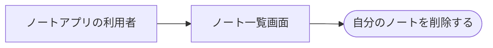

# ノートの削除API

ステータス: 仕様確認中(未実装) ／ 優先度: 高

## 概要

ノートアプリの利用者が、自分で作成したノートを1件ずつ削除できるようにするAPI。削除できるのは自分のノートだけ。 〔合意〕

## ユーザーストーリー

- ノートアプリの利用者としては、自分が作ったノートを一覧画面から削除したい。不要なノートが残り続けると、探したいノートが見つけにくくなるため 〔合意〕

## ユースケース図

正となる文章は上記ユーザーストーリーと下記の機能要件。

## 機能要件

### ノート削除API

ノート一覧画面から1件のノートを削除できるようにする。 〔合意〕

詳細を開く

- [1] フロントエンドのノート一覧画面から `DELETE /notes/{noteId}` を呼び出せること 〔論理〕
- [2] 削除に成功した場合、204(本文なし)を返すこと 〔論理〕

## ビジネスルール・制約

### 削除できる対象

自分が作成したノートのみ。存在しない場合と他人のノートは同じ404。数値ルールなし。根拠あり。 〔合意〕

詳細を開く

- [1] 削除できるのは、呼び出した利用者自身が作成したノートのみであること(根拠: 既存の閲覧APIと同じ所有者制限に揃える、という2026-08のチーム決定) 〔論理〕
- [2] 対象ノートが存在しない場合、404を返すこと 〔論理〕
- [3] 他の利用者が作成したノートを指定した場合も、存在しない場合と同じ404を返すこと(根拠: 存在の有無を推測させないというセキュリティ設計方針) 〔論理〕
- [4] 削除は物理削除とし、削除後にそのノートを取得しようとすると404になること(復元機能は作らない) 〔論理〕

## 非機能要件

- [1] 1利用者あたり最大数百件のノートを想定し、削除は1日に数十回程度の頻度である。特別な性能要件は設けない 〔非機能〕 〔合意〕

## スコープ外

- 複数ノートの一括削除 〔合意〕
- 削除の取り消し(ゴミ箱) 〔合意〕
- 管理者による他人のノートの削除 〔合意〕
