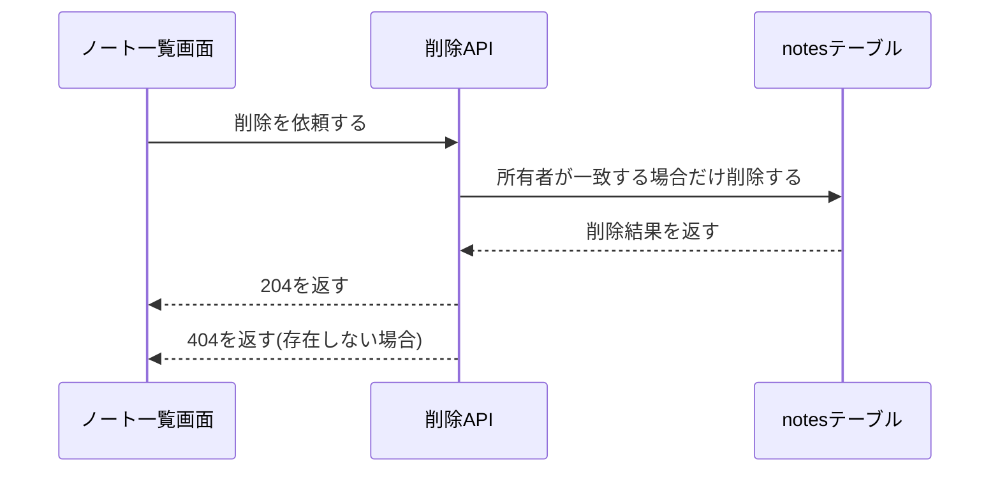

# ノートの削除API 設計

## 概要

API Gateway が認可した利用者IDとノートIDで、所有者が一致するノートだけを条件付きで削除する。 〔提案〕

## 決定事項

| 論点 | 選んだ案 | 採らなかった案 | 理由 | 影響範囲 | 出所 |
|---|---|---|---|---|---|
| 削除の方式 | 物理削除 | 論理削除(削除フラグ) | 復元機能を作らないため、フラグの運用コストに見合わない | 削除処理、取得API | 合意 |
| 見つからない場合の応答 | 存在しない場合と他人のノートで同じ404 | 403と404を分ける | 存在の有無を推測させない | 削除処理 | 合意 |

## 処理フロー

### ノートを削除する

所有者が一致する場合だけ削除し、一致しなければ404を返す。 〔合意〕

図はこの処理の俯瞰。手順の文章が正。

詳細を開く

- 対象: パスで指定された1件のノート
- 手順:
  1. 認可済みトークンから呼び出した利用者のIDを取り出す
  2. 指定されたノートIDと利用者IDの組で、所有者が一致する場合に限り削除する条件付き削除を行う
  3. 条件を満たすノートが無かった場合(存在しない、または所有者が異なる)は404を返す
  4. 削除できた場合は204(本文なし)を返す
- 関連するビジネスルール: requirements.md#削除できる対象

旧仕様では所有者の確認を先に読み取りで行う2段階の処理だったが、条件付き削除の1回に変更した。

## エラーハンドリング

条件不一致以外の失敗は500を返して処理を止める。 〔提案〕

詳細を開く

- DynamoDB への接続エラー・スロットリングなど、条件不一致以外の失敗は500を返し、呼び出し元にはエラーの内部詳細を返さない
- 認可済みトークンから利用者IDが取り出せない場合は401を返す

## 関連するファイル(抜粋)

新規1本と既存の共通処理1本。 〔提案〕

詳細を開く

- 新規: `apps/notes-api/application/lambda/delete_note.py`
- 既存で使う共通処理: `apps/notes-api/application/lambda/common/db.py`(DynamoDBクライアント)

## セキュリティ

- 所有者の確認はアプリ側での読み取り後の比較は採らず、DynamoDB の条件式で行う(読み取りと削除の間の競合を作らない) 〔提案〕
- 404 は存在しない場合と他人のノートの場合で同じ応答本文にし、存在の有無を推測させない 〔合意〕

## ログ

削除の開始と結果を残し、失敗の種類が分かるようにする。 〔提案〕

詳細を開く

- 削除の開始(利用者ID・ノートID)を INFO で出す
- 条件不一致による404は INFO、接続エラー等の500は ERROR で、失敗の種類が分かる文言を出す

## テスト戦略

requirements の [n] 全項目に割り当て済み。 〔提案〕

詳細を開く

| 仕様項目 | テストレベル | 備考 |
|---|---|---|
| ノート削除API-1 | 単体 | ルーティングとハンドラ呼び出し |
| ノート削除API-2 | 単体 | |
| 削除できる対象-1 | 結合 | 条件付き削除が所有者不一致で失敗すること |
| 削除できる対象-2 | 単体 | |
| 削除できる対象-4 | 結合 | 削除後の取得が404になること |

