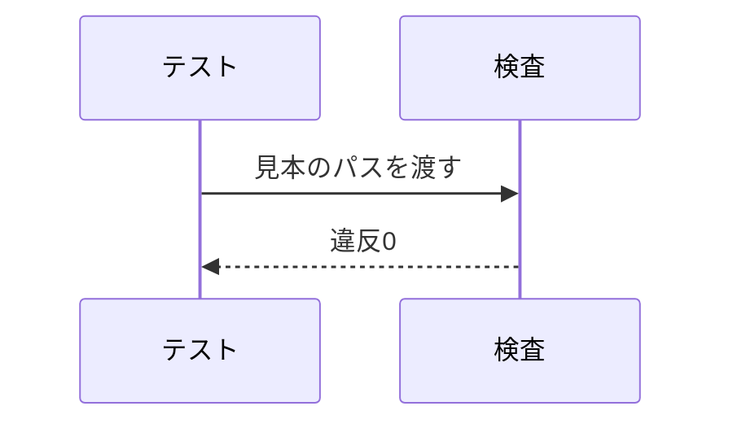

# 新形式のお手本(設計)

## 概要

検査スクリプトが違反0で通す設計書の見本。決定事項を概要の次に置き、処理フローは図を外に出す。 〔提案〕

## 決定事項

| 論点 | 選んだ案 | 採らなかった案 | 理由 | 影響範囲 | 出所 |
|---|---|---|---|---|---|
| 見本の置き場 | tests/fixtures | スクリプト内の文字列 | 実ファイルと同じ経路で読める | テスト | 合意 |
| 見本の数 | 用途ごとに1つ | なし | 違反の切り分けが楽 | テスト | 提案 |

## 処理フロー

### 見本を読む

図はこの処理の俯瞰。手順の文章が正。

詳細を開く

見本のspecフォルダを読み取る処理の1行概要。

- **対象**: 見本のspecフォルダ
- **手順**:
  1. ファイルを読む
  2. 違反を返す

## エラーハンドリング

見本が読めないときだけ止める。 〔提案〕

詳細を開く

- 見本が読めない場合は違反1件として記録する

## セキュリティ

読むだけで書かない。 〔提案〕

詳細を開く

- 見本はローカルのファイルだけを読む

## テスト戦略

requirements の [n] 全項目に割り当て済み・漏れなし。 〔提案〕

詳細を開く

| 仕様項目 | リスク種別 | テスト種別 | 量の目安 |
|---|---|---|---|
| 見本の機能-1 | 生成物 | 構造検証 | 1件 |

