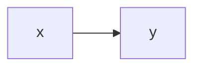

# 新形式のお手本(要件定義)

ステータス: 実装中 ／ 優先度: 中

## 概要

検査スクリプトが違反0で通す形の見本。読み手が人の見出しは畳まず、AIの見出しは要点と畳みに分ける。 〔合意〕

## ユーザーストーリー

- 検査を書く人としては、違反0で通る形の見本がほしい 〔合意〕
- 検査を直す人としては、正しい形が1つあれば壊したときに気づける 〔提案〕

## ユースケース図

線はアクターとユースケースの関わりを表す。

## 機能要件

### 見本の機能

見本として置く機能の1行概要。 〔合意〕

詳細を開く

- [1] 見本であること 〔生成物〕
- [2] 目印 `〔合意〕` は行末のトークンだけを数えること 〔論理〕

### 図を持つ機能

図が畳みの外にある機能の1行概要。 〔提案〕

図はこの機能の俯瞰。

詳細を開く

- [1] 図が外にあっても違反にならないこと 〔論理〕

## ビジネスルール・制約

### 見本のルール

数値ルールなし。根拠あり。 〔合意〕

詳細を開く

- [1] 見本のルールであること。根拠: テストのため 〔論理〕

## 非機能要件

- [1] 検査が1秒以内に終わること 〔非機能〕 〔提案〕

## 依存関係

実現性: 標準ライブラリだけで動く(できる)。未確定なし。 〔合意〕

詳細を開く

| 依存 | 結論 | 確認内容 |
|---|---|---|
| Python標準ライブラリ | できる | 実行して確認 |

## スコープ外

- 目印の正しさの機械検査 〔合意〕

## 用語

> 読み手: AI

固定セットに無い見出しは読み手を宣言する。 〔提案〕

詳細を開く

- 見本: この見出しは区分け表に無い

