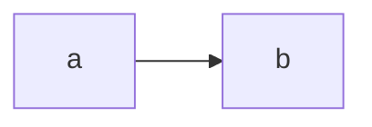

# 違反の見本(設計)

## 概要

決定事項の表に出所列が無い設計書の見本。 〔提案〕

## 決定事項

| 論点 | 選んだ案 | 採らなかった案 | 理由 | 影響範囲 |
|---|---|---|---|---|
| 出所列 | 置き忘れる | なし | 違反の見本のため | テスト |

## 処理フロー

### 見本を読む

図はこの処理の俯瞰。

詳細を開く

見本を読む処理の1行概要。

- **対象**: 見本のspecフォルダ

