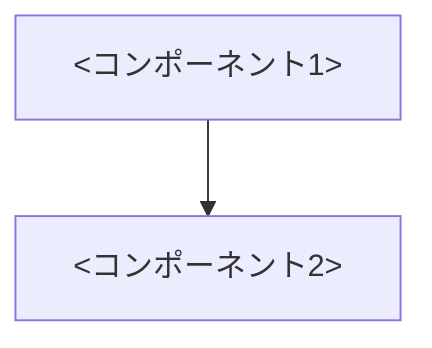

# architecture.mdとは何か

`architecture.md`は、複数specにまたがる全体像を1箇所に集約するドキュメント。specの数が少ないうちは不要で、2つ目・3つ目のspecができたあたりで導入を検討すればよい。以下と役割分担する(重複させない)。

| ドキュメント | 担当範囲 |
|---|---|
| CLAUDE.md | プロジェクト全体で共通のフォルダ規約・コーディング規約 |
| ADR(プロジェクト共通) | 複数アプリ・モジュールにまたがる技術選定とその理由・経緯 |
| ADR(アプリ配下 `specs/<アプリ名>/adr/`) | そのアプリ内だけで完結する設計判断とその理由・経緯(後述「ADRの置き場所」) |
| `specs/<機能名>/requirements.md`・`design.md` | 1つの機能(spec)固有の要件・処理フロー・DB項目・セキュリティ |
| `architecture.md` | 複数specをまたぐ全体像(機能マップ・依存関係・使用するADR/外部サービスの一覧) |

architecture.mdは**参照のハブ**であり、他ドキュメントの内容を転記する場所ではない。技術選定の理由はADRへ、機能ごとの詳細はrequirements.md/design.mdへリンクするだけに留める。「architecture.mdだけ読めば全体を把握できる」ことを目標とする。このためモジュール単位のREADMEとは役割を分け、概要・構成図・機能マップ・関連設計書リンクはarchitecture.mdが担い、READMEはセットアップ方法・開発コマンド(テスト・lint・build)に絞る(両方に構成図を置くと二重管理になり「図だけが古くなる」事故の温床になる)。

# どこに置くか

specと同様、リポジトリにはコミットせずローカルミラーディレクトリに置く(パスの考え方は[dev-flow.md](../../dev-flow.md#specの置き場所ローカル専用リポジトリにコミットしない)参照)。例: `~/.claude/local-specs/<プロジェクトルート>/specs/architecture.md`。

# いつ作る/更新するか

- 新しいアプリ/モジュールの立ち上げ時に最初から作成することを推奨する(具体的なspecが1つしかない段階でも作ってよい。[/devflow:requirement](../requirement/SKILL.md)の「複数のユーザーストーリーを分割する」参照)。単一specで完結する小規模プロジェクトでは、specが2つ目に育つタイミングまで省略してよい
- 新規specフォルダの作成・廃止、既存specの依存関係の変化があったときは、[/devflow:fix](../fix/SKILL.md)の「仕様(3点セット)への影響を洗い出す」の一環として、機能マップを更新する
- 採用技術・外部サービス・ディレクトリ構成が変わったときも同様に更新する

# 仕様書は「最新仕様のみ」を書く(恒久ルール)

architecture.mdは[dev-flow.mdの「仕様書は『最新仕様のみ』を書く」](../../dev-flow.md#仕様書は最新仕様のみを書く恒久ルール)に従って書く(差分ナラティブを書かず、常に今の正しい仕様だけを現在形で書く)。経緯・決定理由が必要な場合はADRに分離し、仕様書からは「12. 関連ADR」にリンクだけを張る。

# ADRの置き場所(判断の範囲で使い分ける)

ADR(Architecture Decision Record)は、決定に至った背景・理由・トレードオフを残す場所。仕様書から追い出した経緯はここに集める。

| 判断の範囲 | 置き場所 | 採番 |
|---|---|---|
| 複数アプリ・モジュールにまたがる技術選定・方針(DB・ホスティング・認証基盤・CI基盤・リポジトリ構成など) | `docs/adr/`(プロジェクトが`doc/adr/`等の別名を使っていればそれに従う) | プロジェクト全体で連番(既存の最大値+1、3桁) |
| 特定のアプリ・モジュール内だけで完結する判断 | `specs/<アプリ名>/adr/`(そのアプリのarchitecture.mdと同じ階層) | **アプリごとに`001`から**独立採番 |

- 迷ったら「他のアプリ・モジュールがこの判断を参照しうるか」で決める。参照しうるならプロジェクト共通側へ
- ファイル名は`adr-NNN-<英小文字ケバブケースの表題>.md`(例: `adr-003-adopt-dynamodb.md`。社内標準のAI駆動開発ハーネスと同じ形)。**既に`NNNN-<表題>.md`(4桁)で採番している既存の`adr/`では、その体系のまま続番を振る**(1つのディレクトリ内で2つの形式を混在させない。既存ファイルの改名もしない)
- 構成は`ステータス` / `コンテキスト` / `決定` / `検討した選択肢` / `影響` / `AI利用記録`の6節
  - **検討した選択肢**: 採用案だけでなく候補を複数挙げ、利点・欠点・リスクを同じ評価軸で比べ、採用しなかった理由を必ず書く(仕様書からは消える「却下した代替案」を残す唯一の場所。コードレビューのCR-10「ドキュメント・意図の共有」が辿る先)
  - **AI利用記録**: AIが提示した案とその根拠、人がどう検証したか(一次情報の裏取り・PoCの結果)、採用/棄却の結果を表で残す。AIを使わずに決めた場合は「対象外(AI未使用)」と明記し、節は消さない
- 決定を覆す場合も既存ファイルを書き換えず、新しいADRを追加して旧ADRのステータスを`Superseded by adr-NNN`(4桁体系のディレクトリでは`Superseded by NNNN`)に更新する(**ADRだけは履歴を残す場所**。仕様書と役割が逆である点に注意)
- ADRを追加したら、プロジェクト共通側なら`adr/README.md`等の一覧に、アプリ配下ならそのアプリのarchitecture.md「12. 関連ADR」に、それぞれ行を足す
- ADRをリポジトリにコミットするか、specと同じローカルミラーに置くかは、そのプロジェクトのspec配置ルールに合わせる

# 図の運用方針(AI駆動開発向け)

設計図は「人が理解するため」だけでなく「AIが理解・保守しやすいこと」を最優先する。

- 図はMermaidコードブロックとして`specs/`配下の既存Markdownに直接埋め込む(専用ファイル・画像は作らない)。Git差分・レビュー・AIによる更新と親和させるため
- **図は日本語の文章を置き換えない。** 処理フロー等の文章が正であり、図は俯瞰用の補助。`[n]`採番・テストとの対応付けの対象は従来どおり文章側
- **各図種は必須相当**(design.mdの必須見出しと同じ運用)。下表の作成条件に該当する箇所が一つでもあれば、原則その図を描く。該当する箇所が一つもない、と一旦立ち止まって検討した上で判断した場合のみ、その理由を一言添えて省略してよい(安易に省略しない)。一方で、条件に該当しない箇所へ無理に図を足す必要はない(全処理・全画面への一律付与は求めない)

## 図の一覧(Mermaid・specs/配下に埋め込み)

| 図 | 記載先 | 作成条件(満たす箇所があれば必須相当) |
|---|---|---|
| ユースケース図 | requirements.md「ユースケース図」([/devflow:requirement](../requirement/SKILL.md)参照) | 利用者(アクター)とできること(ユースケース)がある機能。単一アクター×自明な1ユースケースのみなら省略可 |
| コンテキスト図 | architecture.md「4. コンテキスト図」 | architecture.mdを作るなら必須。本システム・利用者・外部サービスの境界を1枚で |
| システム構成図 | architecture.md「5. システム構成図」 | architecture.mdを作るなら必須 |
| コンポーネント図 | architecture.md「10. コンポーネント図」(機能マップの直後) | 複数specにまたがるモジュール・共通ライブラリ間の依存があるとき |
| ER図 | architecture.md「12. 外部サービス」内。spec単位のカラム/属性表(design.md)は現行どおり | 使用テーブルが2つ以上、またはリレーションが生まれたとき |
| シーケンス図 | design.md「処理フロー」配下([/devflow:design](../design/SKILL.md)参照) | 呼び出し元・API・DB・外部サービスなど複数アクター間のやり取りがある処理があるとき |
| 画面遷移図 | design.md「画面設計」配下([/devflow:design](../design/SKILL.md)参照) | 画面が複数、または画面内で表示が大きく切り替わる(入力→確認→完了など)とき |
| 状態遷移図 | design.md「状態管理」([/devflow:design](../design/SKILL.md)参照) | 状態が3つ以上、または遷移に条件分岐があるとき |

## Mermaidの書き方ルール

- ノード名・ラベルは業務的な言葉にする([/devflow:design](../design/SKILL.md)の処理の呼び名の規則と同じ。関数名を図に書かない)
- 差分レビューしやすく書く: 1行1エッジ、ノード定義とエッジ定義を分ける、意味のないリネームをしない
- 図の直後に、その図が表す内容の正となる文章・specへのリンクを置く
- **1図の可読サイズを超えたら分割する**: 1つの図は**ノード10個・エッジ12本以内**を目安にする(人が一目で追える「7±2」の上限側)。これを超えるシステム構成図は、1枚に詰め込まず、まず全体像の**俯瞰図**を1枚置き、続けて**利用シーン/フロー単位**の詳細図に分ける。各詳細図も同じ上限に収める。レイヤ(クライアント/API/データ/外部)での分割は、フローがレイヤを縦断するシステムでは各図の意味が薄くなるため、フロー単位を第一候補とする
  - **このサイズ上限は構成/構造図(システム構成図・コンポーネント図・コンテキスト図・ER図)に適用する。** 工程の端から端までを1枚で見せる**プロセス/ワークフロー遷移図**は、パイプライン全体を一望できること自体が価値なので、ノード10を超えても機械的に分割しない
- **シーケンス図の可読ルール**: 参加者4人以内・メッセージ12本以内を目安にし、超えたら処理のフェーズ単位(例: 棚卸し→置換→書き出し)で図を分ける。**参加者の並び順(宣言順=表示順)は、やり取りの多いペアが隣り合うように決め、ライフラインをまたぐ矢印を最小にする**。処理フローの登場順のまま宣言しない — 端の参加者と頻繁にやり取りする図は、本数が上限内でも矢印が交差して読めなくなる。並び順で交差を消せない場合はフェーズ分割に切り替える
- 図種を問わず、線の交差が多くて目で追えない図は、描画確認の時点で「読める図」に直してからレビューに出す(分割・並び替え・エッジ削減)。描画エラーが無いことと読めることは別の合格基準
- **エッジラベルに半角の括弧類 `()[]{}<>` を書かない**: Mermaidがノード形状の開始と誤認して描画エラー(`Parse error … got 'PS'`等)になり、図全体が表示されなくなる。全角 `()` を使うか、ノードラベルと同様に `"…"` で括る(ノードラベルは `["…"]`・`[("…")]` で括られているため半角括弧でも壊れない)。図を書いたら、プレビューまたはGitHub上で実際に描画されるか(赤いParse errorが出ないか)を必ず目視で確認する。CIで自動検査する仕組みを持つプロジェクトはそちらに任せてよいが、無いプロジェクトでは目視確認が唯一の防波堤になる

# 読み手と文書骨格

どの見出しを人が読みどれをAIが読むかは[読み手の区分け表](../../quality-standards/base/spec-layout.md#読み手の区分け)が正(このSKILL.mdに転記しない)。architecture.md では**概要・コンテキスト図・システム構成図・機能一覧表(機能マップ)を人が読み、それ以外の見出しはAIが読む**。読み手がAIの見出しは「見出し → 見える要点1〜2行 → `<details><summary>詳細を開く</summary>`で畳んだ本文」の順にし、人が読む見出しは畳まない。図(Mermaid)とその直後の説明1行は、読み手の区分に関わらず畳みの外に置く。

要点行と箇条書きは、その行だけで意味が取れる文にする。新しく作るもの(表・図・設定)は、名前の初出で何のために作り何が入っているかが読み取れるようにし、用語集を前段に置かない(詳細は[/devflow:requirement](../requirement/SKILL.md)の「読み手に伝わる書き方」)。

承認者が読む行(人が読む見出しの箇条書き各行・AIが読む見出しの要点行)には`〔合意〕`か`〔提案〕`をちょうど1つ付ける。付け方と「迷ったら`〔提案〕`」の原則は[/devflow:requirement](../requirement/SKILL.md)の「出所の目印」に従う。

次の骨格を写し、この項目で扱う見出しを下の「見出しテンプレート」から足していく。

````markdown
# <システム名>の全体像

## 概要

<何をするシステムか。1〜3行> 〔提案〕

## コンテキスト図


図は外との境界の俯瞰。内部構造は次のシステム構成図を参照。

## システム構成図



図は実際に使うコンポーネントの俯瞰。

## 機能一覧表(機能マップ)

| spec | 機能(利用者から見て) | 役割 | 依存 | 状態 |
|---|---|---|---|---|
| <spec名> | <利用者から見た機能> | <役割> | <依存> | 仕様のみ(未実装) |

## 採用技術

<採用技術の1行要約> 〔提案〕

<details><summary>詳細を開く</summary>

| 技術 | 用途 |
|---|---|
| <技術> | <用途> |

</details>

## 関連ADR

<関連するADRの本数と範囲の1行要約> 〔提案〕

<details><summary>詳細を開く</summary>

- [<ADR番号>](<パス>) — <題名>

</details>

## 用語集

<この分野で独自の言い回しがある範囲の1行要約> 〔提案〕

<details><summary>詳細を開く</summary>

- **<用語>** — <定義>

</details>
````

# 見出しテンプレート

以下の見出しで構成する。機能一覧表(機能マップ)・コンテキスト図・システム構成図は必須(それ以外で該当しない見出しは省略してよい。無理に埋めない)。8・13〜15・17の後半・19は**システム全体で1回決める横断的な観点**で、各見出しに書いた作成条件に当たるときだけ書く(社内のAI駆動開発 標準テンプレートが7種の設計書に分けて持つ観点のうち、spec単位のdesign.mdには収まらないものを取り込んだ。7冊に分ける形は採らず、architecture.md 1冊の見出しとして持つ)。

0. **概要(必須)** — 先頭の`##`見出し。「何をするシステムか」を1〜3行で書く。タイトルと最初の`##`の間には何も置かない(機械検査が「章の外に本文」として検出する)。要約だけを並べる「サマリ」の見出しは置かない。ステータス・優先度のラベルを持つのは requirements.md だけで、architecture.mdは持たない
2. **アーキテクチャの目的** — このプロジェクト固有の目的のみ(一般論はCLAUDE.mdの担当)
3. **設計方針** — このプロジェクトだからこそ追加で効いてくる方針のみ(CLAUDE.mdの共通方針は書かない)
4. **コンテキスト図(必須)** — Mermaidコードブロックで書く。本システムを中心に、利用者(アクター)・依存する外部サービス・他システムとの境界を1枚で俯瞰する(内部構造は描かず、外との関係に絞る)
5. **システム構成図(必須)** — Mermaidコードブロックで書く。実際に使うコンポーネントのみを描く(汎用テンプレートをそのまま貼らない)
6. **アーキテクチャ概要** — 上の図を文章で説明(この文章が正、図は補助)
7. **採用技術** — 実際に使っている技術のみ。選定理由はADRへのリンクで済ませ再掲しない
8. **非機能要件への対応**(requirements.mdに非機能要件を書いたspecが1つでもあるときのみ) — 性能・可用性・セキュリティ・運用などの非機能要件ごとに、どの仕組みで実現するかを表で書く。数値目標はrequirements.md側が正で、ここには「何で担保するか」だけを書く。検証方法・合格基準は[/devflow:test-design](../test-design/SKILL.md)のsystem-test.mdに書く
   ```markdown
   | 非機能要件 | 実現方式 | 関連spec |
   |---|---|---|
   | 営業時間中の可用性 | マネージドサービスのマルチAZ構成。単一障害点を持たない | order-creation/requirements.md#非機能要件-1 |
   ```
   ```markdown
   | 技術 | 用途 |
   |---|---|
   ```
9. **機能一覧表(機能マップ)(必須)** — specフォルダ一覧と、利用者から見た機能名・役割・依存関係・進捗状態。architecture.mdの中核であり、全specを漏れなく載せる
   ```markdown
   | spec | 機能(利用者から見て) | 役割 | 依存 | 状態 |
   |---|---|---|---|---|
   | note-creation | ノートを作成する | ノートをDBに登録する | - | リリース済み |
   | note-deletion | ノートを削除する | 自分のノートを削除する | note-creationで作られたノートを参照 | 実装中 |
   ```
   **状態列の値(3段階)**: 「仕様のみ(未実装)」→「実装中」→「リリース済み」。リリース済みのspecにバグ修正・改修で再度手が入ったら「実装中」に戻し、本番反映の確認が済んだ時点で「リリース済み」に戻す。

   **更新タイミング**(複数specにまたがる開発で、1セッション単位の作業が終わるたびに全体進捗を追えるようにするための仕組み):

   | タイミング | 更新後の状態 | 担当Skill |
   |---|---|---|
   | 新規specフォルダ作成(requirements.md新規作成)時 | 仕様のみ(未実装) | [/devflow:requirement](../requirement/SKILL.md) |
   | 仕様の承認(チャット承認、または仕様承認PRのマージ)を確認して実装に着手する時 | 実装中 | [/devflow:implementation](../implementation/SKILL.md) |
   | 実装PRのマージ後、本番反映の確認が済んだ時 | リリース済み | [/devflow:pr](../pr/SKILL.md)の完了時案内 |

   いずれのタイミングでも、機能マップの該当spec行の状態を更新するだけでなく、**更新後の機能マップ全体(表)をその工程の完了報告にそのまま貼って提示する**(ファイルを直すだけで済ませない。セッションを閉じる前にユーザーがチャット上で全体進捗を把握できることが目的)。architecture.mdを持たないプロジェクト(単一spec)ではこの運用自体が不要。
10. **コンポーネント図**(複数specにまたがるモジュール・共通ライブラリ間の依存があるときのみ) — Mermaidで依存関係を描く。機能マップの「依存」列が文章としての正であり、図はその俯瞰
11. **ディレクトリ構成** — CLAUDE.mdの一般規約から逸脱・追加している部分のみ。逸脱がなければ「CLAUDE.mdの規約通り」の一言で済ませる
12. **外部サービス** — 実際に依存する外部サービス(使用テーブル名など)。選定理由は書かず関連ADRへリンクする。使用テーブルが2つ以上、またはリレーションが生まれたら、この見出しにER図(Mermaid `erDiagram`)を置く(spec単位の属性表はdesign.mdの現行どおりで、そちらが正)
    ```markdown
    | サービス | 用途 |
    |---|---|
    ```
13. **外部連携IF一覧**(ファイル・メッセージ・キューなど、API以外の方式で外部システムと連携するときのみ) — 連携ごとに、相手システム・方向(送る/受ける)・方式・フォーマット・タイミングと、欠損/遅延/重複/フォーマット不正が起きたときの挙動とリトライ、疎通確認の方法を書く。相手先と合意する文書としての役割を持つ。接続先URL・認証情報などの秘密情報はここに書かず、置き場所だけを示す。REST等のAPIは下記「API共通仕様」と各specのdesign.md「API設計」で扱う
14. **API共通仕様**(このアプリがAPIを提供するときのみ) — 全エンドポイントに共通する決まりだけを書く: 認証方式(トークンの形・ヘッダ)、共通エラー形式、ページネーション・日時形式・文字コード、バージョニング方針、命名規則。個々のエンドポイントは各specのdesign.md「API設計」が正で、ここには繰り返さない
15. **データ運用**(データを永続化するときのみ) — 保持期間・アーカイブ、バックアップ(取得タイミング・保持・リストア手順の所在)、初期データと移行の方針、インデックスの方針を書く。テーブル・属性の定義は各specのdesign.md「データベース設計」と上記ER図が正
16. **関連ADR** — 依存するADRのリンクのみ列挙する(内容は転記しない)。プロジェクト共通のADRと、このアプリ配下の`adr/`の両方を載せる
17. **セキュリティ** — このアプリ固有のリスクを書く(IAM等の横断的な仕組み自体はADR参照。機能固有の対策は各specのdesign.md「セキュリティ」に書く)。**認証・認可があるか個人情報・機微情報を扱うアプリでは**、加えて次を書く: 保護対象(何を守るか)、認証方式とセッション管理(タイムアウト・無効化)、認可(ロールと権限の表)、データ保護(通信・保存の暗号化、マスキング)、想定する脅威と対策、監査ログ(何を・どこに・どれだけの期間残すか)
18. **技術的制約** — 固有の制約のみ(プロジェクト全体の制約はADR/CLAUDE.mdの担当)
19. **インフラ・運用**(クラウドサービスを1つでも使うときのみ。図は下記「クラウド・インフラ系の図」) — 可用性(目標稼働率・RTO/RPO・冗長化・障害時の切り替え方式)、監視・運用(監視項目とアラート先・ログの収集と保管期間・バックアップ・パッチ適用の方針)、環境構成(開発/検証/本番の違いと切り替え方)を書く。IaC(Terraform等)がある場合、リソースの一覧はコードが正で、ここには方針と図だけを書く
20. **用語集** — ドメイン特有の用語のみ(汎用IT用語は書かない)

## 会話ドリブン原則(推測で埋めない)

architecture.mdに書く方針(アーキテクチャの目的・設計方針・採用技術・外部サービス・機能マップの役割/依存など)も、[/devflow:consult](../consult/SKILL.md)・[/devflow:requirement](../requirement/SKILL.md)・[/devflow:design](../design/SKILL.md)の会話の中で確認したもの・こちらから提案して合意したものだけを書く。会話に出ていない技術選定・構成方針を推測で埋めない(立ち上げ時に一気に作る場合も、主要な採用技術・外部サービスは提案の形で認識合わせしてから記載する)。

# クラウド・インフラ系の図

クラウドサービスを1つでも使っている場合、以下をプロジェクト共通ドキュメントとして作成する(モジュール単位ではなくリポジトリ/プロジェクト単位)。置き場所はプロジェクトの規約に従う(リポジトリにコミットする`doc/architecture/`等を持つプロジェクトはそちらへ置きルートREADMEからリンクする。無ければローカルミラーの`specs/`と同じ階層へ)。

| 図 | 内容 | 作成条件 |
|---|---|---|
| インフラ構成図 | 使用している全クラウドサービスと役割・データの流れ・課金/無料枠の境界 | クラウドサービスを使っていれば必須 |
| デプロイメント図 | mainマージから本番反映までの経路(CI・ビルド・デプロイ先) | デプロイパイプラインがあれば必須 |
| ネットワーク構成図 | VPC・サブネット・通信経路・境界 | ネットワーク境界を自分で設計している場合のみ(VPC、プライベート接続、独自DNS/CDN経路の制御など)。フルマネージドサービスの利用だけなら不要(インフラ構成図が兼ねる) |

## 形式の選択

- 構成が単純なうち(サービス数が少なく、配置・アイコンに意味がない)はMermaidで.mdに埋め込む
- AWS/GCP等でアイコン・レイアウト・境界の表現に意味が出てきたらDraw.ioへ昇格する:
  - `<名前>.drawio` を正本とし、README掲載用SVG・資料用PNGを同名で出力する
  - drawio CLIのセットアップと出力手順をADRとして残す(サンドボックスではCLIの追加インストールにネットワークが必要で実行できないため、手順の実行はユーザーの手元で行う)
  - README・architecture.mdにはSVGを掲載する(PNGは資料・プレゼン用)

# 更新ルール(図だけが古くなることの禁止)

設計変更時は、要件定義・設計書・Mermaid図・(あれば)Draw.io図・READMEを**同じ変更で同期する**。同期の確認ポイントは各工程Skillに組み込まれている:

- [/devflow:design](../design/SKILL.md)「architecture.mdへの反映」: 機能マップに加え、コンテキスト図・システム構成図・コンポーネント図・ER図への影響も確認する
- [/devflow:fix](../fix/SKILL.md)「仕様(3点セット)への影響を洗い出す」: 図の同期チェックを含む
- [/devflow:spec-review](../spec-review/SKILL.md)チェックリスト: 図が本文・コードと矛盾していないかを確認する
- インフラ・デプロイ構成を変える変更(ホスティング変更・CI変更・外部サービス追加)では、該当のインフラ系図を同じ変更で更新する

architecture.md を直したら、層分けの検査スクリプトに掛ける。**architecture.md は個々のspecフォルダではなくその1階層上(`specs/`)に置くため、specフォルダを渡す検査では対象に入らない。** architecture.md のあるフォルダを渡して別に1回実行する:

```
python3 ${CLAUDE_PLUGIN_ROOT}/lib/spec_layout_check/scripts/check_spec_layout.py <architecture.md のあるフォルダの絶対パス>
```

終了コードごとの扱いは[/devflow:spec-review](../spec-review/SKILL.md)の「起動前の機械検査」と同じ。

# 書く際の注意

- 各見出しは「関連するものだけ」を書く。プロジェクト全体・複数モジュール共通の内容を見つけたら、architecture.mdに書かずCLAUDE.mdまたはADR側の更新を検討する
- 機能マップの「依存」列と、依存元specのrequirements.mdの依存関係見出しが矛盾しないか確認する(architecture.mdは索引であり、依存の詳細はspec側の`[n]`参照が正)
- architecture.mdはrequirements.mdのような`[n]`採番・仕様承認ゲートの対象外