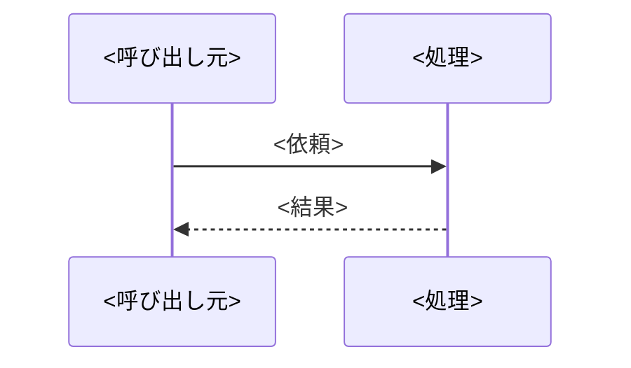

> ワークフロー上の位置: [/devflow:requirement](../requirement/SKILL.md) → **/devflow:design(本Skill)** → [/devflow:spec-review](../spec-review/SKILL.md)。全体フロー・モデル対応表は[dev-flow.md](../../dev-flow.md)を参照

# 前提条件

- 対象spec(ローカルミラーパス、[dev-flow.md](../../dev-flow.md#specの置き場所ローカル専用リポジトリにコミットしない)参照)の`requirements.md`が存在すること。なければ[/devflow:requirement](../requirement/SKILL.md)(要件定義)から始める(要件ヒアリングを飛ばして設計に入らない)
- requirements.mdの成立条件に外部サービス・API・クラウド機能・組織ポリシーへの依存がある場合、その実機エンドツーエンド確認の結論が「できる」であること(`~/.claude/feasibility-check.md` 参照)。「未確定」のまま設計を進める場合は、毎回の報告冒頭に実現性ステータスを明示し、設計詳細より先に方針判断を仰ぐ

# 仕様書は「最新仕様のみ」を書く(恒久ルール)

design.mdは[dev-flow.mdの「仕様書は『最新仕様のみ』を書く」](../../dev-flow.md#仕様書は最新仕様のみを書く恒久ルール)に従って書く(差分ナラティブを書かず、常に今の正しい仕様だけを現在形で書く)。

# design.mdの書き方

requirements.mdのビジネスルールを「どんな手順・分岐で処理するか」を日本語の文章(変数名・数式なし)で書く**処理フロー**を中心に、この機能が実際に関わるファイル・DB・エンドポイント・画面などを確認用に書き足す。フォルダ構成の一般ルールや、プロジェクト全体の非機能要件・設計方針はCLAUDE.md/requirements.mdの領分のためここには書かない。分岐・複数ステップのロジックが1つもない機能(例: 純粋なルーティング変更)は、design.md自体を作らずrequirements.mdのみで完結してよい。

**会話ドリブン原則(推測で埋めない):** design.mdに書く設計方針は、データベース設計・エラーハンドリング方針・セキュリティ・任意見出しも含め、ユーザーとの会話の中で確認したもの・こちらから提案して合意したものだけを書く。要件ヒアリング・[/devflow:consult](../consult/SKILL.md)で既に合意済みの点はそれを反映し、設計段階で新たに決めるべき方針が出てきたら、書き切る前にユーザーに提案・確認してから記載する(design.mdは「会話で合意した設計がドキュメントになっているだけ」の状態を目指す)。

**概要(必須):** design.mdの先頭の`##`見出しを「概要」にし、処理の全体像を1〜3行で書く。タイトルと最初の`##`の間には何も置かない(機械検査が「章の外に本文」として検出する)。ステータス・優先度のラベルを持つのは requirements.md だけで、design.mdは持たない。

**決定事項(必須):** 概要の直後・処理フローの前に`##`の**決定事項**を置き、設計の分かれ道でどちらを選び何を採らなかったかを1つの表で一覧する。承認者はこの表と各見出しの要点行だけを読んで判断する。

- 列は **論点 / 選んだ案 / 採らなかった案 / 理由 / 影響範囲 / 出所** の6列
- 「採らなかった案」が無い決定は、空欄にせず**「なし」と書く**(別の言い回しにしない)
- 「理由」列は**1〜2行**に収める。経緯・トレードオフの説明が長くなる場合はADRに分離し、「理由」列からリンクする(仕様書は最新仕様のみを書き、経緯はADRへ分離する)
- 「出所」列の値は`合意`(会話で決めた)か`提案`(設計中に書き手が決めた)のどちらか
- 処理フロー・エラーハンドリング・セキュリティの本文で「〜とする」「〜は採らない」と選択・却下を述べた箇所は、1行ずつこの表に載せる
- **畳みの外に見せるのは承認者の判断に効く分かれ道だけ**。それ以外の決定は捨てず、同じ見出しの`<details>`の中に2つ目の表として残す(実装の根拠は残しつつ、承認者が読む量を増やさない)。書式そのもの(使う文字列・出力の書き方)は appendix.md に書く
- 分かれ道が1つも無い設計では、表を空にせず**「決定事項なし」**と1行書く

**品質統制の適用(必須):** 決定事項の直後・処理フローの前に`##`の**品質統制の適用**を置き、社内標準ハーネスの実装統制 IMC-01〜06 をこの機能に当てるかを1つの表で判定する。統制の定義(適用条件・観点の詳細)は標準ハーネスの `implementation-control-catalog.csv` と各観点CSVが正で、ここには判定に要る観点だけを書き直している(CSVを複製しない)。標準のフェーズSkillを使うプロジェクトでは標準の /design に従う。

- 列は **統制 / 判定 / 理由 / 反映先 / 出所** の5列で、行は IMC-01〜06 の**6行を常に全部**置く(対象外の行も消さない。何を検討して外したかを承認者が見るため)
- 「判定」列の値は`適用`か`対象外`のどちらか。「理由」列には、適用なら当てはまった条件、対象外なら当てはまらない根拠を1行で書く
- 「反映先」列は、適用の行で対策を書いた design.md の見出し名(例: セキュリティ・ログ)。対象外の行は「—」
- 「出所」列は決定事項の表と同じく`合意`か`提案`
- **適用と判定しても、要件に無い仕組み(監査用テーブル・新しい外部サービス・新しいOSS)を足さない。** 既存の見出しで満たせる範囲で対策を書き、足りなければ書き切る前に提案して合意を得る(会話ドリブン原則)
- IMC-01・IMC-06 を`対象外`にする判定は、承認者の確認が要る(標準でも人のレビューを必須にしている)。出所は`提案`にする

判定の観点(書き直し。定義は標準側が正):

| 統制 | 適用する条件 | 対象外にできる条件 | 主な反映先 |
|---|---|---|---|
| IMC-01 PII入出力 | 個人を特定できる情報(氏名・メールアドレス・電話番号・利用者IDなど)や機密情報を、入力・出力・保存・ログ・外部送信のどれかで扱う | 扱うデータにもレスポンス・ログにも、そうした情報が一切現れない | セキュリティ・ログ |
| IMC-02 冪等性 | 状態を変える処理(更新・削除のAPI、バッチの登録・更新、再送・リトライ、外部への更新連携)がある | 参照だけで、保存・外部更新・通知送信のような副作用を持たない | 処理フロー・エラーハンドリング(同じ依頼が2回来たときの結果) |
| IMC-03 監査ログ | データの登録・更新・削除、AI処理の起動、外部システム連携、権限の変更のどれかを行う | 画面の表示だけ・入力値の形式変換だけ | ログ(誰が・何に・何をして・結果どうなったか) |
| IMC-04 静的解析 | 常に適用(リンター・フォーマッター・型チェックをPRで自動実行) | なし | 機能単位ではなくプロジェクト共通の設定。/devflow:implementation-review で確認 |
| IMC-05 コミット粒度 | 常に適用(1コミット1意図) | なし | [dev-flow.md](../../dev-flow.md)の「コミットの粒度とメッセージ」 |
| IMC-06 OWASP | 外部からの入力を受ける・認証や認可を伴う・データを永続化する・外部と通信する・依存パッケージを追加更新する、のどれかに当たる | 外部入力も永続化も通信も持たない内部計算だけ | セキュリティ |

**見出しと読み手:** どの見出しを人が読みどれをAIが読むかは[読み手の区分け表](../../quality-standards/base/spec-layout.md#読み手の区分け)が正(このSKILL.mdに転記しない)。読み手がAIの見出しは「見出し → 見える要点1〜2行 → `<details><summary>詳細を開く</summary>`で畳んだ本文」の順にし、読み手が人の見出し(決定事項・品質統制の適用)は畳まない。**処理フローは例外で、畳みの外に出すのは図とその直後の説明1行だけにし、処理の1行概要も畳みの中に置く**。**各`###`には図を1枚置く**。図を描くほどの流れが無い処理は`###`を立てずに近い処理へまとめ、その手順の中に入れる(図が無いまま`###`だけが並ぶと、承認者には見出しの一覧しか見えない)。**処理が1つしかない場合も`###`を1つ立てる**(`##`の直下に本文を置く形は違反「小見出しなし」になる)。`<summary>`の文言は「詳細を開く」に固定し、`</summary>`の直後に空行を1行置く。

**読んで分かる言葉で書く:** 要点行・決定事項の表・図の説明は、その行だけで意味が取れる文にする。この設計で新しく作るもの(表・設定ファイル・スクリプト)は、名前の初出で何のために作り何が入っているかが読み取れるようにする(詳細は[/devflow:requirement](../requirement/SKILL.md)の「読み手に伝わる書き方」)。

**出所の目印:** 承認者が読む行(決定事項の表の「出所」列・各見出しの要点行)に`〔合意〕`か`〔提案〕`をちょうど1つ付ける。骨格に書いてある目印は置き場所の例で、実際にはその行の出所で選ぶ。付け方と「迷ったら`〔提案〕`」の原則は[/devflow:requirement](../requirement/SKILL.md)の「出所の目印」に従う。

## 文書骨格

次の骨格を写し、`<>`の中身だけを埋める。この機能が関わらない任意見出しは見出しごと削る。

````markdown
# <タイトル>

## 概要

<処理の全体像> 〔提案〕

## 決定事項

| 論点 | 選んだ案 | 採らなかった案 | 理由 | 影響範囲 | 出所 |
|---|---|---|---|---|---|
| <分かれ道> | <選んだ案> | <採らなかった案。無ければ なし> | <1〜2行> | <影響範囲> | 合意 |

残りの決定は折りたたみの中。書式そのものは [appendix.md](appendix.md)。

<details><summary>詳細を開く</summary>

承認の判断には効かないが、実装の根拠として残す決定。

| 論点 | 選んだ案 | 採らなかった案 | 理由 | 影響範囲 | 出所 |
|---|---|---|---|---|---|
| <細かい決定> | <選んだ案> | <採らなかった案> | <1〜2行> | <影響範囲> | 提案 |

</details>

## 品質統制の適用

| 統制 | 判定 | 理由 | 反映先 | 出所 |
|---|---|---|---|---|
| IMC-01 PII入出力 | <適用 / 対象外> | <当てはまった条件、または当てはまらない根拠> | <見出し名。対象外なら —> | 提案 |
| IMC-02 冪等性 | <適用 / 対象外> | <理由> | <見出し名> | 提案 |
| IMC-03 監査ログ | <適用 / 対象外> | <理由> | <見出し名> | 提案 |
| IMC-04 静的解析 | 適用 | 常に適用 | プロジェクト共通の設定 | 提案 |
| IMC-05 コミット粒度 | 適用 | 常に適用 | dev-flow.md のコミット規約 | 提案 |
| IMC-06 OWASP | <適用 / 対象外> | <理由> | <見出し名> | 提案 |

## 処理フロー

### <処理の呼び名>



図はこの処理の俯瞰。手順の文章が正。

<details><summary>詳細を開く</summary>

<処理の1行概要>

- **対象**: <何に対して行うか>
- **手順**:
  1. <日本語の文章で書くステップ>
- **関連するビジネスルール**: `requirements.md#<見出し>`

</details>

## バリデーション

<検証する項目とNGの扱いの1行要約> 〔提案〕

<details><summary>詳細を開く</summary>

- <検証項目と条件・NGの場合の扱い>

</details>

## エラーハンドリング

<何が起きたら処理を止めて人に知らせるか> 〔合意〕

<details><summary>詳細を開く</summary>

- <複数の処理にまたがる共通のエラー処理方針>

</details>

## 関連するファイル(抜粋)

<新規と変更の内訳の1行要約> 〔提案〕

<details><summary>詳細を開く</summary>

新規:

- `<パス>` — <役割>

変更:

- `<パス>` — <変更内容>

</details>

## データベース設計

<追加・使用するテーブルと属性の1行要約> 〔提案〕

<details><summary>詳細を開く</summary>

### <テーブル名>

| 属性 | 型 | 補足 |
|---|---|---|
| <属性> | <型> | <補足> |

</details>

## API設計

<エンドポイントの数と役割の1行要約> 〔提案〕

<details><summary>詳細を開く</summary>

- <メソッド> `<パス>` — <リクエスト/レスポンス・ステータスコード>

</details>

## 画面設計

<画面の数と流れの1行> 〔提案〕


図は画面遷移の俯瞰。項目と操作の文章が正<。画面モックがある場合は「配置・見た目・状態の切り替わりは[mock.html](mock.html)が正」と続ける>

<details><summary>詳細を開く</summary>

- <表示項目と操作>

</details>

## コンポーネント設計

<追加するコンポーネントの1行要約> 〔提案〕

<details><summary>詳細を開く</summary>

| Props | 型 | 役割 |
|---|---|---|
| <名前> | <型> | <役割> |

</details>

## 状態管理

<状態の数と主な遷移の1行> 〔提案〕

```mermaid
stateDiagram-v2
    [*] --> <状態1>
    <状態1> --> <状態2>
```



図は状態遷移の俯瞰。文章が正。

<details><summary>詳細を開く</summary>

- <何を・どこで保持するか>

</details>

## セキュリティ

<この機能固有のリスクと対策の1行要約> 〔提案〕

<details><summary>詳細を開く</summary>

- <リスクと対策>

</details>

## パフォーマンス

<特別な考慮が要る箇所の1行要約> 〔提案〕

<details><summary>詳細を開く</summary>

- <考慮する内容>

</details>

## ログ

<出力するログの1行要約> 〔提案〕

<details><summary>詳細を開く</summary>

- <タイミング・内容・ログレベル>

</details>

## テスト戦略

requirements の [n] 全<件数>項目に割り当て済み・漏れなし。 〔提案〕

<details><summary>詳細を開く</summary>

| 仕様項目 | リスク種別 | テスト種別 | 量の目安 | 備考 |
|---|---|---|---|---|
| <見出し-n> | <リスク種別> | <テスト種別> | <量の目安> | <備考> |

</details>
````

## AI専用情報の付録分離(appendix.md)

**設定ファイルの書式・キャッシュの書式・コマンドの雛形・ログの書式**は design.md の本文に置かず、同じspecフォルダの `appendix.md` に移す。design.md の該当箇所には appendix.md の該当見出しへのリンクを1行残す(参照なしで移さない)。

appendix.md は読み手がAIのファイルとして扱い、要点行・畳み・出所の目印を持たない。**書式だけを置き、処理の手順・分岐・方針は置かない**(手順は design.md の処理フローが正)。appendix.md も3点セットと同じ承認(チャット承認、または仕様承認PR)の対象に含める。

以下の見出しのうち**処理フロー・エラーハンドリング・関連するファイル(抜粋)・セキュリティ・ログの5つ(必須5見出し)は必須**(先頭の「概要」「決定事項」「品質統制の適用」と合わせて必須)。この5つは、該当しないと思っても一旦立ち止まって深く検討し、対策として実装できることは極力実装する方針で臨む(考えた末に本当に不要と判断した場合のみ、その理由を一言書く。安易に「特になし」で済ませない)。**加えて、下記13. テスト戦略も機能の有無によらず常に必須**とする(必須5見出しとは別枠)。残りの見出しはこの機能が実際に関わる場合だけ書き、関わらないものは見出しごと省略する(「該当なし」とは書かない)。

1. **処理フロー**(必須) — `##`見出し。個々の処理はこの下に`###`見出しで並べる
   - **処理の呼び名**(`###`見出し) — 業務的な言葉にする(実装詳細(関数名・ファイル名)はtasks.mdに書く)
   - **対象** — この処理が何に対して行われるか
   - **手順** — 日本語の文章で書く番号付きステップ(変数名・数式は使わない)。分岐がある場合は「〜の場合は…、そうでない場合は…」と書く。単純な1つの計算のようにビジネスルールの文章だけで手順が自明なものは書かない。その処理固有のエラー時の振る舞い(例:「対象が存在しない場合は404を返す」)はここに書く。複数の処理にまたがる方針がある場合のみ、下記のエラーハンドリング見出しにまとめる
   - **シーケンス図**(呼び出し元・API・DB・外部サービスなど複数アクター間のやり取りがある処理のみ) — 該当する処理の配下にMermaidコードブロック(`sequenceDiagram`)を埋め込む。手順の文章が正であり、図は俯瞰用の補助(後述「Mermaid図の埋め込みルール」参照)
   - **関連するビジネスルール** — `requirements.md#見出し`

2. **バリデーション**(入力値に対する検証ロジックが必要な場合のみ) — 検証する項目・条件と、NGの場合の扱いを簡潔に書く。単純な必須入力チェックなど自明なものは省略してよい。

3. **エラーハンドリング**(必須) — 通信エラー・想定外の例外など、複数の処理にまたがる共通のエラー処理方針を積極的に検討して書く。個々の処理固有のエラー時の振る舞いは処理フローの手順に直接書けば足りるため、ここでは機能全体を通じた方針に絞る。

4. **関連するファイル(抜粋)**(必須) — フォルダ構成のルール自体はCLAUDE.mdにあるため、ここでは「新規に追加するファイル」「既存でこの機能から使う共通処理(DBクライアント・共通モジュールなど)」だけを、対象プロジェクト内の実際のパスで列挙する。

5. **データベース設計**(DBのテーブルに保存・参照する場合のみ) — テーブル名(DynamoDBならパーティションキー・ソートキーを含む)と、この機能で追加・使用する属性のみを書く。アクセス制御やテーブル運用方針などプロジェクト横断の決定はADR等を参照し重複させない。
   ```
   ### notes テーブル
   | 属性 | 型 | 補足 |
   |---|---|---|
   | noteId (PK) | string | UUID |
   | ownerId (SK) | string | 所有者ユーザーID |
   ```

6. **API設計**(このプロジェクトがAPIエンドポイントを新設・変更する場合) — エンドポイント・リクエスト/レスポンス・ステータスコードを書く。API Gateway + Lambdaのようにアプリ自体がAPIである場合はこの見出しが中核になる。フロントエンドのみで完結し独自APIを持たない場合は不要。

7. **画面設計**(新しい画面・表示項目・操作を追加する場合のみ) — 表示項目と操作を箇条書きで。画面の配置・見た目・状態の切り替わりの正本は、要件定義で合意したspecフォルダの`mock.html`([/devflow:requirement](../requirement/SKILL.md)の「画面モックの作り方」)。配置と見た目はこの見出しに書き写さず、画面遷移図の直後の説明1行に`mock.html`への相対リンクを添える。型定義は実装に委ねる。
   - **モックとの対応** — 表示項目・操作と、画面遷移図に描く画面・状態は、モックにある画面・状態と1対1に対応させる。設計の中でモックに無い状態・操作が要ると分かったら、design.mdにだけ足して済ませず、モックに加えてプレビューを再発行し、requirements.mdにも書き足す(要件の抜けとして扱う。書き足し方は[/devflow:requirement](../requirement/SKILL.md)の「画面モックの作り方」の「要件の抜けを requirements.md に戻す」)
   - **モックが無い場合** — 既存の画面の文言の変更や項目の並べ替えなど、[/devflow:requirement](../requirement/SKILL.md)の2段階の対象外だった画面変更では、表示項目と操作の箇条書きだけで足りる。非自明なUI仕様はrequirements.mdのUI/UX要件に書く
   - **画面遷移図(必須相当)** — 画面が複数ある、または画面内で表示が大きく切り替わる(入力→確認→完了など)機能では、画面間・表示状態間の遷移をMermaid(`flowchart`。分岐条件が主役なら`stateDiagram-v2`でもよい)でこの見出しに埋め込む。箇条書きの表示項目・操作が正であり、図は遷移の俯瞰。単一画面で完結し遷移がない、と検討の上で判断した場合のみ、その理由を一言添えて省略してよい(安易に省略しない)

8. **コンポーネント設計**(再利用可能な新しいコンポーネントを追加する場合のみ) — Propsの型と役割だけを簡潔な表にする。

9. **状態管理**(複数の処理・画面にまたがって共有する状態がある場合のみ) — 何を・どこで保持するか(useState/Context/URLパラメータなど)を一言で書く。状態が3つ以上、または遷移に条件分岐があるときは、状態遷移図(Mermaid `stateDiagram-v2`)をこの見出しに埋め込む(文章が正、図は補助)。画面を持たないバックエンド機能でも、ジョブの実行状態・リソースのライフサイクルなど状態遷移があればこの見出しの対象とする。

10. **セキュリティ**(必須) — 入力値のサニタイズ、個人情報・機微情報の扱い方など、この機能固有のリスクを積極的に洗い出し、対策できることは設計に盛り込む。IAMポリシー・API認可の方針などプロジェクト横断の決定はADR等を参照し重複させない。

11. **パフォーマンス**(この機能で特別な考慮が必要な場合のみ) — 例: 大量データのページネーション、重い計算のメモ化・非同期化など。

12. **ログ**(必須) — この機能で出力すべきログ(処理の開始・終了・失敗など)を積極的に検討して書く。出力するログはタイミング・内容・ログレベルを簡潔に書く。

13. **テスト戦略**(必須) — requirements.mdの`[n]`採番された仕様項目**ごと**に、リスク種別(論理/境界/生成物/環境/並行/非機能)と、それを担保するテスト種別・量の目安を表で宣言する。**テスト種別に書ける名前は「単体」「性質」「契約」「構造検証」「環境スモーク」「性能」「evals」「なし」だけ**で、「結合」「統合」「E2E(自動化を除く)」「手動」のような一般的な呼び名を持ち込まない(DBやAPIを相手にする箇所は境界のリスクなので**契約テスト**と書く)。リスク種別ごとのテスト種別・量の目安・完了条件の正は[テスト方針](../../test-policy.md)(「リスク種別」「テスト種別の定義」「量の目安と完了条件」)。工程は分けず、宣言したテストは[/devflow:implementation](../implementation/SKILL.md)のTDDサイクルの中で書く。
   - 「手動確認」はテスト種別ではない。人が目で見る確認は**環境スモーク**(本番と同じ起動経路で1回)か**実データE2E**(実現性確認・出荷後の初回実行)に言い換えて書く
   - **テストを置かない項目があってよい**(数値の約束が無い非機能要件など)。その場合はテスト種別に「なし」と書き、備考に置かない理由を書く。**要点行もそれに合わせる**(「全n項目に割り当て済み・漏れなし」と書いたまま「なし」の行を残さない)
   - **生成物**(HTML・JavaScript・Markdown・plist・JSON等)を作る機能は、生成器ごとに「構造検証」の行を必ず置く
   - **無人実行・定期実行**するものは「環境スモーク」の行を必ず置く(省略不可)。チャットから人が起動するSkillは任意で、省略する場合は備考に理由を書く
   - **境界**の項目は、備考にfixtureの出所(実現性確認で保存した実応答か、実応答が得られるまでの想像fixtureか)を書く
   - **E2E(自動化)**: **UIがあり、かつ継続的に改修が入る(デグレのリスクが繰り返し発生する)プロジェクトの主要シナリオに限り**自動化する。E2Eフレームワークを新規導入する場合は[新しいOSSの導入](../../oss-adoption.md)の承認を経て、選定理由をADR([architecture-workflow](../architecture-workflow/SKILL.md)の「ADRの置き場所」)に残す
   ```markdown
   | 仕様項目 | リスク種別 | テスト種別 | 量の目安 | 備考 |
   |---|---|---|---|---|
   | ノート削除API-2 | 論理 | 単体 | 正常1 + 分岐2 | |
   | 候補の提示-1 | 境界 | 契約 | fixture 1種 + 失敗形3 | fixtureは実現性確認で保存した探索応答(UTC) |
   | 候補の提示-2 | 生成物 | 構造検証 | 生成器1つに1件 | 選択画面HTMLのscriptを node --check |
   | 定期実行-1 | 環境 | 環境スモーク | 実行経路ごとに1回 | launchd経由で成果物が出ること |
   | 集計-3 | 非機能 | 性能テスト | 数値要件1つに1件 | 1,000件で3秒以内(要件5秒の2/3)。tests/perf/ |
   | 通知到達-1 | 非機能 | 出荷後の実測 | 監視側に判定1つ | 外部律速。会議終了から15分以内 |
   ```
   requirements.mdの全`[n]`項目が表に含まれること(割り当て漏れがないこと)を[/devflow:spec-review](../spec-review/SKILL.md)で検査する。

# Mermaid図の埋め込みルール

design.mdに入れる図(シーケンス図・画面遷移図・状態遷移図)は以下に従う:

- 図はMermaidコードブロックとして該当見出しに直接埋め込む(専用ファイル・画像は作らない)
- **図は日本語の文章を置き換えない。** 処理フロー等の文章が正であり、図は俯瞰用の補助。`[n]`採番・テストとの対応付けの対象は従来どおり文章側
- **各図種は必須相当**(design.mdの必須見出しと同じ運用)。その図種の作成条件に該当する箇所(複数アクター間のやり取り・複数画面/表示の切り替え・複数状態の遷移)が一つでもあれば、原則その図を描く。作成条件に該当する箇所が一つもない、と一旦立ち止まって検討した上で判断した場合のみ、その理由を一言添えて省略してよい(安易に省略しない)。一方で、条件に該当しない処理へ無理に図を足す必要はない(全処理への一律付与は求めない)
- ノード名・ラベルは業務的な言葉/1行1エッジ/図の直後に正となる文章へのリンク/**エッジラベルに半角括弧を書かない**などの書き方ルールは[architecture-workflow](../architecture-workflow/SKILL.md)の「Mermaidの書き方ルール」に従う。書いた図はプレビュー等で実際に描画されるか目視で確認する

# クレジット残量の記録(agent-routing)

タスク分解を終えて担当マークを付ける前に、Copilot委任用アカウントの残量の記録を有効な状態にする。設定`~/.claude/config/agent-routing.json`が無いプロジェクト・マシンでは、下記手順1で記録を無効と判定して終わる(全タスクがclaude担当になり、その理由を表示する)。残量は、設定の付与総額から月ごとに用意する記録を土台にした自己計上で求め、ユーザーに貼り付けは求めない。

日付の比較はすべて日本時間(JST、Asia/Tokyo)で行う。サンドボックスの`date`はUTCを返すため、日付を取るときは日本時間へ直す。

**現在の期間の開始日** = 設定の`planResetDayOfMonth`から求めた、今日(JST)以前で最も近いリセット日(今日がリセット日ならその日。その月に無い日は月末へ丸める)。2回以上リセットをまたいでいても、この定義により最新の期間だけが対象になる。

1. **設定の検証**: 設定から委任用アカウントのユーザー名・月あたりの付与総額(`monthlyGrantedCredits`)・**月次リセット日(`planResetDayOfMonth`)**・委任用閾値・セッション上限を読む。設定が無い・`monthlyGrantedCredits`が`null`または正の数でない・`planResetDayOfMonth`が無いか1〜31の範囲外の場合は、満額の記録を用意できず閾値の取得元も無いため、記録の状態によらず記録を無効として扱い、ここで終わる。キャッシュは読まず書き換えもせず、全タスクをclaude担当にして、その事実(設定が無い / 付与総額が未設定または正の数でない / リセット日が未設定または不正 の別)をtasks.md提示時に表示する
2. **記録の読み取り**: キャッシュ`~/.claude/config/agent-routing-credits.json`から委任用アカウントの記録を読む。JSONとして読めない・必須項目が欠けている・日時が解釈できない場合は、壊れたファイルを同じフォルダの`agent-routing-credits.json.bak-<YYYYMMDD-HHMMSS>`(日時は退避した時刻)へ移してから「記録が無い」ものとして扱い(手順3へ進む)、退避した事実と退避先をtasks.md提示時に表示する
3. **満額の記録の用意**: 記録が無い、または記録の`resetsOn`に今日(JST)が達している(当日を含む。リセットは日付が変わった瞬間ではなく当日の朝に起きるため、当日を有効としてしまうと旧期間の記録をその日いっぱい使うことになる)場合は、手順5の規則で満額の記録を用意してキャッシュへ書く。ユーザーに貼り付けは求めない
4. **計算へ**: 記録が有効(手順3で用意した満額の記録を含む)なら、そのまま下記「有効残量の計算と未反映消費の消し込み」へ進む。ユーザーには何も尋ねない
5. **満額の記録の組み立て**:
   - プラン上限(`planLimitCredits`)= 設定の`monthlyGrantedCredits`
   - 使った量(`planUsedCredits`)= 0
   - 記録した日時(`readAt`)= 用意した日時
   - 月次リセット日(`resetsOn`)= 現在の期間の開始日の翌月のリセット日(その月に無い日は月末へ丸める)
   - 未反映消費 = 直前の記録の未反映消費のうち、`at`をJSTの日付に直して現在の期間の開始日以降のエントリだけを残す(新しい期間に属する消費なので残す)。それより前のエントリは前の期間に属するため破棄する。直前の記録が無い・壊れていた場合は空
   - 記録の出所の印`source` = `"rollover"`
   - 直近の実測日時`measuredAt` = 直前の記録の値(無ければ`null`)
6. **繰り越しの表示**: 満額の記録を用意した走行では、直前の記録があれば「リセット日 <現在の期間の開始日> を越えたため付与総額 <付与総額> から用意した」、直前の記録が無い・壊れていた場合は「記録が無かったため付与総額 <付与総額> から用意した(未反映消費は無し)」と、用意した記録の値(新しいリセット日・引き継いだ未反映消費の件数)をtasks.md提示時に表示する。満額の記録では使った量が0なので、有効残量 = 付与総額 − 繰り越し後に発生した委任の消費の合計になる。この消費はClaudeが委任1件ごとに`copilot-usage.json`から記録した実測が根拠
7. **任意の補正(貼り付け)**: ユーザーがCopilot CLIの残量表示(`/usage`)の出力を貼り付けてきた場合は、工程を問わずいつでも受け付ける。/devflow:designの実行中でなくてもよく、手順1〜4の順序とは独立に受け付ける。貼り付け経路では手順1(設定の検証)と手順2(記録の読み取りと退避)だけを行い、手順3の満額の記録は用意しない。手順2で読んだ記録(退避した場合は無し)を「前回の記録」として手順8〜10を行う。どの工程でもユーザーに貼り付けを求めない。実測の入れ方の案内は、tasks.md提示時の判断根拠に1行で添えるだけにする(下記「担当マークの付与」手順6の文言)。**案内には必ず、残量表示の前にアカウントを確認することを含める**(Copilot CLIは既定でGitHub CLIのトークンを継承してレビュー用アカウントとして動くため、素で起動して`/usage`を貼ると**レビュー用アカウントのプラン値を委任用アカウントの記録として保存**してしまい、以後の委任判断がすべて誤った残量に基づく)。`/user`の表示の末尾に`(via gh)`が付いていれば`/login`で委任用アカウントへ切り替える。`/logout`は使わない(ログアウトしてもレビュー用アカウントに戻るだけ)
8. 貼り付けられた出力から**プラン上限とそこまでに使った量**(`<使った量> / <上限> AIC`の行)を読み取る。同じ出力に出るそのセッションの消費(`AI Credits <数値>`)は、残量記録のためだけの起動では0に近い値になるため**使わない**(未反映消費として記録しない)。**月次リセットまでの残日数はCopilot CLIのどこにも表示されない**ため、出力から読もうとしない
9. 読み取ったプラン上限・使った量・読み取り日時をキャッシュへ書き、`source`を`"measured"`、`measuredAt`を読み取り日時にする。リセット日は設定の`planResetDayOfMonth`から、**読み取り日時より後に次に到来する日付**として導出して一緒に書く(読み取り日時の日が設定日より前なら当月、同じ日または過ぎていれば翌月。その月に存在しない日は月末へ丸める)。未反映消費は手順10の判定・消し込みを済ませた前回の記録のものを書き、前回の記録が無ければ空のまま書く。設定が手順1の無効条件にあたる場合はリセット日を導出できないため、キャッシュを書き換えず手順1と同じ扱いにする。設定の`monthlyGrantedCredits`が有効で、読み取ったプラン上限がその値と食い違う場合は、付与プランが変わった可能性があるので**その事実を表示する**(キャッシュには読み取った実値を書き、設定値では上書きしない)
10. 前回の記録(貼り付け前のキャッシュの記録。退避した場合は無し)がある場合は、使った量が増えたか減ったかにかかわらず**必ず**下記「有効残量の計算と未反映消費の消し込み」の手順2〜4を行い、その結果を手順9の記録に反映する。前回の記録が無ければ判定・消し込みは行わず、未反映消費は空のまま実測として記録する(呼び出し側で「増えた場合」に絞ると、使った量が減るリセット直後に消し込みが発火せず、旧期間の未反映消費が永久に残る)

**バリデーション**: 貼り付けの上限・使った量の2つがともに読み取れることを確認する。読み取れない場合はキャッシュを書き換えず、読み取れなかった旨を表示する(貼り付け直しは求めない。記録は貼り付け前の状態のまま有効で、委任判断はそれに基づく)。使った量が上限を超えている等の解釈できない値もエラーとして扱い、キャッシュを書き換えない。設定の`planResetDayOfMonth`が無い・1〜31の範囲外、または`monthlyGrantedCredits`が正の数でない場合は手順1のとおり記録を無効として扱う。

**キャッシュのフォーマット**: `~/.claude/config/agent-routing-credits.json` は次の構造で書く。**キー名はここで定義したものを使い、その場で決め直さない**(次回の読み取りで必須項目の欠損と判定され、記録が壊れたものとして退避され続けるため)。

```json
{
  "accounts": {
    "<委任用アカウントのGitHubユーザー名>": {
      "planLimitCredits": 12500,
      "planUsedCredits": 0,
      "resetsOn": "2026-11-01",
      "readAt": "2026-10-29T10:00:00+09:00",
      "source": "rollover",
      "measuredAt": "2026-09-10T12:46:45+09:00",
      "unreportedConsumption": [
        { "at": "2026-10-29T11:00:00+09:00", "credits": 7.72, "estimated": false, "delegationBranch": "feature/agent-routing-copilot-task3" },
        { "at": "2026-10-29T12:05:00+09:00", "credits": 100, "estimated": true, "delegationBranch": "feature/agent-routing-copilot-task5-7" }
      ]
    }
  }
}
```

- `planLimitCredits` / `planUsedCredits` = 実測なら`/usage`の`<使った量> / <上限> AIC`から読んだ値、満額の記録なら設定の`monthlyGrantedCredits`と0
- `resetsOn` = 実測なら設定の`planResetDayOfMonth`から`readAt`より後に次に到来する日付として導出した月次リセット日、満額の記録なら現在の期間の開始日の翌月のリセット日。**この日に達した記録は当日を含めて満額の記録へ繰り越す**
- `readAt` = この記録を書いた日時(実測なら読み取り日時、満額の記録なら用意した日時)。未反映消費の記録・消し込みでは更新しない
- `source` = 記録の出所の印。`"measured"`は貼り付けで読み取った実測、`"rollover"`は付与総額から用意した満額の記録
- `measuredAt` = 直近の実測の読み取り日時。実測が一度も無ければ`null`。満額の記録では直前の記録の値を引き継ぐ
- `unreportedConsumption` = プラン値にまだ反映されていない委任の消費。`credits`が消費額、`estimated`が真なら実測ではなくセッション上限による暫定値、`at`は委任コマンドブロックを提示した時刻、`delegationBranch`はどの委任のぶんかを示す委任ブランチ名。**1回の走行で複数の委任を出すことがあるため、実消費を取り込んだときにどのエントリを上書きするかは`delegationBranch`で決める**
- 必須項目は5つ(アカウント名・`planLimitCredits`・`planUsedCredits`・`resetsOn`・`readAt`)。委任用アカウントの項目はあるがその中の4項目のいずれかが欠けている記録は壊れた記録として退避する(委任用アカウントの項目そのものが無ければ記録が無いものとして扱う)。`unreportedConsumption`の各エントリは`at`・`credits`・`estimated`・`delegationBranch`をすべて持つ。1つでも欠けたら壊れた記録として退避する
- 任意の項目(`unreportedConsumption`・`source`・`measuredAt`)が無い記録は壊れた記録にしない。`unreportedConsumption`が無ければ空の配列、`source`が無ければ`"measured"`とみなす。`measuredAt`が無ければ、`source`が`"measured"`(または無い)なら`readAt`の値、`"rollover"`なら`null`(「実測なし」)とみなす(繰り越した日を実測の日と誤読しないため)
- `accounts`は**委任用アカウントのぶんだけ**を持つ。レビュー用アカウントの残量は追跡しないため、ここに書かない

# 有効残量の計算と未反映消費の消し込み(agent-routing)

プラン側の集計には数日以内の反映遅延があるため、残量は「プラン値」と「プラン値に未反映の消費」の二層で持つ。

0. **記録を有効にする**(委任可否を判断する経路の前処理。貼り付け経路では行わない): まず上記「クレジット残量の記録」の手順1〜3(設定の検証 → 記録の読み取りと退避 → 満額の記録の用意)で記録を有効にする。有効残量を求めるどの工程(/devflow:design・/devflow:implementation・/devflow:implementation-review・/devflow:autopilot)でも計算の直前に必ず行う。/devflow:designを経由しない走行でも、リセット日を越えた記録をそのまま使わない。設定が無効なら記録は無効で、以降の手順は行わない(委任も発生しない)。貼り付け経路(任意の補正)では、「クレジット残量の記録」の手順1(設定の検証)と手順2(記録の読み取り・退避)だけを済ませ、満額の記録は用意せずに手順2へ進む
1. **有効残量** = プラン上限 − 使った量 − 未反映消費リストの全エントリの合計。結果が負になる場合は0として扱う。満額の記録(`source`が`"rollover"`)でも式は同じで、使った量が0なので、付与総額から繰り越し後の委任の消費を引いた値になる
2. **リセットまたぎの判定**: 貼り付けでプラン値を新しく読み取ったとき、前回の記録(貼り付け前のキャッシュの記録。壊れていて退避した場合は無く、この手順〜手順4は行わない)のリセット日に今日(JST)が達している(当日を含む)、または今回の使った量が前回より減っている場合は、月次リセットをまたいで新しい期間に入ったものとする。この場合は消し込みを行わず、未反映消費リストのうち**`at`をJSTの日付に直して現在の期間の開始日以降のエントリだけを残し**、それより前のエントリを破棄してからプラン値を記録し直す(前の期間の消費は前の期間の集計に属し、新しい期間のプラン値には現れないため、持ち越すと新しい期間の残量を不当に減らし続ける)。残した新期間の消費が貼り付けた使った量に既に反映されていて二重に引かれることはありうるが、多く引く側(安全側)なので許容する。現在の期間の開始日は「クレジット残量の記録」の定義と手順5の規則のとおり
3. **消し込みの判定**: リセットまたぎでない場合、今回の使った量から前回の使った量を引いた値を「プラン側で進んだ量」とする。0なら消し込みを行わない。前回の記録が満額の記録(`source`が`"rollover"`)なら、前回の使った量は0なので、今回の実測の使った量がそのまま進んだ量になる
4. **消し込みの実行**: 未反映消費リストを古い順にたどり、進んだ量を各エントリの消費で埋めていく。エントリの消費が残りの進んだ量以下ならそのエントリを削除して進んだ量から差し引く。エントリの消費が残りの進んだ量を上回る場合は、そのエントリの消費から進んだ量ぶんを減らして残し、消し込みを終える
5. 消し込み後にリストが空になった場合、直近の委任はすべてプラン値に反映済みで、有効残量はプラン値だけで決まる状態になる
6. 有効残量とその内訳(プラン上限・使った量・未反映消費の合計と件数・記録の出所(実測か自己計上か)・記録した日時・直近の実測日時)を、判断根拠として提示できる形で持つ

# tasks.mdの書き方

設計をもとに実装可能な最小単位に分解する。対象の関数名・ファイル名などの実装詳細はここに書いてよい。タスクを細かく分けるほどAIの生成精度が上がりレビューもしやすくなる。

**冒頭のタイトル直下に、タスクの総件数と担当マーク別の件数を示す1行**を置く。各タスクは`###`見出しにタスク名と担当マークを書き、その下に**何のための作業かを1行**、中身は`<details>`で畳む(開かずに全体像と担当の内訳をつかめるようにする)。出所の目印は付けない。

- **タスク名は、開かなくても何をするかが分かる言い方にする。** 「fixture」「入口と出力」のようなファイル名・部品名ではなく、「検査の答え合わせに使う見本の仕様書を置く」のように動作で書く
- **タスク名でも主語と対象を省かない。** 「手順書を新しい書き方に合わせる」ではなく「**/devflow:requirement と /devflow:fix の**手順書を新しい書き方に合わせる」のように、どのファイル・どの工程を触るのかを名前で書く([/devflow:requirement](../requirement/SKILL.md)の「主語と対象を省かない」)
- **目的の1行は、そのタスクが要る理由を書く。** 「〜できるようにする」「〜を防ぐ」の形にすると、読む側が優先度と削ってよいかを判断できる
- **冒頭の件数行は、全タスクを書き終えてから最後に書く。** タスクには通し番号を振るので、**最後のタスクの番号がそのまま総件数**になる。数え上げるのではなく、いちばん下の `###` の番号を写す。担当ごとの内訳は `【担当: claude】` と `【担当: copilot】` の数で、合計が総件数と一致する。承認者が最初に読む行なので、合わないまま出さない
- **数え違い・書き損じに気づいたら、本文を直してから出す。** 「n件が正しいので読み替えてほしい」のような注記で済ませない。承認者はファイルを開いて見えている行だけを読むので、注記は届かない

```markdown
# <spec名> タスク

タスク <最後のタスクの番号>件(claude <件数> / copilot <件数>)

## <まとまりの名前>

### 1. <開かなくても何をするか分かるタスク名> 【担当: claude】

<何のための作業か1行>

<details><summary>詳細を開く</summary>

<やること・受け入れ条件・テスト>

</details>
```

タスクの並び順・粒度は、各タスクを🔴Red(失敗するテストを書く)→🟢Green(最小実装)→🔵Refactorの順で完結できる単位にする(TDDサイクルの進め方・詳細は[/devflow:implementation](../implementation/SKILL.md)を参照)。冒頭に`> TDDで進める。各タスクは 🔴 Red(失敗するテストを書く) → 🟢 Green(最小実装) → 🔵 Refactor の順で進める。`という一文を入れる。

テスト戦略で環境スモークを宣言した場合は、tasks.mdの末尾に[テスト方針](../../test-policy.md)「環境スモーク」の定型3項目(本番経路で起動する・成果物が出る・失敗時の通知が届く)を確認チェックリストとして置く。性能テストを宣言した場合は、別スイート(`tests/perf/`)を作るタスクを含める。

- 変更頻度が低く設計が単純な機能は requirements.md のみで可

## 担当マークの付与(agent-routing)

tasks.mdを作成・更新するときは、**常に**各タスク行の末尾へ`【担当: claude】`または`【担当: copilot】`を付ける。`~/.claude/config/agent-routing.json`が無いマシン・プロジェクトでもマーク自体は付け、下記手順2に従って全タスクをclaude担当にする(マークの有無が環境によって変わると、tasks.mdを読む側がどちらの状態か判別できなくなるため)。

1. 上記「クレジット残量の記録」の手順1〜3で記録を有効にした状態で、有効残量を求める
2. 記録が無効な場合、すなわち設定が無い・設定の付与総額(`monthlyGrantedCredits`)が未設定または正の数でない・月次リセット日(`planResetDayOfMonth`)が未設定または不正の場合は、全タスクをclaude担当とし、その事実(設定が無い / 付与総額が未設定または正の数でない / リセット日が未設定または不正 の**別**が分かる形)をtasks.md提示時に表示する。記録が無い・リセット日に達している・壊れている場合は「クレジット残量の記録」の手順2〜3で満額の記録が用意されているため、ここで無効にはならない
3. 記録が有効でも有効残量が委任用閾値(既定300クレジット)未満の場合は、委任基準を満たすタスクもclaude担当とし、その旨を表示する
4. 記録が有効かつ有効残量が閾値以上の場合のみ、各タスクを委任基準で判定する。判定は**自己完結している・受け入れ条件が明確・設計判断を含まない・実機検証が不要**の4条件で、1つでも欠けたらclaude担当。「自己完結している」はtasks.md上の後続タスクからそのタスクの成果物が参照されない(依存の葉である)ことを含む
5. copilot担当を付けたタスクのうち、受け入れ条件を同時に検査できて相互に依存しないものを「まとめて渡せる組」として束ね、その組み分けを提示する(セッションを1つ立てると起動時コンテキストの読み込みだけで8〜10クレジットの下限が生じるため、細切れに分けない)
6. copilot担当を付けた各タスクについて、判断根拠(4条件への適合状況・依存の葉であること・参照した有効残量とその内訳)をチャットで添える。付与を保留した場合はその理由を表示する。判断根拠には次も必ず書く
   - 残量が実測か自己計上か(`source`による)。自己計上なら「残量は付与総額からの自己計上(直近の実測: <`measuredAt`>)」(`measuredAt`が`null`なら「実測なし」)、実測なら「残量は実測(読み取り日時: <`readAt`>)」
   - その走行で満額の記録を用意したなら、「リセット日 <現在の期間の開始日> を越えたため付与総額 <値> から用意した」。直前の記録が無い・壊れていたなら「記録が無かったため付与総額 <値> から用意した(未反映消費は無し)」
   - 壊れた記録を退避したなら「記録を <退避先のパス> へ退避した」
   - 実測で補正するための案内を次の1行に固定して添える: 「実測で補正する場合は、手元のターミナルで `copilot` を起動し `/user` で委任用アカウントであることを確かめてから `/usage` の表示を貼り付けてください」
7. 記録が満額の記録(`source`が`"rollover"`)で、`measuredAt`が`null`、または`measuredAt`が前の期間の開始日(現在の期間の開始日の1か月前のリセット日。その月に無い日は月末へ丸める)より前なら、「実測で補正すると精度が上がる」の1行を添える。満額の記録を用意した走行に限らず提示のたびに判定し、入力は待たない

担当マークは仕様承認の対象に含まれ、ユーザーが承認時に変更したらそのままtasks.mdへ反映して確定する(自動判断は既定値であり、確定はユーザー)。

# architecture.mdへの反映

新規specフォルダの作成・廃止や、spec間の依存関係の変化がある場合、対象プロジェクトが`architecture.md`を採用していれば機能マップも合わせて更新する(採用していなければこの手順は不要。作成基準・書き方は[architecture-workflow](../architecture-workflow/SKILL.md)を参照)。あわせて、architecture.md内の図への影響も確認する: コンテキスト図(利用者・外部サービス・他システムとの境界の増減)、システム構成図(使うコンポーネント・外部サービスの増減)、コンポーネント図(spec横断の依存の変化)、ER図(使用テーブルの追加・リレーションの発生)に変化があれば同じ変更で図も更新する(図だけが古くなることの禁止)。

# 出す前に、承認者と同じものを読み返す

仕様書を書いた本人は自分の文脈で読めてしまうため、**主語の抜け・目的の書かれていない成果物・意味の取れない略称は、書き手には見えない。**出す前に必ず、承認者が実際に目にする行だけを機械に抜き出させて読み返す。

```
python3 ${CLAUDE_PLUGIN_ROOT}/lib/spec_layout_check/scripts/check_spec_layout.py --visible <specフォルダの絶対パス>
```

畳みの中を除いた「見えている行」だけが順に出る。これを読んで次を確かめる。

- **その行だけで意味が取れるか。**主語(何が・誰が)と対象(何を・どのファイルを)が省かれていないか
- **この仕様で作るものについて、何のために作り何が入っているかが書かれているか。**名前だけ出て目的が無いものは無いか
- **目印が全部`〔合意〕`になっていないか。**こちらが補った行を`〔合意〕`にすると、承認者はそれを読み飛ばす
- **どの章にも属さない記載が無いか**(`章の外に本文` の違反として出る)
- **タスク名だけで何をするか分かるか**

**書いているspecで終了コード2(旧形式)が返ったら、それは旧形式ではなく書きかけ。** 畳みも出所の目印もまだ1つも無い状態は、この仕様より前に書かれた既存specと文字面が同じなので機械では見分けられず、`--visible` も1行も出ない。骨格の `<details>` と `〔合意〕`/`〔提案〕` を入れてから回し直す。

**この出力を、完了報告にそのまま貼る。**承認者がspecのファイルを開かなくても、読む量の全部をその場で確認して指摘できる状態にするため。自分で読み返さずに「できました」と報告すると、指摘を受けてから直す往復がそのぶん増える。

# 完了時の次ステップ案内

3点セット(requirements.md/design.md/tasks.md)が揃ったら、[/devflow:spec-review](../spec-review/SKILL.md)(仕様レビュー)へ進むことを案内する。この時点ではまだコード(テストを含む)を書かない。

design.md/tasks.mdを書き終えた時点で、compactや新しいセッションへの切り替えを行っても支障はない。セッション終了時の出力形式は `~/.claude/session-handoff.md` に、プロンプト例は[dev-flow.md](../../dev-flow.md)の「次セッションへの引き継ぎプロンプト例」に従う。
